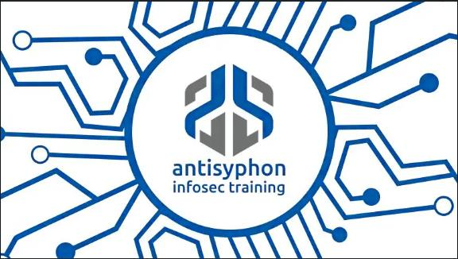

# UBoatRAT - BITS Job Abuse and Behavioral Investigation

**Environment:** Windows 11 VM (isolated workstation) + Ubuntu VM (controlled server)

## Mission briefing

Your SOC isolated a Windows 11 workstation after an unsigned executable, `WinSvcHelper.exe`, was discovered. An analyst ran it once: no window appeared and no visible output was produced. Investigate the suspicious behavior using the Windows workstation and a controlled Ubuntu server.

**Your goal:** identify how the executable stages a misleadingly named file, configures a BITS download and completion callback, retrieves a dead-drop resolver, and sends a fixed XOR-encoded network beacon. Then propose one practical detection.

> [!IMPORTANT]
> **This is not UBoatRAT malware.** `WinSvcHelper.exe` is an educational simulator that we will use to understand how **UBoatRAT** works. It cannot execute remote commands, open a shell, steal credentials, collect or exfiltrate files, upload over HTTP, or receive C2 instructions. It sends one predetermined benign message to the Ubuntu VM.

### Architecture

The **Windows VM** is the isolated workstation under SOC investigation. The **Ubuntu VM** emulates external C2 infrastructure using controlled, harmless services. The diagram below describes the way UBoatRAT would communicate with a C2 server from an infected machine (the Windows VM, in this instance) .


Ubuntu serves only `GET/HEAD /health`, `/c2/trigger.dat`, `/resolver/README.md`, plus a TCP/9001 receiver. No HTTP uploads or command responses are supported.

### Concepts to recognize

| Concept | What to look for |
|---|---|
| **BITS job** | A persistent, service-managed transfer request with a name, URLs, destination, state, and optional notification. |
| **`SetNotifyCmdLine`** | A command configured to run when BITS reports a relevant transfer notification; it is not the download itself. |
| **Masquerading** | `svchost.exe` running from `runtime\`, **not** from a normal Windows system directory. |
| **Dead-drop resolver** | `/resolver/README.md` contains `[Rudeltaktik]<BASE64_VALUE>!`; Base64 decodes to the private Ubuntu address on port `9001`. |
| **XOR beacon** | A fixed message XOR-encoded with `0x88`, sent once over TCP; XOR is encoding, not encryption. |

The job is named `UBoatLab_Persistence`. Its download is inert. In this exercise, the BITS transfer enables the callback; **BITS does not send the beacon**. The callback executable performs the resolver request and beacon connection.

**ATT&CK links:** T1197 (BITS Jobs), T1102.001 (Dead Drop Resolver), T1036 (Masquerading), and an inert download resembling T1105 (Ingress Tool Transfer). This is a behavioral mapping, not a full historical UBoatRAT emulation.


---

# Part I - Investigate the suspicious executable

## Phase 1 - Start the two VMs

### 1.1 Ubuntu: establish the controlled server

In Windows, connect to the Ubuntu VM and identify the IPv4 address : 

```bash
ip -brief -4 address show scope global
```


<br>


**Read the output:** identify the VM's private IPv4 address (for example, an address beginning with `10.`). Do not reuse the IP printed in a screenshot: **your session IP can change**. Refer to it as `<UBUNTU_PRIVATE_IP>` below.

Start the server in the same terminal, replacing the placeholder with your actual IP:

```bash
cd ~/BnB/UBoatRAT
python3 ubuntu_c2_server.py --bind <UBUNTU_PRIVATE_IP> --advertise-ip <UBUNTU_PRIVATE_IP>
```


**Read the output:** check that the HTTP server listens on **8080**, the TCP beacon listener on **9001**, and the resolver decodes to `<UBUNTU_PRIVATE_IP>:9001`. Keep this server terminal open.

Open a second Ubuntu terminal if you want to inspect the listening sockets:


```bash
ss -lntp | grep -E ':(8080|9001)\b'
```


**Read the output:** expect listeners for both ports. When this is confirmed, you can close this terminal. 

### 1.2 Windows: initialize the investigation session

Open the **Administrator Windows PowerShell** shortcut supplied on the desktop. The **classic PowerShell console is supported**; Windows Terminal is not required.


Run these commands **separately**, rather than pasting them as one multiline block:

```powershell
Set-Location "C:\Users\Administrator\Desktop\Labs\UBoatRAT"
```

```powershell
.\lab_start.ps1 -UbuntuIP <UBUNTU_PRIVATE_IP>
```

The setup script maps `uboat-c2.test` to Ubuntu, checks ports and HTTP endpoints, resets only lab-specific runtime/BITS state, prepares BITS Operational and process telemetry, and writes `lab_session.json`. **It does not execute the simulator.** Wait for the success message.


**Read the output:** locate the successful initialization message, the Ubuntu IP, the Wireshark display filter, and the saved Sysmon configuration path. `Failed`/`ERROR` means the session is **not** ready.

Inspect the session metadata:

```powershell
Get-Content .\lab_session.json | ConvertFrom-Json | Format-List
```


**Read the output:** find `UbuntuIP` and `SessionStartUtc`; these identify your server and the start of the event search window. Store them for later commands:

```powershell
$Session = Get-Content .\lab_session.json | ConvertFrom-Json
```

```powershell
$SessionStart = [datetime]$Session.SessionStartUtc
```

```powershell
$UbuntuIP = $Session.UbuntuIP
```


**Read the output:** assignments normally produce **no text**. Verify a variable with `$SessionStart` or `$UbuntuIP` if needed. Keep this PowerShell session open: later commands use these variables.

---

## Phase 2 - Establish the baseline and start captures

### 2.1 Investigate the file **before** execution

Execute each command:

**File metadata**

```powershell
Get-Item .\WinSvcHelper.exe | Format-List Name,Length,CreationTime,LastWriteTime
```


**SHA-256**

```powershell
Get-FileHash .\WinSvcHelper.exe -Algorithm SHA256 | Format-List Algorithm,Hash
```


**Digital signature**

```powershell
Get-AuthenticodeSignature .\WinSvcHelper.exe | Format-List Status,StatusMessage
```


**Version fields**

```powershell
(Get-Item .\WinSvcHelper.exe).VersionInfo | Format-List FileVersion,ProductVersion,CompanyName,FileDescription
```


**Read the output:** `Length` is the file size in bytes; `Hash` is a reproducible identifier, not proof of maliciousness; `Status` reveals whether Windows recognizes a valid signature. An unsigned executable warrants investigation but is not automatically malicious. 

### 2.2 Confirm the clean starting state

```powershell
Test-Path .\runtime
```


**Read the output:** expect `False`.

Check the specific BITS job, without touching unrelated jobs:

```powershell
Get-BitsTransfer -AllUsers | Where-Object DisplayName -EQ "UBoatLab_Persistence" | Format-List *
```


**There should be no output**. That means there are no "UBoatLab_Persistence" BITS jobs currently. 

For an independent queue view:

```powershell
bitsadmin /list /allusers
```


**Read the output:** other legitimate Windows jobs may exist. In this case however, there are none. 

### 2.3 Prepare host and network telemetry

Start **Process Monitor (Procmon)**:

```powershell
.\tools\Procmon\Procmon64.exe
```


**Read the interface:** the events table records operations with timestamp, process name, operation, path, and result. Let Procmon collect briefly, then pause with **Ctrl+E**; resume just before executing the simulator. Leave it open.

Open Wireshark and select the Windows network interface that communicates with Ubuntu:


Start the **capture** using Wireshark's Start control. In the **display filter** bar, enter the actual private Ubuntu IP:

```text
ip.addr == <UBUNTU_PRIVATE_IP> && (tcp.port == 8080 || tcp.port == 9001)
```


**Read the interface:** a display filter narrows visible packets.

---

## Phase 3 - Execute the simulator once

Resume Procmon with **Ctrl+E**. Check that Wireshark is still capturing and Ubuntu's server is running.

```powershell
.\WinSvcHelper.exe
```

No visible program window or console output is expected. Allow the transfer and callback time to execute; then pause Procmon and stop the Wireshark capture. **Leave Ubuntu running** for evidence inspection.


**Read the screenshot:** note the execution may appear uneventful in PowerShell. Lack of console output is not evidence of failure.

Inspect generated files:

```powershell
Get-ChildItem .\runtime -Force | Format-Table Name,Length,LastWriteTime -AutoSize
```


**Read the output:** new files under `runtime` demonstrate staging, but do not alone prove the callback or network activity. Verify those independently in the next phases.

> [!WARNING]
> Do not rerun the simulator merely because output is silent. Inspect `runtime\execution.log`, `runtime\bitsadmin.log`, and `runtime\callback.log` first. Avoid executing `/complete` on `UBoatLab_Persistence`: we want to inspect the job as left by the simulator.

---

## Phase 4 - Reconstruct execution and file staging

### 4.1 Procmon: who launched what?

In Procmon choose **Tools → Process Tree**:


**Read the tree:** look for the initial `WinSvcHelper.exe` launched by `powershell.exe`, followed by `cmd.exe` and the `bitsadmin.exe` invocations. This is the setup chain:

```text
powershell.exe → WinSvcHelper.exe → cmd.exe → bitsadmin.exe
```


The callback is a **separate execution** of `runtime\svchost.exe --bits-callback`, triggered by BITS notifications; it need not be a direct child of the initial simulator process.

### 4.2 Procmon: narrow down events

Press **Ctrl+L** to open the filter dialog. Add **Include** rules for these process names:

```text
WinSvcHelper.exe
cmd.exe
bitsadmin.exe
svchost.exe
```


Also include the lab path (`Path contains \Desktop\Labs\UBoatRAT\`) if needed:


**Read filtered events:** `Process Create`/`Process Start` identify execution; `CreateFile` and write operations identify file access. Multiple Include rules for different fields can broaden the view; verify that the final list still contains the expected processes, rather than assuming all filters apply as a logical AND.

### 4.3 Confirm process creation in Sysmon

Sysmon **Event ID 1** records process creation and command lines. Use a compact query in the **same PowerShell session** as Phase 1:

```powershell
Get-WinEvent -FilterHashtable @{LogName='Microsoft-Windows-Sysmon/Operational'; Id=1; StartTime=$SessionStart} | Where-Object Message -Match 'WinSvcHelper|bitsadmin|\\runtime\\svchost' | Format-List TimeCreated,Id,Message
```

**Read `Message`:** identify `Image`, `CommandLine`, `ParentImage`, and (if present) `ProcessGuid`. Compare these fields to Procmon. A process named `svchost.exe` outside system directories is suspicious because of its **path**, not just its name.

### 4.4 Inspect file artifacts and the generated batch

```powershell
Get-ChildItem .\runtime -Force | Format-Table Name,Length,LastWriteTime -AutoSize
```

Look for `svchost.exe`, `init.bat`, `bitsadmin.log`, `execution.log`, `callback.log`, `resolver_response.txt`, `beacon.sent`, and the lab marker. The trigger download may still be represented by a `BIT*.tmp` file before BITS completion; **do not assume the final trigger filename must already exist**.

```powershell
Get-Content .\runtime\init.bat
```

**Read the batch:** locate `/create /download`, `/addfile`, `/setnotifycmdline`, and `/resume`. Record the job name, transfer URL, local destination, callback executable, and `--bits-callback` argument. `init.bat` is generated as text by the initial simulator and executed through `cmd.exe`.

<!-- SCREENSHOT PLACEHOLDER:
init.bat open in PowerShell or a text editor with the BITS commands visible.
-->

Inspect the command log and both simulator logs independently:

```powershell
Get-Content .\runtime\bitsadmin.log
```

```powershell
Get-Content .\runtime\execution.log
```

```powershell
Get-Content .\runtime\callback.log
```

**Read the logs:** `execution.log` describes initial staging; `bitsadmin.log` records job setup; `callback.log` confirms the later resolver and beacon actions. If a file is missing, use that absence as a troubleshooting signal rather than assuming success.

For file creation, Sysmon **Event ID 11** provides an independent event source:

```powershell
Get-WinEvent -FilterHashtable @{LogName='Microsoft-Windows-Sysmon/Operational'; Id=11; StartTime=$SessionStart} | Format-List TimeCreated,Id,Message
```

**Read `Message`:** identify the process responsible (`Image`) and the file path (`TargetFilename`). Compare the timestamps with `runtime` files.

**Checkpoint:** can you explain why `runtime\svchost.exe` is suspicious and which process created `init.bat`?

---

## Phase 5 - Understand the BITS job and callback

Inspect the live job:

```powershell
Get-BitsTransfer -AllUsers | Where-Object DisplayName -EQ 'UBoatLab_Persistence' | Format-List *
```

```powershell
bitsadmin /getinfo "UBoatLab_Persistence" /verbose
```

**Read the output:** identify the job GUID/name, type (**download**), source and destination, state, owner, and callback command. The important difference is **`TRANSFERRED` versus `/complete`**: a transferred job may still be inspectable; a successfully acknowledged/completed job leaves the active BITS queue. Leaving it uncompleted does **not** guarantee repeated execution or traffic.

Query the BITS Operational log since this session began:

```powershell
Get-WinEvent -FilterHashtable @{LogName='Microsoft-Windows-Bits-Client/Operational'; StartTime=$SessionStart} | Sort-Object TimeCreated | Format-List TimeCreated,Id,Message
```

Then focus on messages mentioning our job:

```powershell
Get-WinEvent -FilterHashtable @{LogName='Microsoft-Windows-Bits-Client/Operational'; StartTime=$SessionStart} | Where-Object Message -Match 'UBoatLab_Persistence' | Format-List TimeCreated,Id,Message
```

**Read the output:** correlate timestamps of job creation, transfer activity, and any notification or retry. Event IDs can vary by OS build: do not assume a specific ID unless your VM actually produces it. BITS does the transfer; **the configured callback executable** performs the resolver GET and beacon.

<!-- SCREENSHOT PLACEHOLDER:
Event Viewer or PowerShell showing the BITS job lifecycle for UBoatLab_Persistence.
-->

**Checkpoint:** which BITS evidence ties a legitimate background-transfer service to execution of the suspicious `runtime\svchost.exe`?

---

## Phase 6 - Network evidence: BITS, resolver, and XOR beacon

The expected order is (1) BITS trigger download over TCP/8080, (2) callback HTTP GET for the resolver on TCP/8080, and (3) one fixed TCP/9001 beacon. Setup health checks may have produced earlier HTTP requests-filter and correlate with execution time.

### 6.1 Find the BITS HTTP download

In Wireshark use this **display filter**:

```text
http.request.uri == "/c2/trigger.dat"
```

Inspect source/destination IPs and ports, HTTP method and status, `User-Agent`, and any `Range` header. BITS may use range requests; this server supports them.

<!-- SCREENSHOT PLACEHOLDER:
Wireshark packet details for GET /c2/trigger.dat,
including User-Agent and any Range header.
-->

**Read the packet:** look for the requested URI and the HTTP response. A successful download shows file transfer, **not** arbitrary data exfiltration.

### 6.2 Find the dead-drop resolver

```text
http.request.uri == "/resolver/README.md"
```

Follow the HTTP stream. Look for `[Rudeltaktik]` followed by Base64. The callback uses `User-Agent: UBoatRAT-Lab-Simulator/1.0`, unlike the BITS transfer.

<!-- SCREENSHOT PLACEHOLDER:
Follow HTTP Stream output for /resolver/README.md.
-->

**Read the HTTP response:** the encoded text identifies the endpoint; the README does **not** carry commands. This request is generated by the callback, not by BITS. A PCAP alone might not prove process identity; corroborate with Sysmon.

### 6.3 Inspect the beacon

```text
tcp.port == 9001
```

Follow the TCP stream or export the client payload as **raw bytes**. The server receives a fixed, one-way XOR-encoded message and sends no application-level response.

Correlate network connections with **Sysmon Event ID 3**:

```powershell
Get-WinEvent -FilterHashtable @{LogName='Microsoft-Windows-Sysmon/Operational'; Id=3; StartTime=$SessionStart} | Format-List TimeCreated,Id,Message
```

**Read `Message`:** compare `Image`, `DestinationIp`, and `DestinationPort`. The callback copy of `svchost.exe` should be associated with resolver/beacon activity. The BITS download may be attributed to Windows service infrastructure rather than the original executable.

### 6.4 Decode the resolver

Inspect the saved response:

```powershell
Get-Content .\runtime\resolver_response.txt
```

Decode the Base64 marker with these short, sequential commands:

```powershell
$Resolver = Get-Content .\runtime\resolver_response.txt -Raw
```

```powershell
$Encoded = [regex]::Match($Resolver,'\[Rudeltaktik\]([A-Za-z0-9+/=]+)!').Groups[1].Value
```

```powershell
[Text.Encoding]::ASCII.GetString([Convert]::FromBase64String($Encoded))
```

**Read the output:** the decoded value must match the private Ubuntu address and port `9001` (for example `10.x.x.x:9001`). This is **encoding**, not encryption.

### 6.5 Verify and explain the beacon

The simulator's fixed plaintext is:

```text
488|UBOATRAT_LAB|BENIGN_BEACON|NO_COMMAND_CHANNEL
```

Each byte is XORed with `0x88`. For example, ASCII `4` is `0x34`, so `0x34 XOR 0x88 = 0xBC`. The leading plaintext `488` becomes encoded bytes `BC B0 B0`. To decode bytes exported from Wireshark, XOR them again with `0x88`.

Check the Ubuntu evidence:

```bash
cat ~/BnB/UBoatRAT/logs/beacon.log
```

```bash
cat ~/BnB/UBoatRAT/logs/server.log
```

<!-- SCREENSHOT PLACEHOLDER:
Ubuntu beacon.log showing the validated fixed beacon.
-->

**Read the server output:** look for the valid fixed beacon, its source IP, the decoded message, and confirmation that no command was returned. If the log has only health checks, the callback/beacon was not confirmed.

**Checkpoint:** which traffic belongs to BITS, which to the callback, and what evidence proves there was no interactive C2 channel?

---

# Part II - Short detection challenge

You have already collected the relevant evidence. **Do not execute the simulator again** or rebuild a second BITS job. Reuse your captures, BITS Operational log, and Sysmon events.

## Phase 7 - Turn observations into a detection

A useful hunt starts with **Sysmon ID 1** (process creation) and **BITS Operational** events. Look for `bitsadmin.exe /setnotifycmdline`, a callback that runs `svchost.exe` from outside `C:\Windows\`, and subsequent network connections to unusual endpoints. Sysmon ID 3 captures network connections, ID 11 captures file creation, and Security 4688 can corroborate process creation. Sysmon ID 22 (DNS) is **optional**: a hosts-file lookup may not generate a DNS event.

Query matching process events again if necessary:

```powershell
Get-WinEvent -FilterHashtable @{LogName='Microsoft-Windows-Sysmon/Operational'; Id=1; StartTime=$SessionStart} | Where-Object Message -Match 'setnotifycmdline|\\runtime\\svchost' | Format-List TimeCreated,Message
```

### Sigma: BITS callback registration

This single experimental rule is the required detection deliverable. It targets process creation events where `bitsadmin.exe` registers a notification command:

```yaml
title: BITSAdmin Registers a Completion Command
id: 9cf728d7-1a40-4b8e-a731-d32b67f1c126
status: experimental
description: Detects bitsadmin.exe registering a BITS notification command.
references:
  - https://attack.mitre.org/techniques/T1197/
author: UBoatRAT Behavior Lab
date: 2026-07-21
tags:
  - attack.persistence
  - attack.t1197
logsource:
  product: windows
  category: process_creation
detection:
  selection:
    Image|endswith: '\bitsadmin.exe'
    CommandLine|contains: '/setnotifycmdline'
  condition: selection
fields:
  - Image
  - CommandLine
  - ParentImage
  - User
falsepositives:
  - Legitimate administrative BITS callback workflows
level: high
```

**Read the rule:** `logsource` tells you which telemetry it expects; `selection` matches executable path and command line; `condition` activates the selection. **Discuss false positives:** legitimate deployment tooling can use BITS notifications. The combination of callback registration, a misleading `svchost.exe` path, and unusual outbound traffic is stronger than any one signal.

> **Investigator question:** Which two additional events would you correlate with the Sigma match to increase confidence? Explain the reason for each.

---

# Part III - Findings and cleanup

## Phase 8 - Produce a short investigation report

Fill in this table from **observed evidence**, not from the diagram alone:

| Finding | Evidence to cite |
|---|---|
| Initial executable and signature | File metadata / Authenticode |
| Process chain | Procmon tree or Sysmon ID 1 |
| Staged executable and batch | `runtime\svchost.exe`, `init.bat` and Sysmon ID 11 |
| BITS job / callback | `bitsadmin /getinfo`, BITS Operational |
| Download URL / destination | BITS job configuration + HTTP capture |
| Resolver / decoded endpoint | HTTP response + Base64 decoding |
| Beacon / XOR key | TCP/9001 payload + Ubuntu logs |
| Evidence of remote commands or exfiltration | State what you **did not** observe |

**Conclusion to reach from evidence:** the simulator creates a BITS download job, configures a notification that launches a misleadingly named runtime copy, resolves a controlled private endpoint and sends a single benign XOR beacon. It does **not** implement actual RAT capabilities.

### End the session safely

Stop the Ubuntu server with **Ctrl+C** and close the lab session. The platform restores **both** disposable VMs to their prepared snapshots. Do not delete arbitrary BITS jobs or turn off system-wide security protections. Snapshot restoration is the authoritative cleanup method for participants.

The original combined-timeline screenshot placeholder is also retained here, but rebuilding the 64-line timeline is **not** required:

<!-- SCREENSHOT PLACEHOLDER:
Combined timeline output showing the full ordered chain.
-->

The two former manual-reproduction screenshot placeholders are preserved below for the author, but are **not** steps students need to perform:

<!-- SCREENSHOT PLACEHOLDER:
bitsadmin output showing the manual download job, URL, local path, and final state.
-->

<!-- SCREENSHOT PLACEHOLDER:
manual_callback.log and relevant process/event evidence showing cmd.exe launched by the BITS workflow.
-->

---

# Finished?

[Back to Card's Main Page](../Backround_Intelligent_Transfer_Service_As_Exfil.md)
