# FALCO


## Overview

Falco is a cloud native runtime security tool for Linux operating systems. It is designed to detect and alert on abnormal behavior and potential security threats in real-time.

At its core, Falco is a kernel monitoring and detection agent that observes events, such as syscalls, based on custom rules.

Falco can be run in terminal and in the web browser so you can see the output more clearly.

## Testing Falco in the Terminal

Before setting the falco in the web browser let's see if it's even working in normal terminal. 

In first terminal open falco:

```bash
sudo falco
```

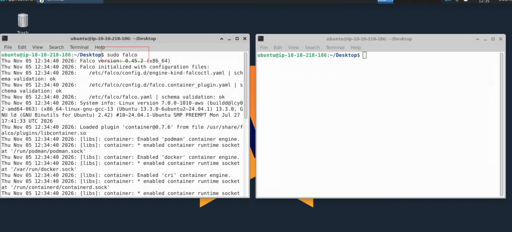

Now Falco is ready to detect any suspicious activity. Let's see if he can see an attempt in reading password's hashes stored in `/etc/shadow`.

>[!NOTE]
> cat is a common command to read files in Linux-based systems
> The password hashes of the local user are stored in the /etc/shadow file. Only privileged people should have access to it.

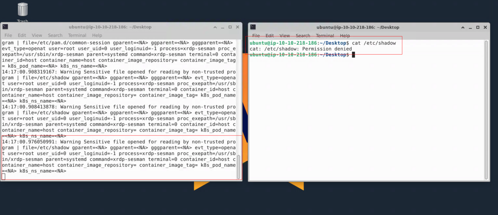

As you can see it detected the suspicious activity. Falco gave us a lot of important data that could be later used in post-activity analysis. File that was meant to be opened, name of the host, ID of the host, etc.

Let's now hook up falco to the web browser so we can gather clear output.

On the left terminal use `CTRL + C` to stop falco from running.

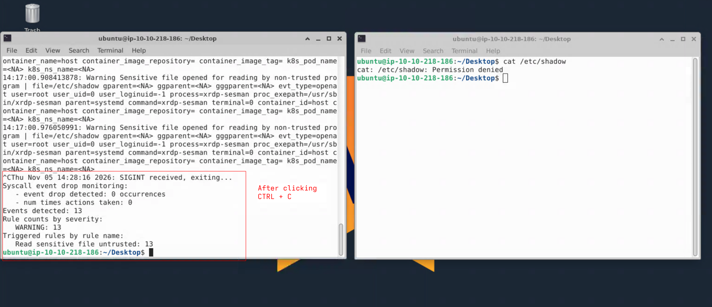

## Setting Up the Web Dashboard

### Installing Docker

First we need to install the docker so our web server can run in the background.

```bash
sudo apt-get update
sudo apt-get install -y docker.io curl gnupg
sudo systemctl enable --now docker
```

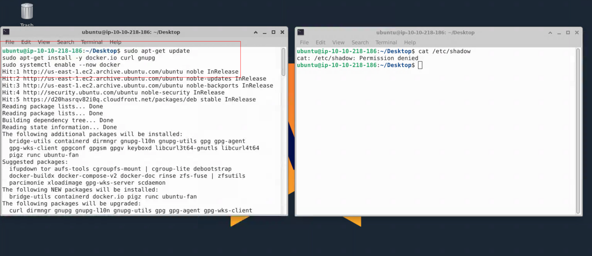

>[!NOTE]
> You can clear terminal with `clear` command so you have clear 'workstation'. Try this out in your own linux terminal!

### Adding the Falco Repository

Now add the falco repository.

```bash
curl -fsSL https://falco.org/repo/falcosecurity-packages.asc | \
  sudo gpg --dearmor --yes -o /usr/share/keyrings/falco-archive-keyring.gpg

echo "deb [signed-by=/usr/share/keyrings/falco-archive-keyring.gpg] https://download.falco.org/packages/deb stable main" | \
  sudo tee /etc/apt/sources.list.d/falcosecurity.list

sudo apt-get update
```

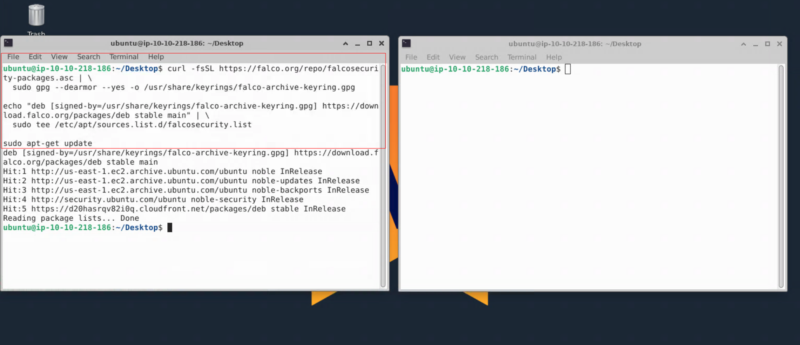

### Running the Falco Service

Next move is to make our dashboard runs in the background

```bash
sudo FALCO_FRONTEND=noninteractive FALCO_DRIVER_CHOICE=modern_ebpf apt-get install -y falco
sudo systemctl enable --now falco-modern-bpf.service
```


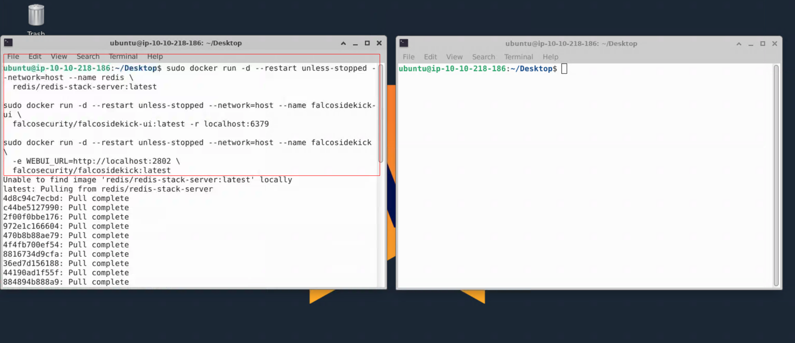

We can verify if it works with `ps` command. 

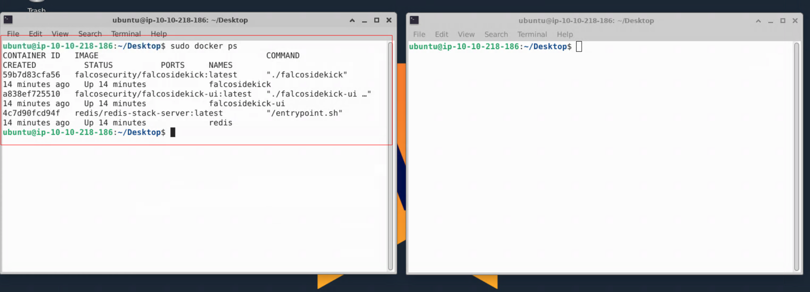

### Connecting Falco to the Dashboard

Now we need to connect the website to our falco so the website will see alerts. 

``` bash
sudo mkdir -p /etc/falco/config.d
sudo tee /etc/falco/config.d/sidekick.yaml > /dev/null <<'EOF'
json_output: true
json_include_output_property: true
http_output:
  enabled: true
  url: http://localhost:2801/
EOF

sudo systemctl restart falco-modern-bpf.service
```
>[!NOTE]
> To write multiple lines of text into a file directly from the terminal, you can use the "EOF method"
> Everything between `<< 'EOF'` and the closing `EOF` is written to the file exactly as typed.
> It looks like this

```bash
cat (or tee) > [some file] << 'EOF'
[Some text]
EOF
```


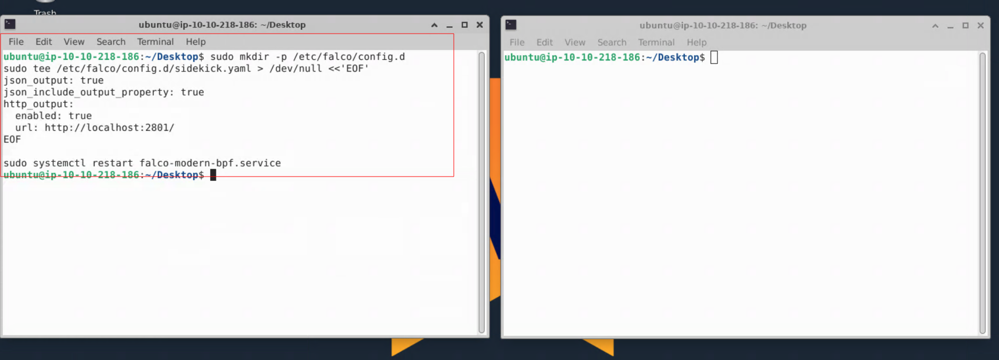

### Opening the Dashboard

Finally we can see if our falco website is seeable.

Go to http://localhost:2802 in your browser and log in with admin / admin. This is address and credentials we provided in the command to get access to our falco website.

```bash
http://localhost:2802
```
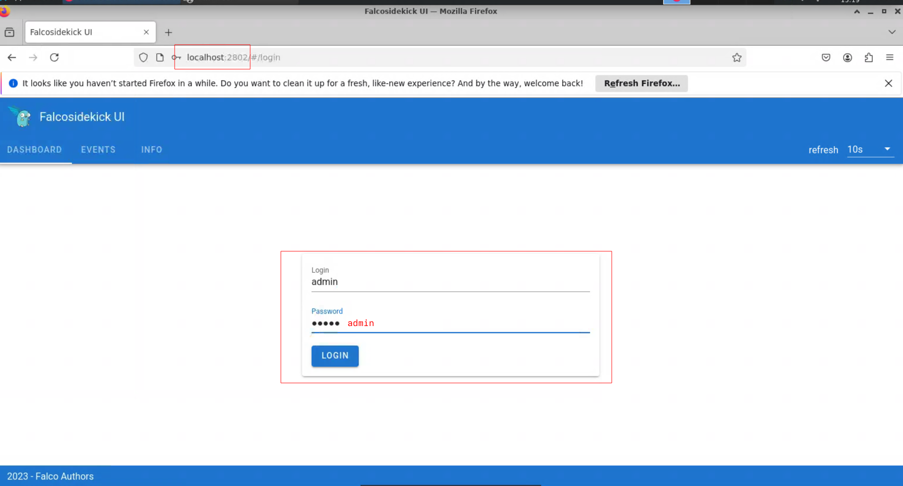

Our website is working! Huge success. Now we can detect anomalies and have a clear output in our browser. Let's see what we can see after logging in.

## Exploring Falco Alerts

Right now the `DASHBOARD` and `EVENTS` tabs are both empty. 

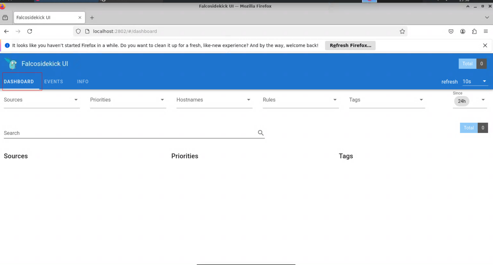
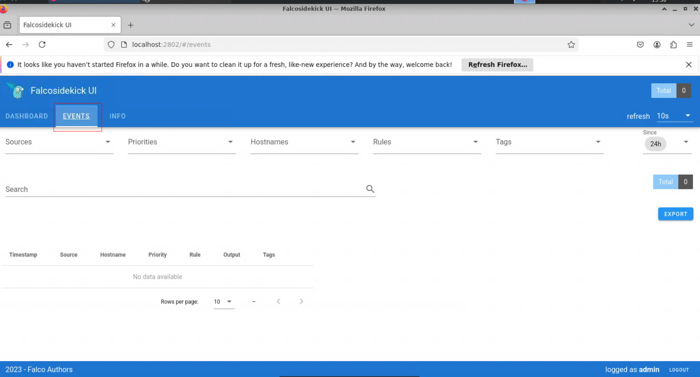

Let's fill them up with some malicious events!

### Alert Priorities

Here are the available event priorities that can be categorized by falco:

- EMERGENCY
- ALERT
- CRITICAL
- ERROR
- WARNING
- NOTICE
- INFORMATIONAL
- DEBUG

We will see how Falco shows us events that are categorized by WARNING, INFORMATIONAL, and CRITICAL levels.

### Warning: Reading `/etc/shadow`

We are going to use the same command as before. Use the command on the second terminal we have opened.

``` bash
cat /etc/shadow
```
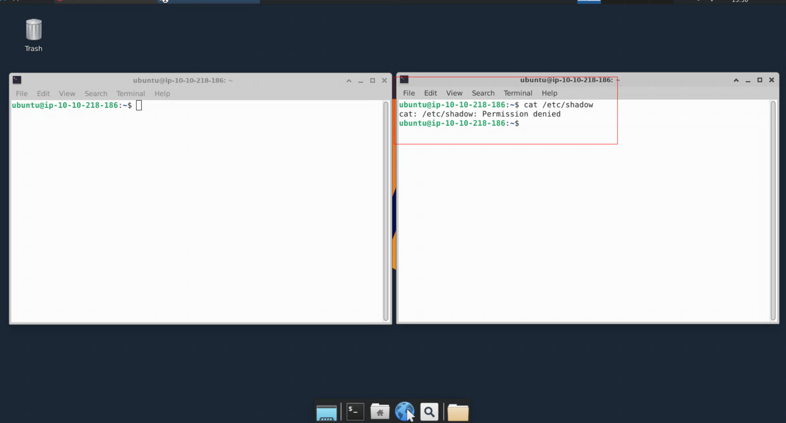

After a couple of seconds we can see the alert in the dashboard and the event tab.

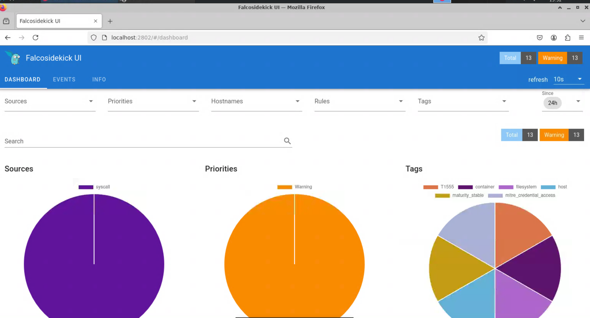
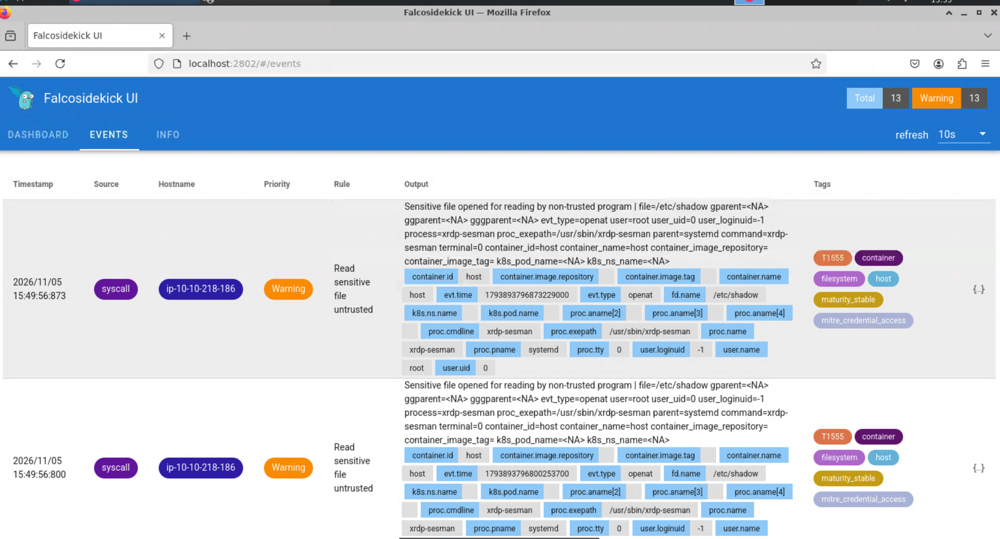


The dashboard contains less information than the event tab. However, its charts provide clearer insight into the logs. The event tab is more informative.

You can choose which tag of alert you want to highlight. 

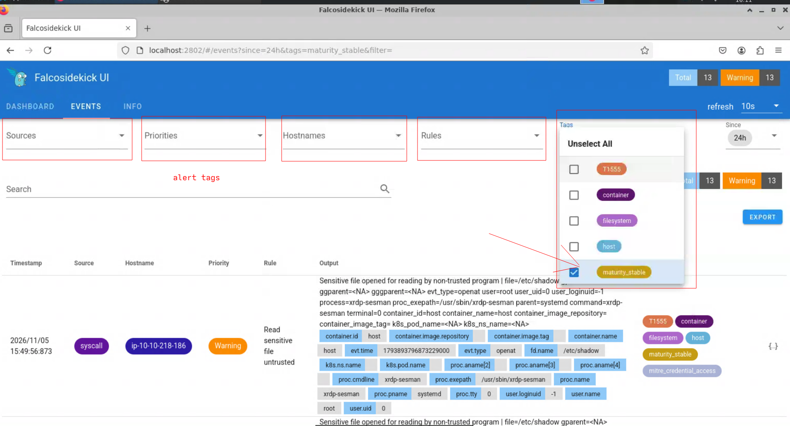

Let's break down one of the alerts.

Timestamp (when it happened) - 2026/11/05 15:49:56:873

Source (where Falco got the event data from) - syscall 

Hostname (the place where it happened) - ip-10-10-218-186

Priority - Warning

Rule (the rule that this event matched) - Read sensitive file untrusted

Message (short description of what happened) - Sensitive file opened for reading by non-trusted program

evt.type (which system call was made) - openat (opening a file)

evt.time (exact time of the event, in nanoseconds) - 1793893796873229000

fd.name (the file that was accessed) - /etc/shadow (the file holding password hashes)

proc.name (name of the program that did it) - xrdp-sesman

proc.exepath (where that program is stored on disk) - /usr/sbin/xrdp-sesman

proc.cmdline (the full command that was run) - xrdp-sesman

proc.pname (the parent program that started it) - systemd

proc.aname[2] (grandparent program) - empty

proc.aname[3] (great-grandparent program) - empty

proc.aname[4] (great-great-grandparent program) - empty

proc.tty (terminal the program was run from, 0 = none) - 0 (not typed by a person in a terminal)

user.name (which user ran the program) - root

user.uid (that user's ID number, 0 = root) - 0

user.loginuid (ID of the user who originally logged in, -1 = nobody) - -1 

container.id (ID of the container where it happened) - host 

container.name (name of that container) - host

container.image.repository (image the container was built from) - empty 

container.image.tag (version of that image) - empty 

maturity_stable (well-tested rule, loaded by default)

host / container (the rule watches both the host and containers)

filesystem (the rule is about file access)

mitre_credential_access (MITRE ATT&CK goal: stealing credentials)

T1555 (MITRE ATT&CK technique ID: Credentials from Password Stores)

>[!NOTE]
> Syscalls are the only way for a program in user space to ask the Linux kernel to do something such as reading, opening the file and etc.

Let's see a different kind of alert.

### Informational: Running a Docker Container

```bash
sudo docker run -d --name victim nginx
sudo docker exec -it victim bash
```
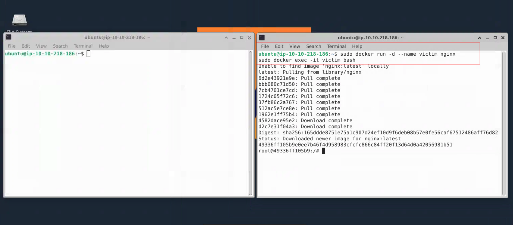
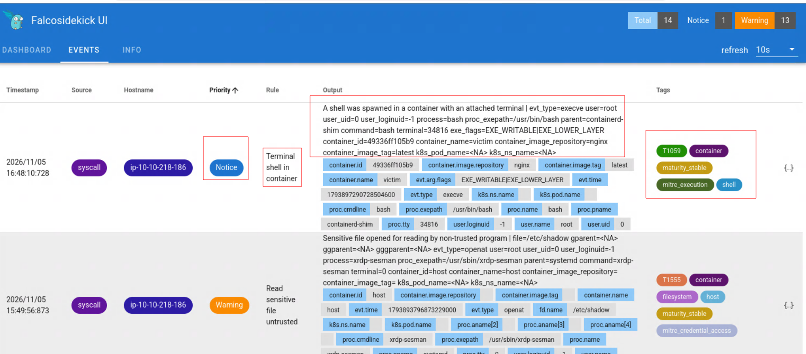

Now we can see a different kind of alert than the previous one. The first difference is that this alert is informational rather than a warning. It informs us that a terminal shell was spawned inside the container ("victim" in our case). There is also a lot of useful information.

Message - A shell was spawned in a container with an attached terminal

proc.name (name of the program that was started) - bash

container.name  - victim

container.image.repository (image the container was built from) - nginx

### Critical: Fileless Execution

In order to see how Falco reacts to dangerous situations, we are going to try `fileless execution with memfd_create`. The idea behind this technique is that we are going to use the binary that lives only in RAM (a volatile memory) and use it to get some output (in our case it would be printing a message). The executed binary is never written to disk.

```bash
cat > memfd_test.py << 'EOF'
import os

# Create an anonymous in-memory file (flags=0, no MFD_CLOEXEC)
fd = os.memfd_create("falco-test", 0)

# Copy a harmless binary into it
with open("/bin/echo", "rb") as src, open(f"/proc/self/fd/{fd}", "wb") as dst:
    dst.write(src.read())

# Execute it from memory
os.execv(f"/proc/self/fd/{fd}", ["falco-test", "hello from memfd"])
EOF
```

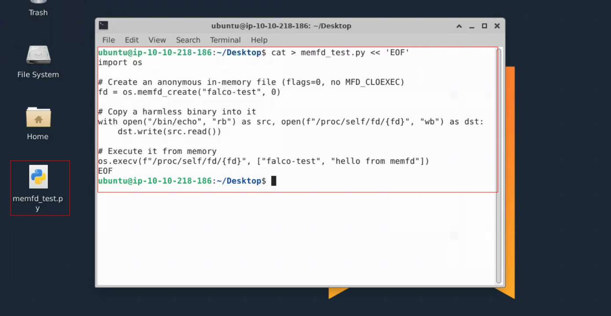

This way we created the Python script that's going to run a binary without ever saving it to a disk. Now the only thing we need to do is to run the script.

```bash
python3 ./memfd_test.py 
```
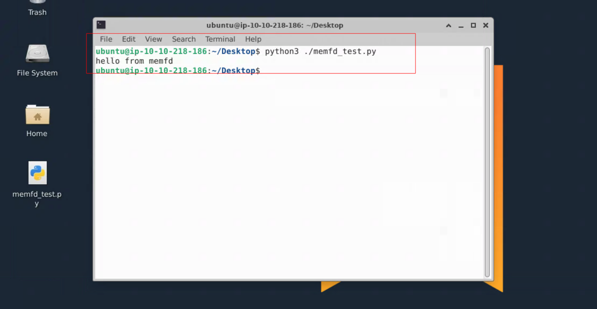
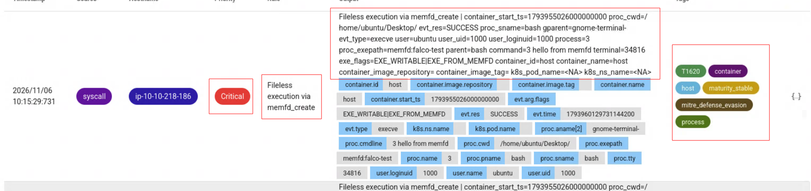

Falco successfully managed to gather the data about the critical event that occurred.

## Creating Custom Falco Rules

Falco not only has a variety of already-made rules but also lets us create our own. For example, let's say I want the `CRITICAL` event-priority alert every time somebody opens the file called `milkshake`.

### Creating a Test File

First, let's create a file.

``` bash
touch milkshake 
cat > milkshake << 'EOF' 
Add some cookies
EOF
```

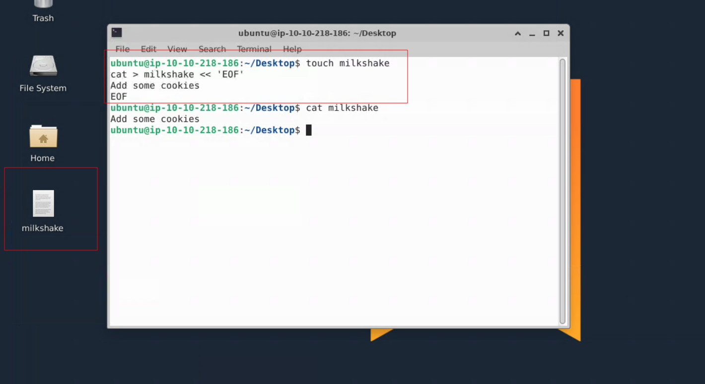

Great. Now that our file is created, let's create a custom rule that will let Falco watch if the file is opened.

### Adding the Custom Rule

``` bash
sudo tee -a /etc/falco/falco_rules.local.yaml > /dev/null << 'EOF'
- rule: Milkshake File Opened on Desktop
  desc: Detects any process opening the file "milkshake" located on a user's Desktop
  condition: >
    evt.type in (open, openat, openat2)
    and fd.typechar = 'f'
    and (fd.name glob "/home/*/Desktop/milkshake" or fd.name = "/root/Desktop/milkshake")
  output: >
    Milkshake file opened on Desktop
    (user=%user.name process=%proc.name command=%proc.cmdline file=%fd.name
    container_id=%container.id)
  priority: CRITICAL
  tags: [filesystem, custom, milkshake]
EOF
```

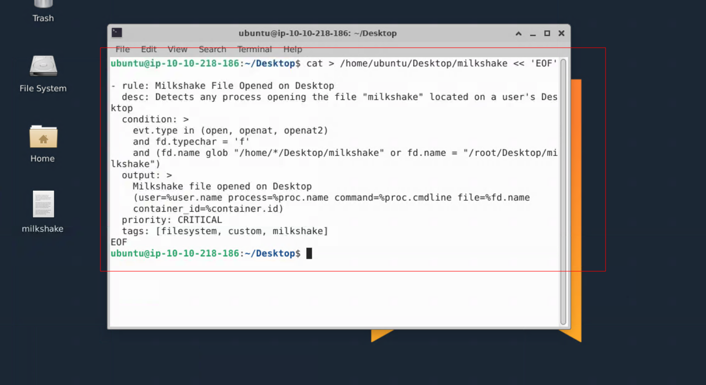

### Verifying the Custom Rule

Verify if it works by checking the files with custom rules.

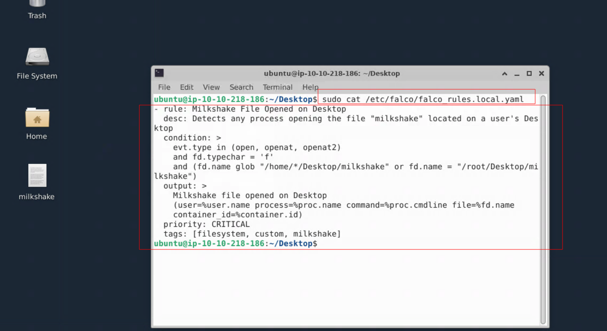

Amazing. Our custom rule is in proper place. Open the file by reading it to see if the rule is working.

```bash 
cat milkshake
```

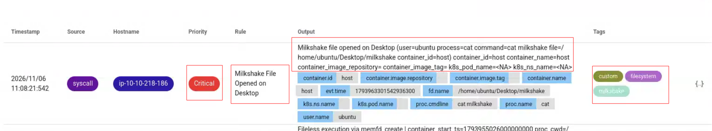

Our custom rule worked! We can see that the file description points at opening `milkshake` file and the priority is `CRITICAL` just as we wanted.
