# FireProx

# Ubuntu VM

## Lab Goal

The goal of this lab is to become familiar with **FireProx** and use it to create and manage HTTP proxies through **AWS API Gateway**. You will compare direct and proxied requests, observe source-IP rotation, and examine how HTTP methods, URL paths, query parameters, request bodies, and headers are forwarded to a target service.

## In this lab you will

- Configure AWS credentials for FireProx.
- Create and list FireProx proxies.
- Compare your original public IP with the IP addresses observed through a proxy.
- Forward URL paths and query parameters.
- Send GET, POST, PUT, and DELETE requests.
- Inspect forwarded request bodies and HTTP headers.
- Create a proxy in another AWS region.
- Delete the proxies and AWS IAM resources created during the lab.

## What is FireProx

**FireProx** is an open-source tool that manages AWS API Gateway pass-through proxies. It creates an API Gateway URL that forwards requests to a configured target and returns the target's responses.

When you send requests through that URL, the connection to the target originates from AWS infrastructure. The outgoing IP address can change between requests.

FireProx configures the AWS resources, while **API Gateway** handles the forwarded traffic.

## Additional FireProx Capabilities

FireProx also supports the following capabilities:

- **Docker execution:** run the tool inside a container.
- **AWS profiles:** load credentials from a named AWS profile using `--profile_name`.
- **Temporary credentials:** authenticate with an access key, secret key, and session token; FireProx also provides a `--session_token` argument.

## Creating AWS Account

Before proceeding, make sure you have an AWS account.

Follow the instructions [here](/Decks/CORE_v3.1/IC/labs/AWS_Account_Setup.md).

Also, proceed to the next section before starting the Ubuntu VM to save credits.

## Configuring AWS IAM for FireProx

After logging in to your AWS account, navigate to the services and, from there open the **IAM (Identity and Access Management)** dashboard.

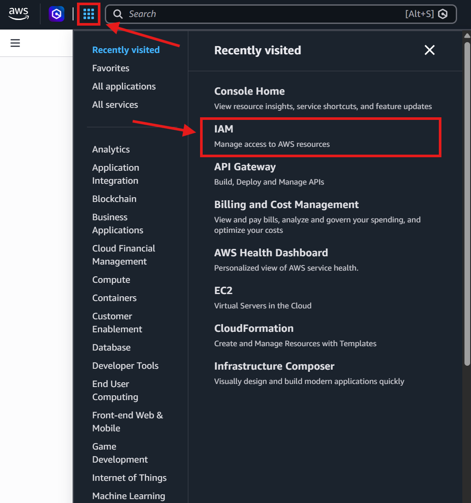

From the IAM dashboard, select **IAM user groups** and then **Create Group**.

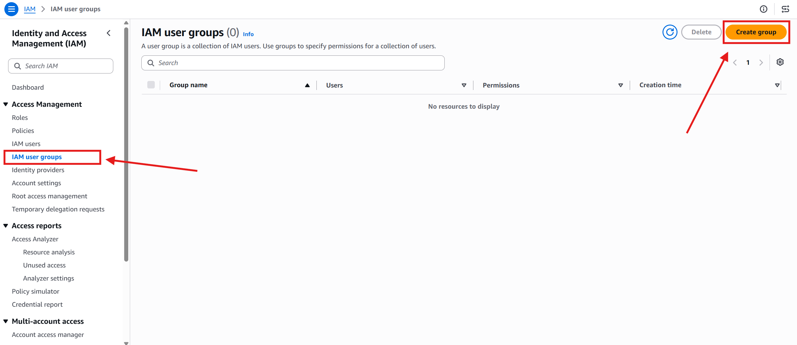

Give the group the name `FireProx-Lab`, then scroll down to the permissions policies, search for and select the **AmazonAPIGatewayAdministrator** policy. Click **Create user group** to create the group.

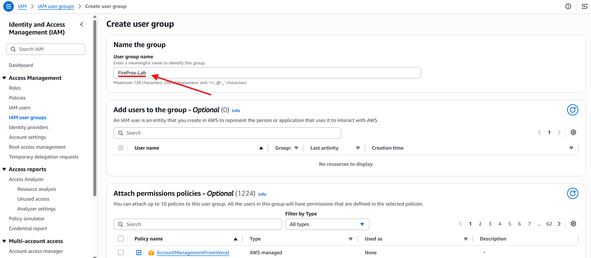

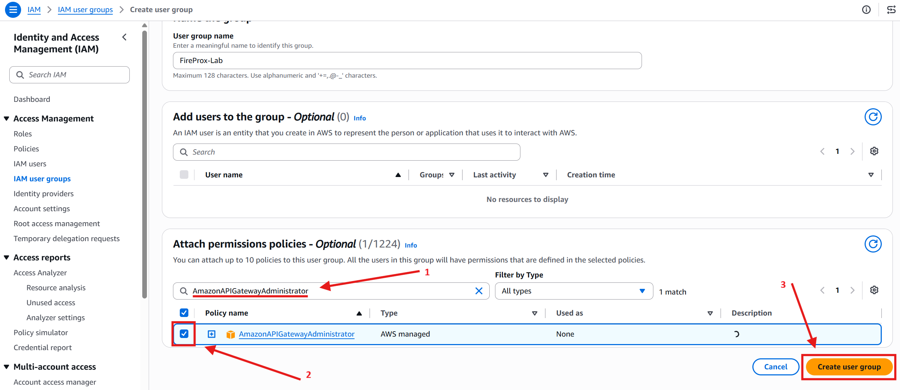

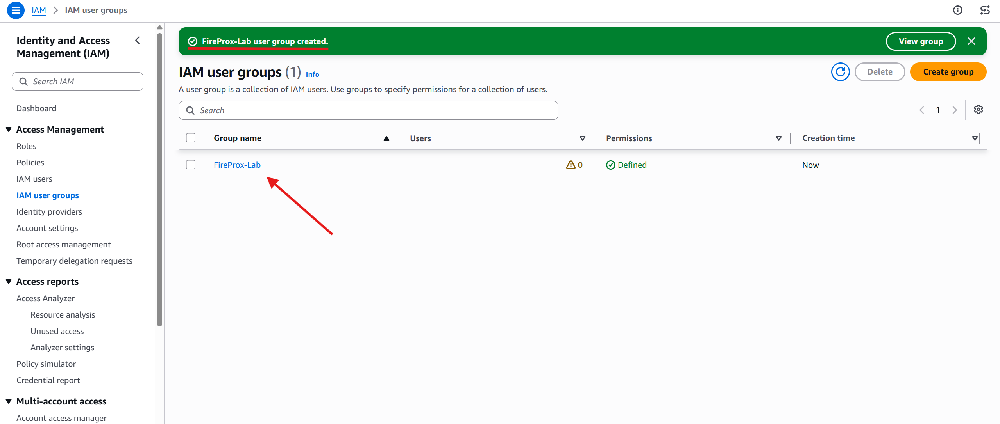

After that, select **IAM users** and then **Create user**.

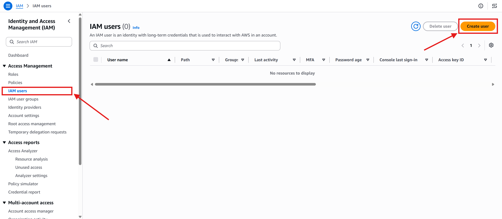

In the **Specify user details** step, give the name `FireProx-LabUser`, and press **Next**. For **Set permissions**, choose **Add user to group** and assign the user to the group you created previously (`FireProx-Lab`). Then review the username and group before clicking **Create user**.

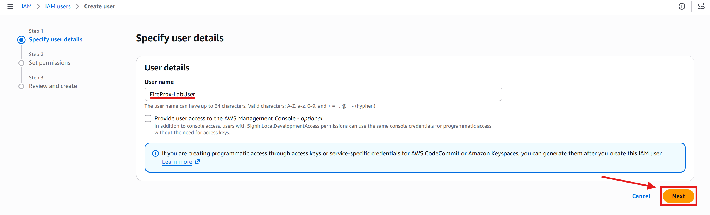

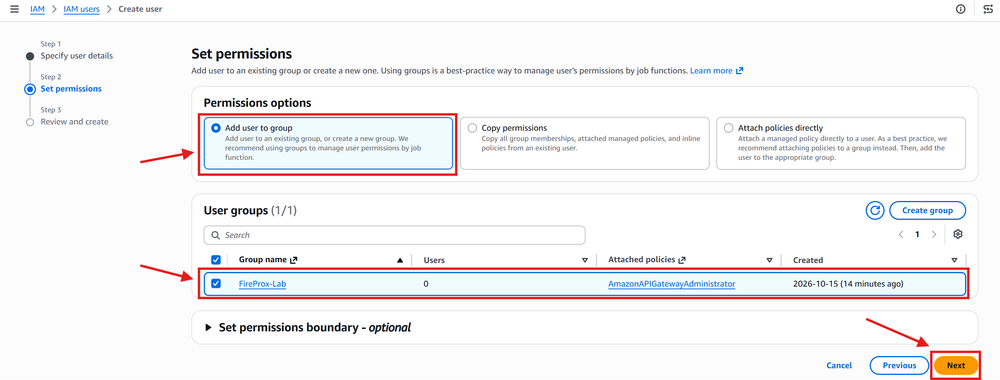

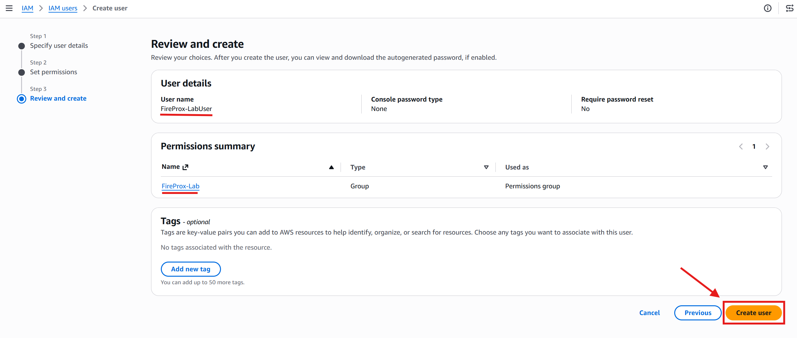

After creating the user, select it to generate the access keys. Then in the **Summary** section, press **Create access key**.

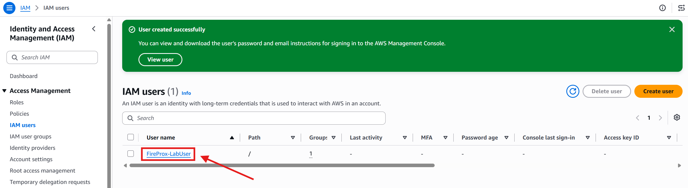

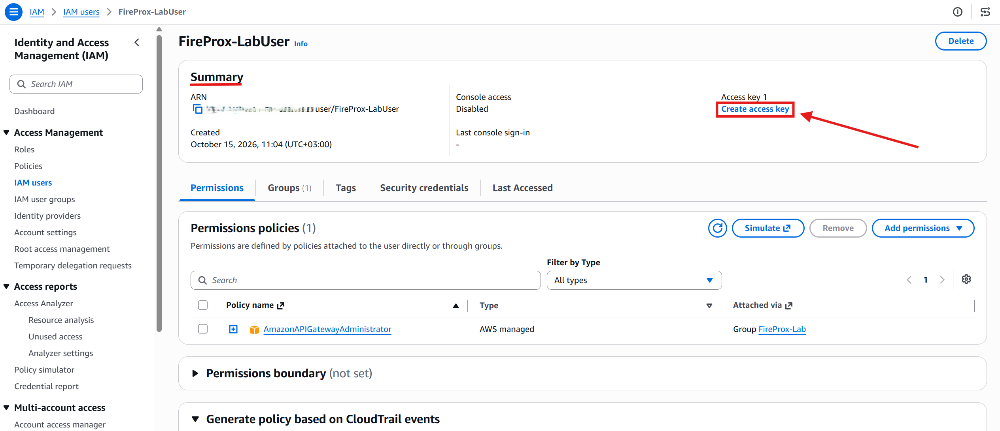

In the **Access key best practices & alternatives** step, select **Command Line Interface (CLI)** and check the confirmation box. Then press **Next**.

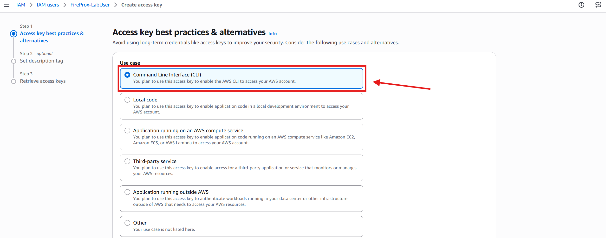

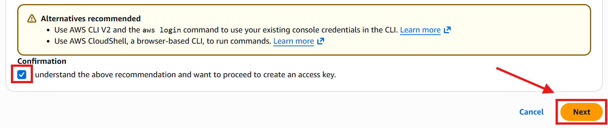

Set the following description to `FireProx-TestingLab` and press **Create access key**.

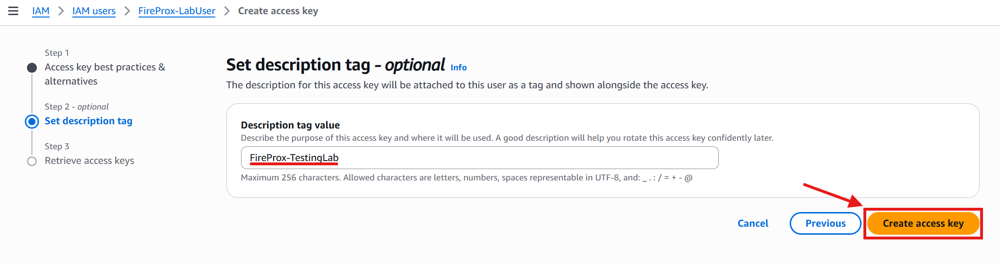

In step 3, **Retrieve access keys** save the **Access key** and **Secret access key** to a file or download the CSV file.

**You won't be able to retrieve them after this step!**

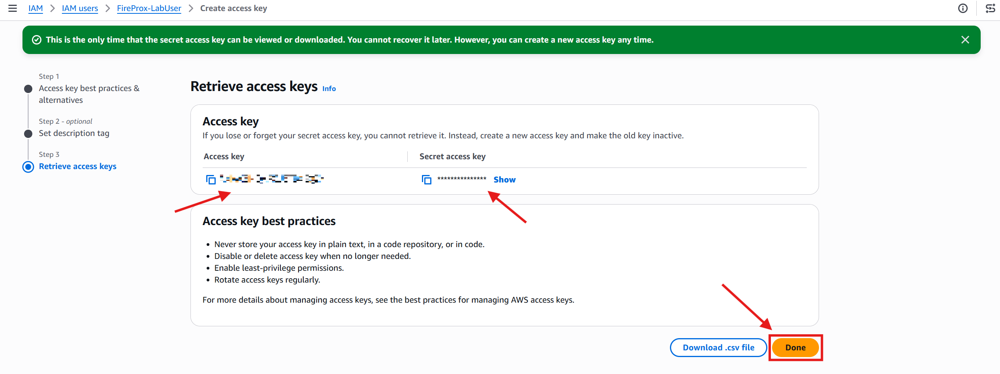

We are now ready to continue the lab on the Ubuntu VM.

## Configure AWS Credentials

As mentioned before, FireProx manages AWS API Gateway pass-through proxies. To achieve this, we have to set the generated keys as environment variables.

Open a terminal in the Ubuntu VM and navigate to the labs directory:

```bash
cd ~/BnB/FireProx/fireprox
source venv/bin/activate
```

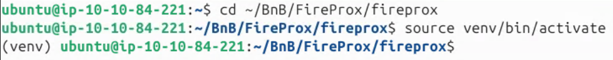

Replace the placeholders below with the lab access key and secret key you created previously:

```bash
export AWS_ACCESS_KEY_ID="<ACCESS_KEY>"
export AWS_SECRET_ACCESS_KEY="<SECRET_KEY>"
```


FireProx also supports temporary credentials, which require an `AWS_SESSION_TOKEN` in addition to the access key and secret key. You can use this token as follows:

```bash
export AWS_SESSION_TOKEN="<SESSION_TOKEN>"
```

Temporary credential generation is outside the practical scope of this lab.

## Using FireProx

In the same terminal execute the following command to view the available arguments:

```bash
python3 fire.py -h
```

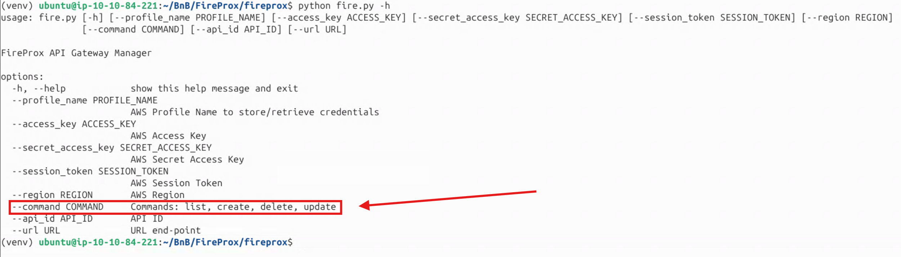

The main operations are:

| Command | Purpose |
| --- | --- |
| `create` | Create a proxy for a target URL. |
| `list` | List proxies in the selected region. |
| `update` | Change an existing proxy's integration destination. |
| `delete` | Delete a proxy using its API ID. |

In this lab, you will use **create**, **list**, and **delete**.

## Check Your Original Public IP

Before creating an IP rotation proxy for the target URL, we will first check our original public IP.

Send a request directly to **icanhazip**. Execute the following command twice and compare the returned IP addresses.

```bash
curl https://icanhazip.com
```

The response contains your public IP address.

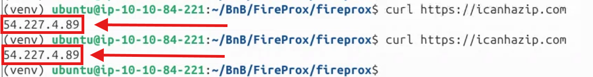

Observe that the returned IPs are the same.

## Create the IP-Rotation Proxy

Create a proxy targeting **icanhazip** in **eu-west-1**:

```bash
python3 fire.py --command create --region eu-west-1 --url https://icanhazip.com
```

Command arguments:
- `--command`: Instructs FireProx to create a new AWS API Gateway proxy. Other supported commands are `list`, `update`, and `delete`.
- `--region`: Specifies the AWS region where the API Gateway will be created.
- `--url`: Specifies the destination website to which the proxy will forward incoming requests.

FireProx returns the API ID and a proxy URL related to the target website:

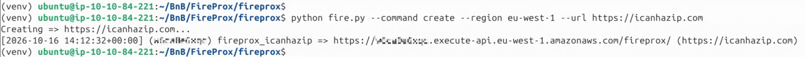

Save the **actual URL and API ID from your output**:

```bash
export FIREPROX_IP_URL="https://<IP_API_ID>.execute-api.eu-west-1.amazonaws.com/fireprox/"
export FIREPROX_IP_API_ID="<IP_API_ID>"
```

The API ID is the identifier before `.execute-api` in the URL. You will need it during cleanup.

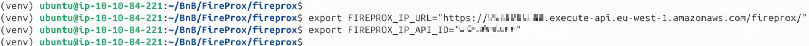

After creating the API, return to the AWS **API Gateway** panel.

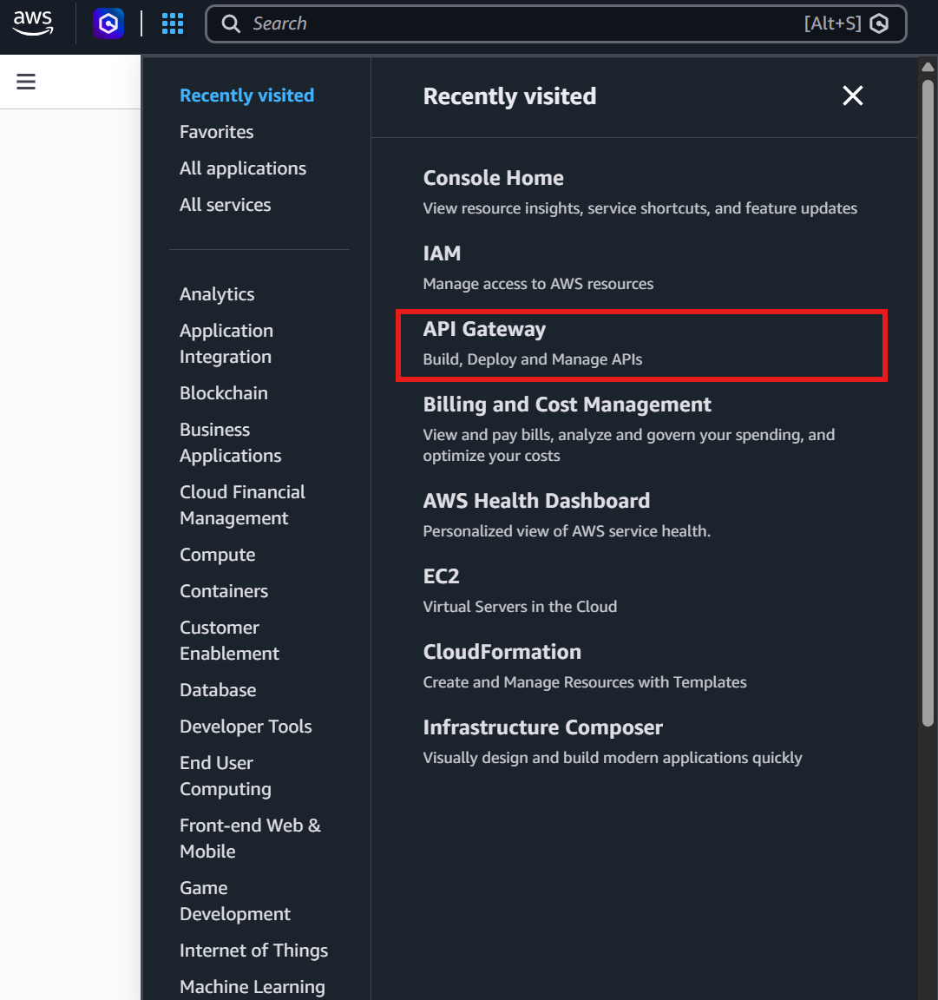

At the top right of your screen, next to your profile name, select the region where you created the API. In our case, `eu-west-1`.

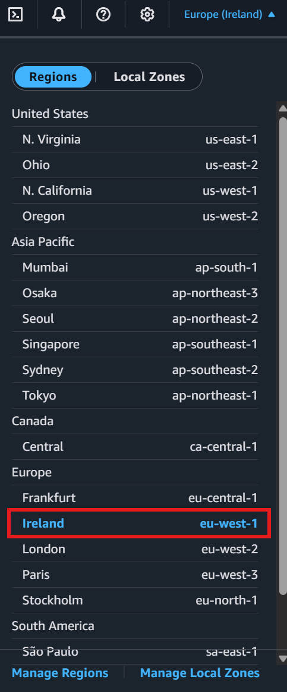

Over there, all the APIs created for this region will appear.

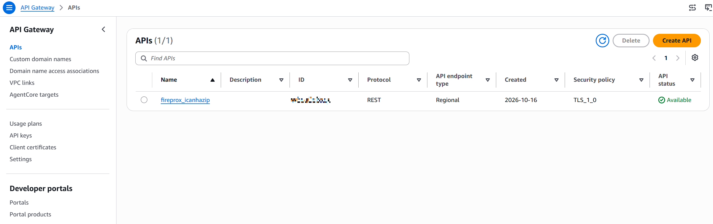

## List Existing Proxies

List the proxies in **eu-west-1**:

```bash
python3 fire.py --command list --region eu-west-1
```

Identify the API you just created. Its output should include its **API ID**, **name**, **FireProx URL**, and **target URL**.

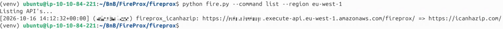

At this stage, you have created one proxy targeting `https://icanhazip.com`.

## Demonstrate Source-IP Rotation

Compare a direct request with a request through your FireProx URL:

```bash
curl "$FIREPROX_IP_URL"
```

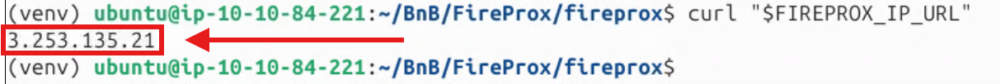

The proxied response shows an AWS outgoing IP address rather than your original public IP.

Send ten requests through the same proxy URL. Use the `ip_rotation.sh` script in the parent directory.

```bash
cd ~/BnB/FireProx
./ip_rotation.sh
```

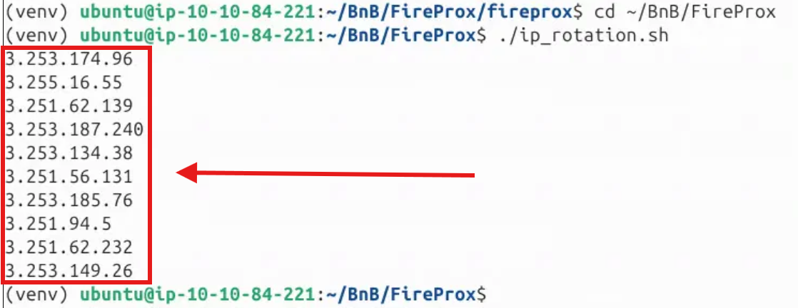

Observe that every request returns a different source IP address.

## Create the HTTP Testing Proxy

Create a separate proxy for **httpbin**, also in **eu-west-1**:

```bash
cd fireprox/
python3 fire.py --command create --region eu-west-1 --url https://httpbin.org
```

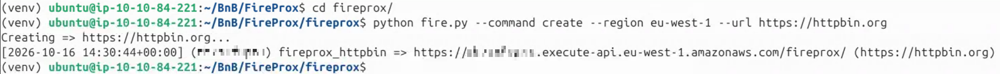

List the proxies in **eu-west-1** again:

```bash
python3 fire.py --command list --region eu-west-1
```

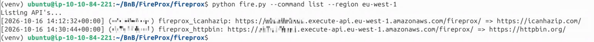

Confirm that the newly created proxy appears in the list.

Save its actual URL and API ID:

```bash
export FIREPROX_HTTPBIN_URL="https://<HTTPBIN_API_ID>.execute-api.eu-west-1.amazonaws.com/fireprox/"
export FIREPROX_HTTPBIN_API_ID="<HTTPBIN_API_ID>"
```

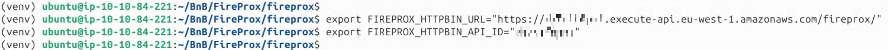

## What is httpbin

**httpbin** is an HTTP testing service that returns information about received requests, including methods, headers, query parameters, and request bodies.

In this lab, we use httpbin to demonstrate how FireProx forwards HTTP requests through AWS API Gateway, supporting different HTTP methods, URL paths, query parameters, headers, and request bodies.

## Test Path Forwarding

Send requests to two different paths through the httpbin proxy:

```bash
curl "${FIREPROX_HTTPBIN_URL%/}/anything/test"
```

```bash
curl "${FIREPROX_HTTPBIN_URL%/}/anything/fireprox/lab"
```

`${FIREPROX_HTTPBIN_URL%/}` removes the final slash from the saved base URL before adding a path. This avoids a double slash in the request.

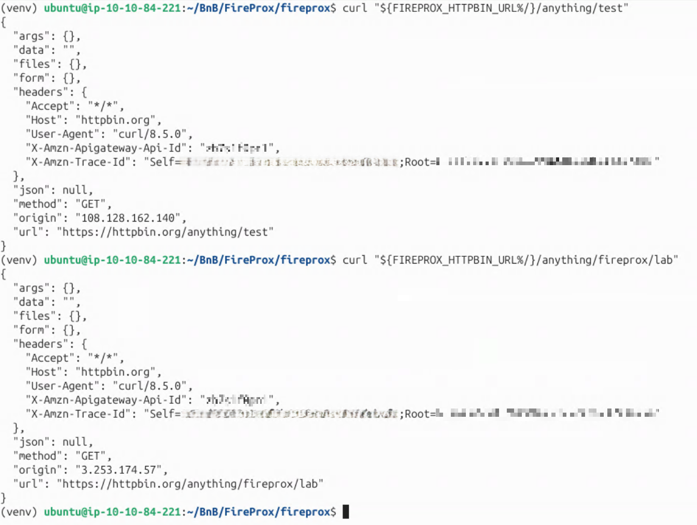

Inspect the response's `url` field. The target paths should be:

- `https://httpbin.org/anything/test`
- `https://httpbin.org/anything/fireprox/lab`

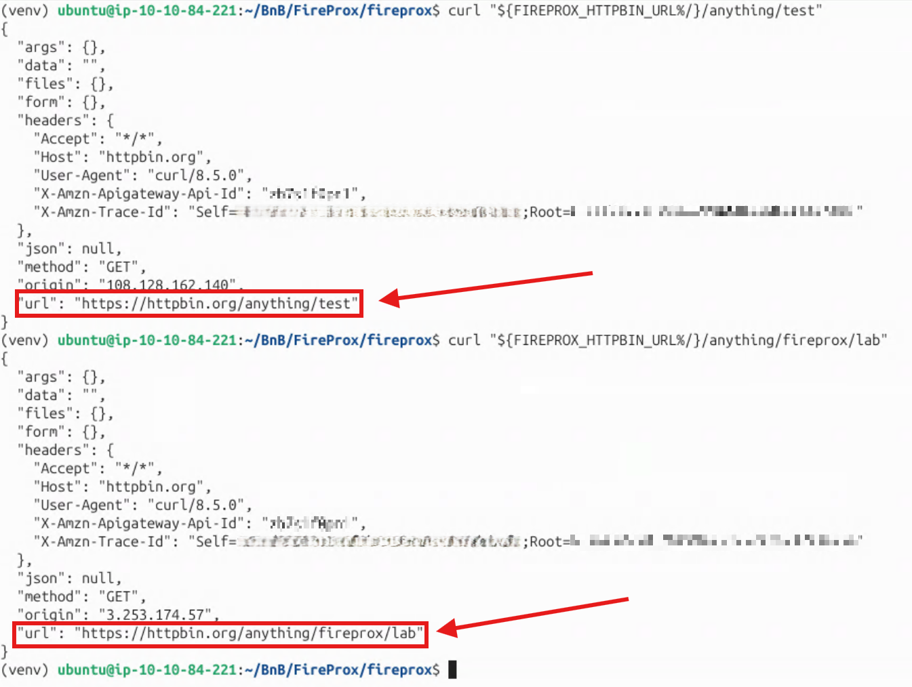

The first `/fireprox/` in the API Gateway URL is the deployment stage. The path after that stage is forwarded to httpbin. The second occurrence of `fireprox` in the last example is part of the target path.

## Test Query-Parameter Forwarding

Send a request containing three query parameters. Keep the complete URL in quotes so the shell treats the `&` characters as part of the query string:

```bash
curl "${FIREPROX_HTTPBIN_URL%/}/get?student=alice&lab=fireprox&test=123"
```

Inspect the `args` object to confirm that all three query parameters were forwarded.

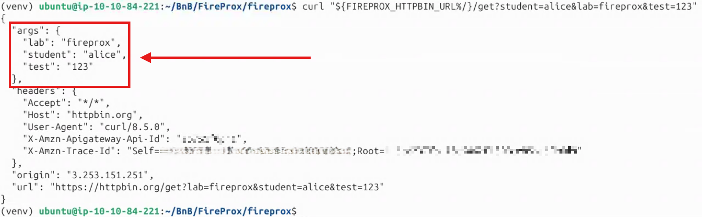

## Test HTTP Methods and Request Bodies

In the previous example, we saw a GET request method. The following requests demonstrate different HTTP methods: POST, PUT, and DELETE. Also, POST and PUT requests demonstrate forwarding a JSON request body.

### POST

Execute the following POST request from your terminal.

```bash
curl -X POST \
  "${FIREPROX_HTTPBIN_URL%/}/post" \
  -H "Content-Type: application/json" \
  -d '{"student":"alice","lab":"FireProx","message":"Hello FireProx"}'
```

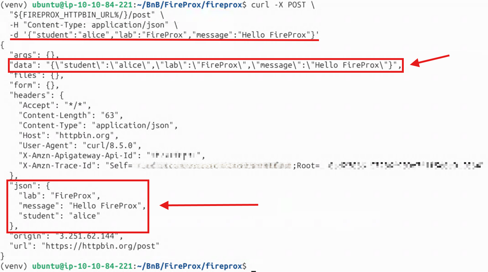

The `json` field contains the submitted student, lab, and message values. The `data` field also contains the request body as text.

### PUT

Execute the following PUT request from your terminal.

```bash
curl -X PUT \
  "${FIREPROX_HTTPBIN_URL%/}/put" \
  -H "Content-Type: application/json" \
  -d '{"status":"updated"}'
```

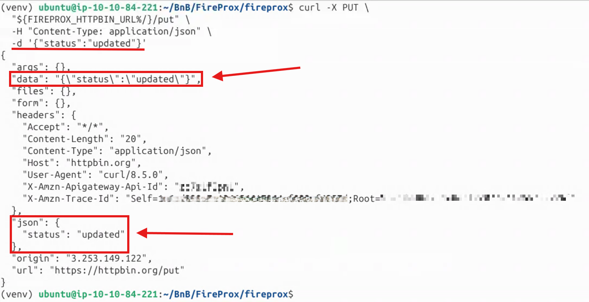

The response's `json` field contains `"status": "updated"`.

### DELETE

Execute the following DELETE request from your terminal.

```bash
curl -X DELETE "${FIREPROX_HTTPBIN_URL%/}/delete"
```

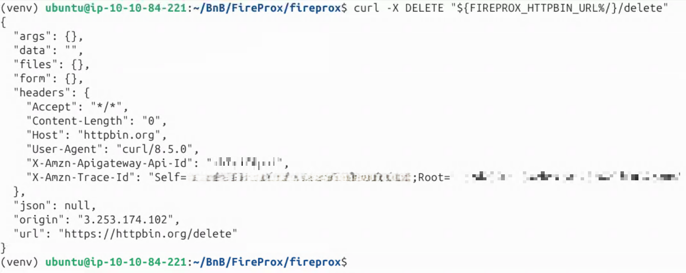

These httpbin endpoints echo the requests. They do not create, update, or delete stored lab records.

## Test Header Forwarding

In this section, we will examine how FireProx forwards HTTP headers through AWS API Gateway and whether they reach the target unchanged.

Send a custom header and User-Agent:

```bash
curl -H "X-Lab-Student: fireprox-test" \
  -H "User-Agent: FireProx-Lab" \
  "${FIREPROX_HTTPBIN_URL%/}/headers"
```

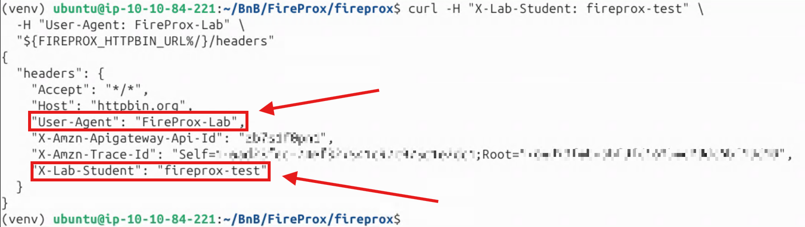

Locate **X-Lab-Student** and **User-Agent** in the response. Header names may be displayed with different capitalization.

You may also observe AWS-related headers, such as `X-Amzn-Trace-Id` and `X-Amzn-Apigateway-Api-Id`. These headers may be added or modified by API Gateway or other intermediaries.

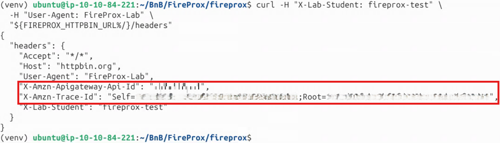

## Create a Proxy in Another AWS Region

Create another icanhazip proxy in **us-east-1**:

```bash
python3 fire.py --command create --region us-east-1 --url https://icanhazip.com
```

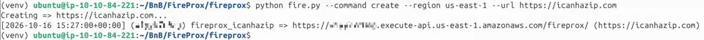

Save its actual URL and API ID:

```bash
export FIREPROX_US_IP_URL="https://<US_IP_API_ID>.execute-api.us-east-1.amazonaws.com/fireprox/"
export FIREPROX_US_IP_API_ID="<US_IP_API_ID>"
```

Send a request through the new proxy:

```bash
curl "$FIREPROX_US_IP_URL"
```

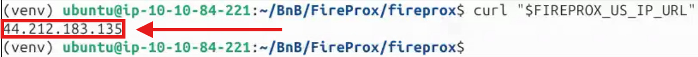

List the APIs in each region:

```bash
python3 fire.py --command list --region eu-west-1
python3 fire.py --command list --region us-east-1
```

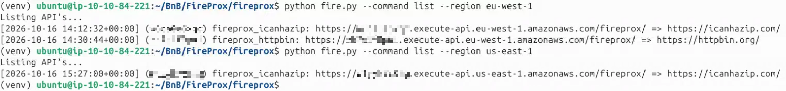

The European proxies and the US proxy are separate regional resources. Notice the region identifier in each invoke URL.

## Cleanup

**Delete every API created during this lab, including the proxy in the second region.**

First, list the APIs in both regions and confirm the IDs you recorded:

```bash
python3 fire.py --command list --region eu-west-1
python3 fire.py --command list --region us-east-1
```


You should have created the following resources:

| Region | Target | Recorded API ID |
| --- | --- | --- |
| `eu-west-1` | `icanhazip.com` | `$FIREPROX_IP_API_ID` |
| `eu-west-1` | `httpbin.org` | `$FIREPROX_HTTPBIN_API_ID` |
| `us-east-1` | `icanhazip.com` | `$FIREPROX_US_IP_API_ID` |

Delete the first proxy:

```bash
python3 fire.py --command delete --region eu-west-1 --api_id "$FIREPROX_IP_API_ID"
```

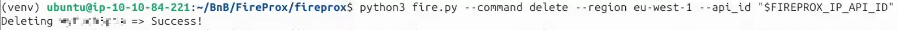

Delete the httpbin proxy:

```bash
python3 fire.py --command delete --region eu-west-1 --api_id "$FIREPROX_HTTPBIN_API_ID"
```

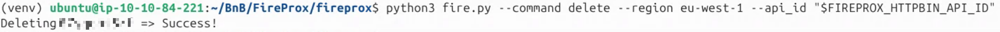

Delete the US-region proxy:

```bash
python3 fire.py --command delete --region us-east-1 --api_id "$FIREPROX_US_IP_API_ID"
```

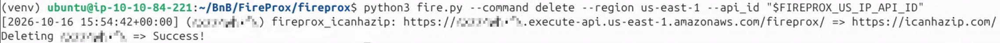

List both regions again:

```bash
python3 fire.py --command list --region eu-west-1
python3 fire.py --command list --region us-east-1
```

Confirm that your recorded API IDs no longer appear. Refresh the API Gateway console in each region and verify their removal there as well.

Now return to your AWS IAM Dashboard and select **IAM users**. Then select the user you created at the start of the lab and press **Delete user**.

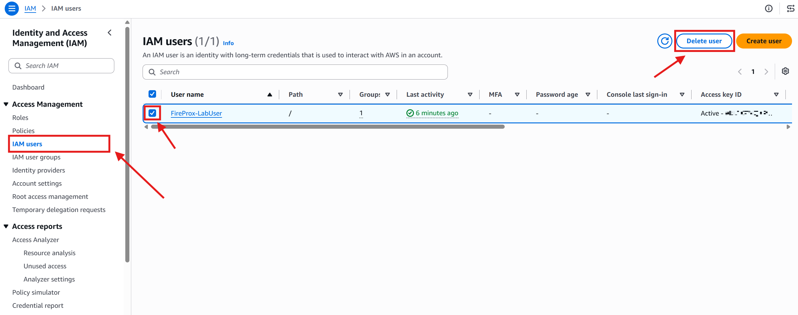

A confirmation window will appear. Press **Deactivate access key**, then type `confirm` in the text field and press **Delete user**.

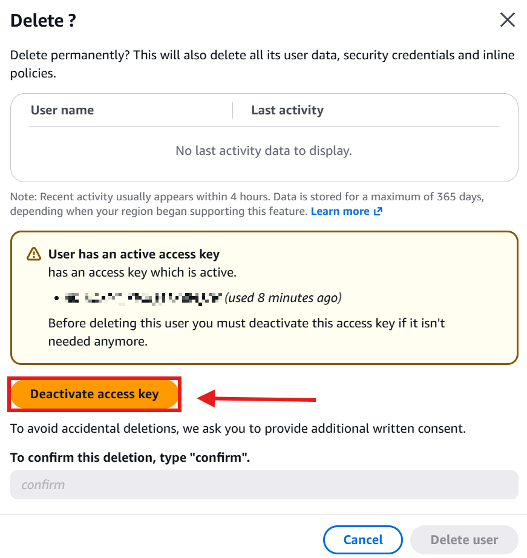

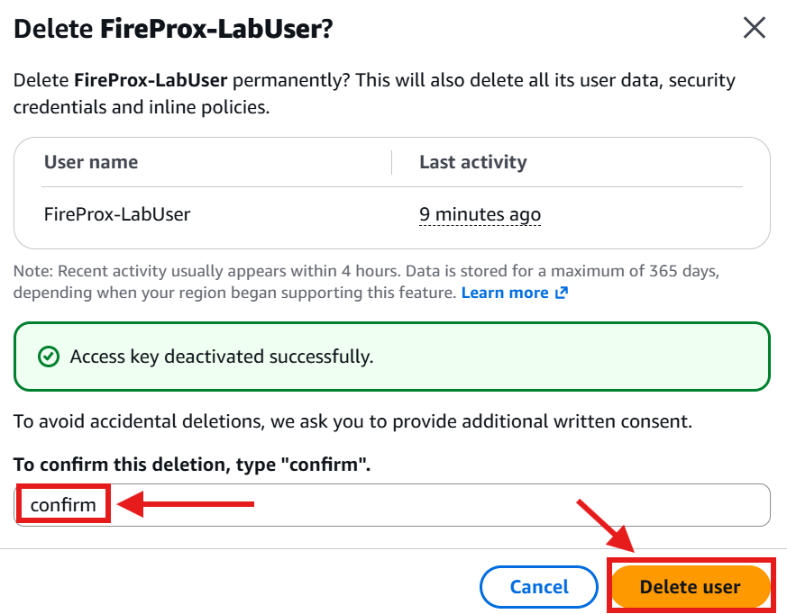

After that, navigate to the **IAM user groups**. Select the group you created at the start of the lab and press **Delete**.

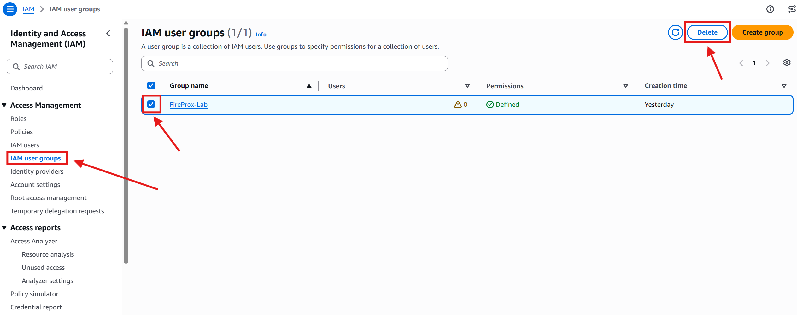

It will open again a windows, fill in the text field with the word it shows you and press **Delete**.

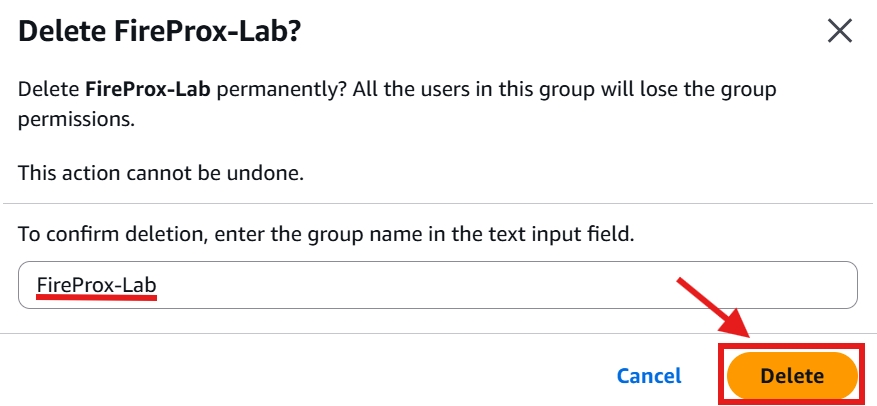

## Conclusion

In this lab, we used FireProx to create and manage AWS API Gateway proxies. We compared direct and proxied source IPs and tested how HTTP methods, URL paths, query parameters, request bodies, and headers are forwarded through the proxies.

We also explored how FireProx can create and manage proxies across different AWS regions.


---

[Back to External_Password_Spray Main Page](/Decks/CORE_v3.1/IC/External_Password_Spray.md)
