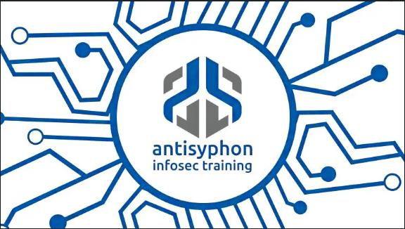

# BloodHound
### Please use both VMs

<hr>

### Lab Goal

Learn how to use **BloodHound Community Edition (CE)** to collect, visualize, and analyze Active Directory data, discover misconfigurations, and identify potential attack paths through relationships and permissions.

### In this lab you will

- Configure a prepared Active Directory environment with intentional misconfigurations.
- Deploy BloodHound CE using Docker.
- Explore the available Active Directory data collection tools.
- Collect domain information using SharpHound CE.
- Explore Active Directory objects, group memberships, and permissions.
- Identify and analyze potential attack paths using graphs and Pathfinding.
- Use built-in and custom Cypher queries to discover security misconfigurations.

### What is BloodHound

**BloodHound** is a security analysis tool that uses graph theory to visualize relationships and permissions within Active Directory and other identity environments.

It represents objects such as users, groups, and computers as nodes, while relationships such as group membership and delegated permissions appear as edges.

BloodHound helps security professionals identify potential attack paths and understand how misconfigurations could create unintended access to privileged resources.

## Start the Lab Environment

Start both virtual machines:

- **Windows Server VM**: Hosts the `antilab.lan` Active Directory domain.
- **Ubuntu VM**: Hosts BloodHound CE using Docker.

## Set Up the Active Directory Environment

On the Windows VM, open **PowerShell as Administrator** and navigate to the lab's directory.

```powershell
cd C:\Users\Administrator\Desktop\Labs\BloodHound
```

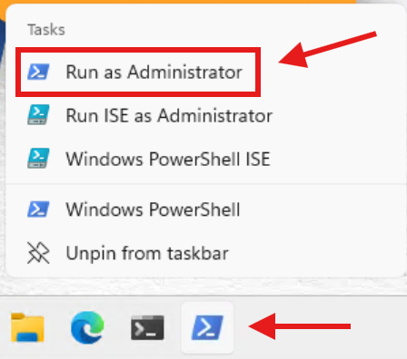

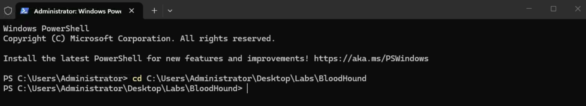

Then execute the PowerShell scripts to setup the Active Directory environment.

```powershell
.\01_Create_LabObjects.ps1
.\02_Set_LabPermissions.ps1
```

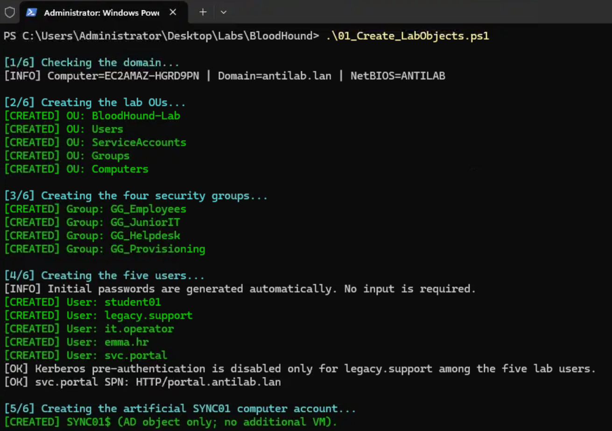
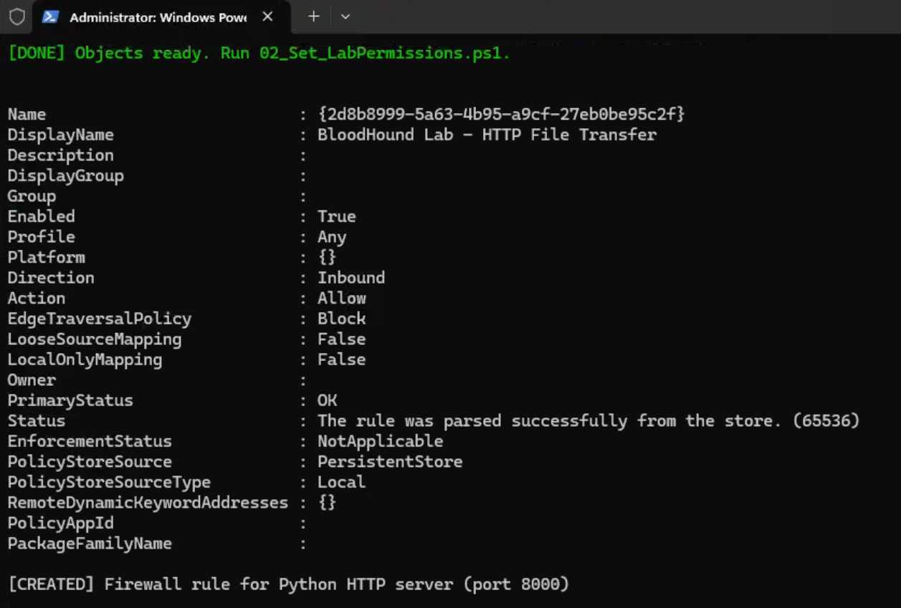
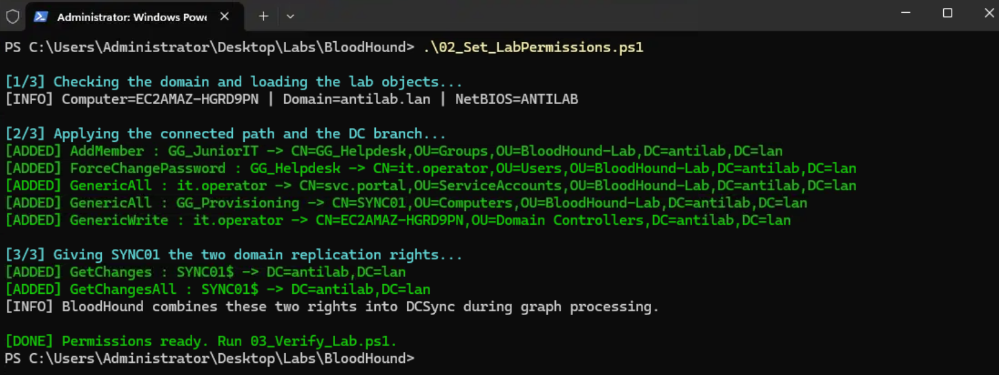

These scripts create the required Active Directory objects and configure intentional security misconfigurations.

The Active Directory environment is now ready. We can verify it by opening the **Active Directory Administrative Center**.

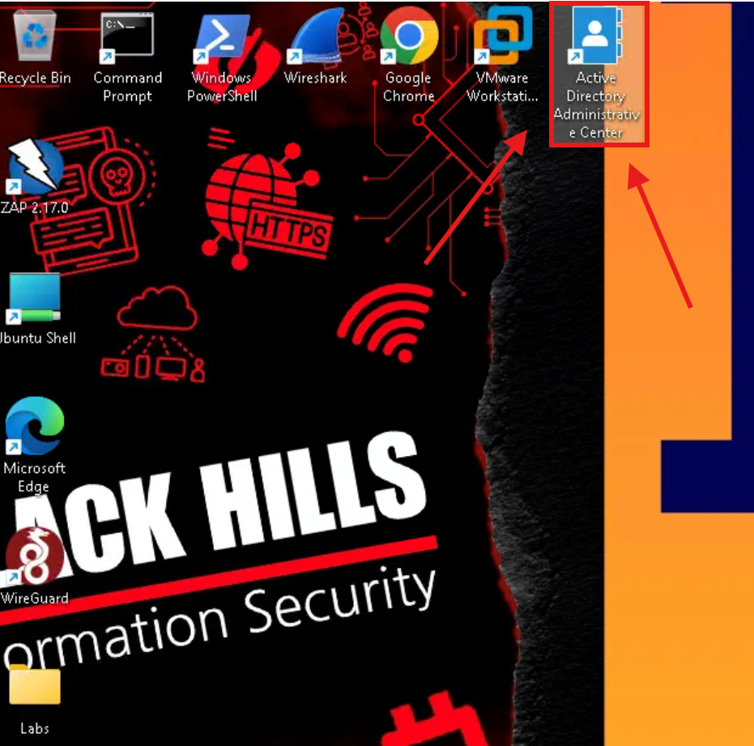

The lab objects are organized under the `BloodHound-Lab` Organizational Unit (OU), within the `antilab.lan` domain.

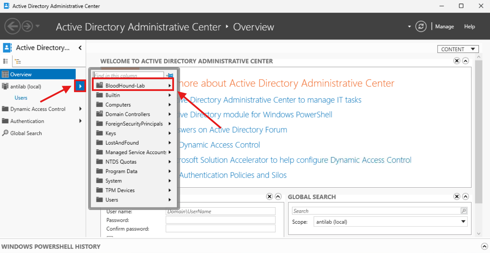

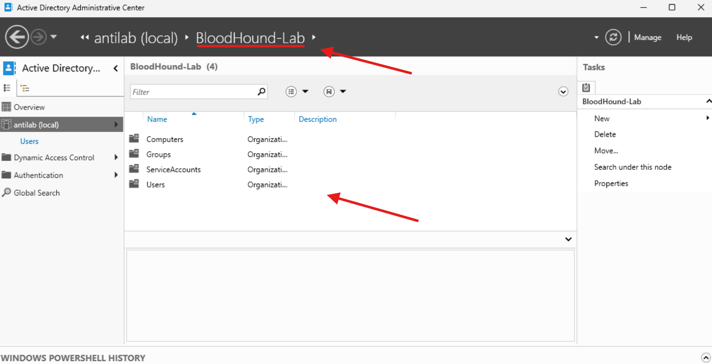

## Set Up BloodHound Community Edition

Switch to the **Ubuntu VM**.

BloodHound CE uses Docker containers to run its application and database services. We will use the official **BloodHound CLI** to deploy the environment.

Open a terminal and navigate to the lab directory.

```bash
cd ~/BnB/BloodHound
```

Then run the following command to launch BloodHound CE. 

```bash
sudo ./bloodhound-cli install
```

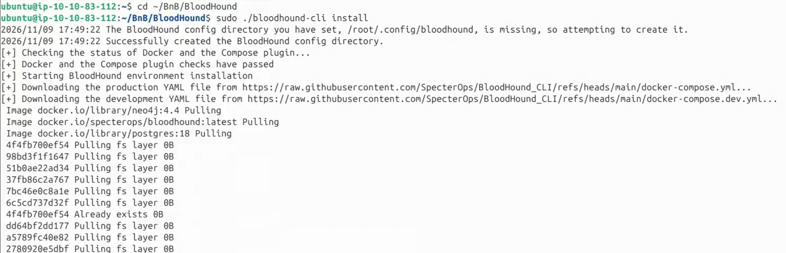

With the completion of the above command, BloodHound's required services will be up and running on Docker. Also, once it finishes, the terminal will display a randomly generated administrator password. This password will be used at the BloodHound login page.

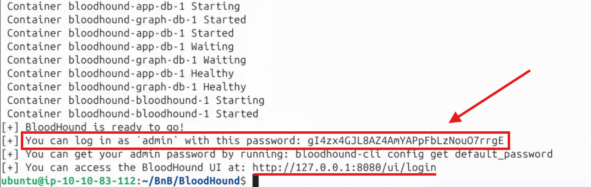

Open Firefox in the Ubuntu VM and navigate to: `http://127.0.0.1:8080/ui/login`.

Log in using:

- **Username**: `admin`
- **Password**: The password generated during installation.

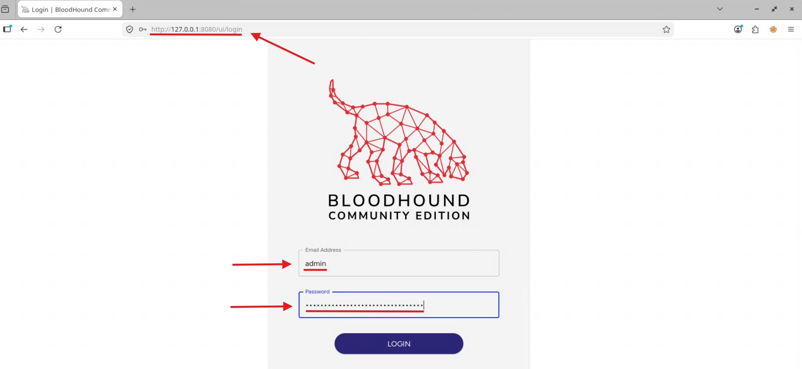

Now we have access at the BloodHound web interface.

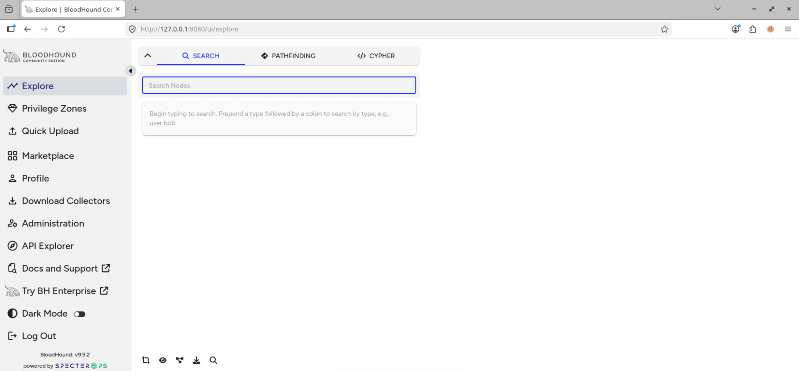

>[!NOTE]
>
> When launching BloodHound for the first time, you will be prompted to upload data. This panel allows you to import JSON or ZIP files.
> For now, **skip this step**, as you will collect and import your own Active Directory data later in the lab.

Before moving on to the analysis part, we must mention two more things.

Firstly, in case of password loss, BloodHound provides us with the ability to reset it with the following command.

```bash
sudo ./bloodhound-cli resetpwd
```

Secondly, if BloodHound was already installed, you can start its existing containers with:

```bash
sudo ./bloodhound-cli containers up
```

## Collect Active Directory Data

Before analyzing Active Directory with BloodHound, we need to collect information about its objects and relationships.

Several tools can collect Active Directory data compatible with BloodHound CE:

1. **SharpHound CE**: The official Windows-based collector developed by SpecterOps.
2. **BloodHound.py CE**: A community-maintained Python collector that can collect AD information from Linux.
3. **RustHound-CE**: A cross-platform collector written in Rust, with support for Linux and Windows.

Each tool has different capabilities and collection coverage. For this lab, we will use **SharpHound CE**.

### Collect Data Using SharpHound

Switch to the **Windows VM**.

SharpHound CE collects information about Active Directory users, groups, computers, organizational units, and their relationships and permissions. SharpHound uses domain credentials to authenticate and collect information from Active Directory. In our lab, we are running SharpHound using the `STUDENT01` domain user account.

Open PowerShell and navigate to the following directory.

```powershell
cd C:\Users\Administrator\Desktop\Labs\BloodHound\SharpHound
```

Run SharpHound:

```powershell
.\SharpHound.exe --CollectionMethods DCOnly --Domain antilab.lan --OutputDirectory ".\Output" --ZipFileName antilab_bloodhound.zip
```

In the above command, we use the following parameters:

- `--CollectionMethods DCOnly`: Collects domain information through the Domain Controller, including AD object permissions and memberships.
- `--Domain antilab.lan`: Specifies the target domain.
- `--OutputDirectory`: Specifies where to save the results.
- `--ZipFileName`: Gives the output archive a predictable name.

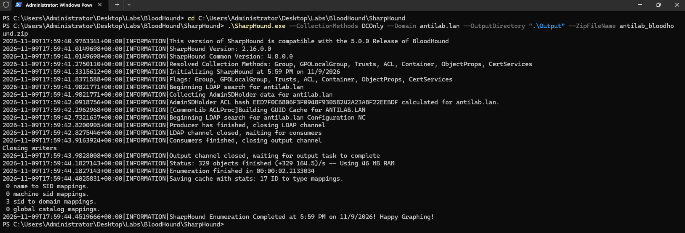

We collect information from the **entire domain**, rather than only the `BloodHound-Lab` OU, to preserve relationships involving domain-level objects and the Domain Controller.

Once the collection finishes, locate `<DATE_ID>_antilab_bloodhound.zip` in `C:\Users\Administrator\Desktop\Labs\BloodHound\SharpHound\Output`. The archive contains JSON files describing the discovered Active Directory objects and relationships.

## Transfer the Collected Data to Ubuntu

We will use a Python HTTP server on Windows to transfer the SharpHound collection to Ubuntu.

Find the Windows VM's private IP address:

```powershell
ipconfig
```

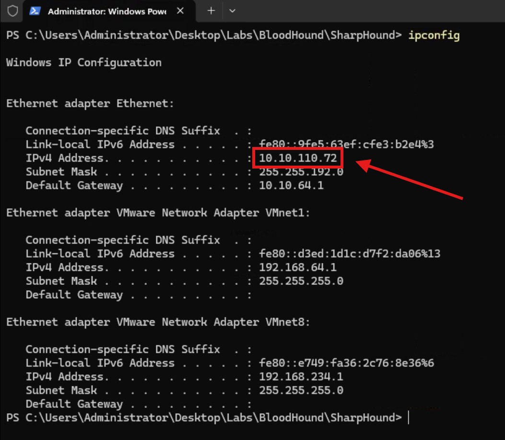

Navigate to the output directory, list the files and start a Python HTTP server:

```powershell
cd C:\Users\Administrator\Desktop\Labs\BloodHound\SharpHound\Output
ls
python -m http.server
```

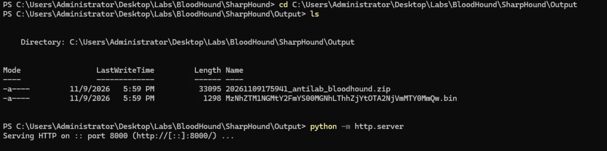

On the Ubuntu VM, open a terminal and navigate to the lab directory. Then download the ZIP file:

```bash
cd ~/BnB/BloodHound
wget http://<WINDOWS_IP>:8000/<DATE_ID>_antilab_bloodhound.zip -O antilab_bloodhound.zip
```

Unzip the file with the following command:

```bash
unzip antilab_bloodhound.zip -d ./sharphound_results
```

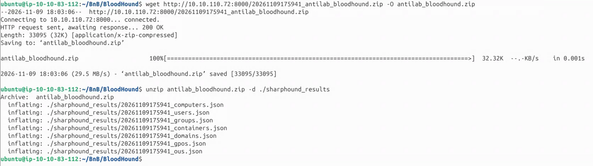

Now we have SharpHound's results in our Linux VM, and we are ready to start the analysis.

## Stop the Windows VM

At this point, we have collected and transferred the Active Directory data to Ubuntu.

We no longer need the Windows VM for the remaining exercises, since BloodHound CE will analyze the collected data locally.

**Stop the Windows VM instance to save credits.**

Make sure the ZIP file is available on Ubuntu before shutting down Windows.

## BloodHound Environment

Return to the Ubuntu VM.

Open your browser and go to the BloodHound interface. The left panel contains BloodHound's functionalities.

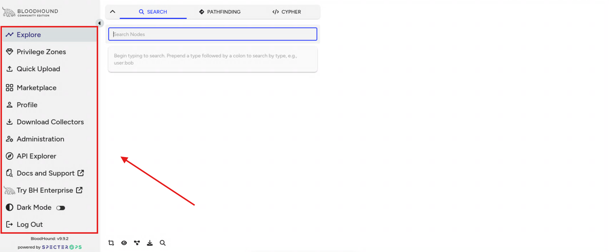

## Marketplace Tab

The **Marketplace** tab allows you to explore community-developed extensions and integrations that expand BloodHound's capabilities beyond traditional Active Directory and Microsoft Entra ID environments.

You can search and filter the available extensions, view their descriptions, and access their GitHub repositories for additional information.

>[!NOTE]
>
> Community extensions are not necessarily reviewed or endorsed by SpecterOps and should be evaluated before use.

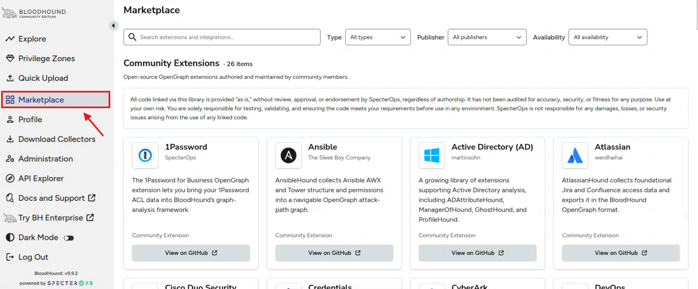

## Profile Tab

The **Profile** tab displays information about your BloodHound account, including your email address, username, and assigned role. From this tab, you can also manage your API keys, reset your password, and enable Multi-Factor Authentication (MFA) for additional security.

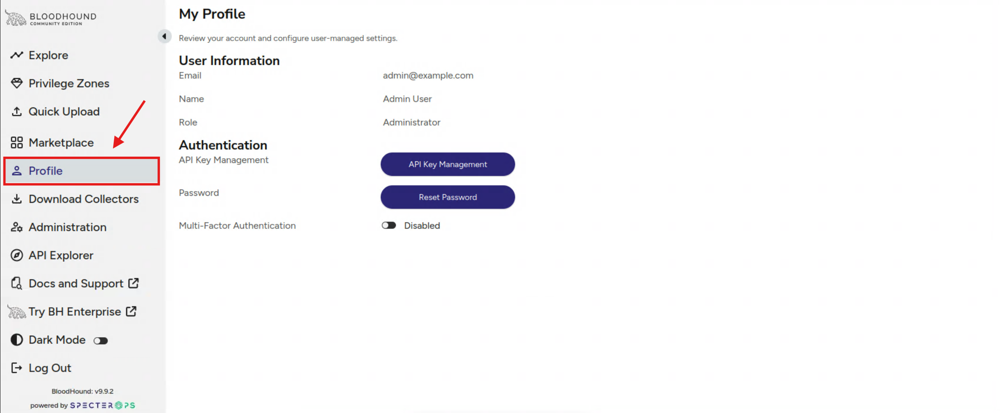

## Download Collectors Tab

The **Download Collectors** tab provides two tools for collecting data from different environments:

- **SharpHound**: Collects information from on-premises Active Directory environments, including users, groups, computers, sessions, and permissions.
- **AzureHound**: Collects information from Microsoft Entra ID (formerly Azure AD) environments, including identities, roles, and permissions.

Both collectors gather data that can be imported into BloodHound for visualization and analysis.

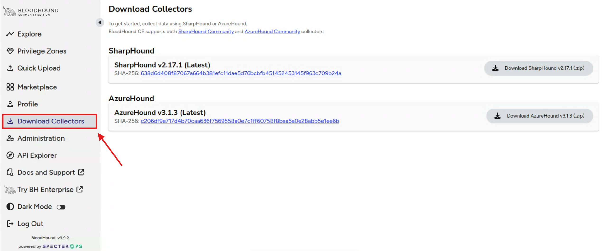

## Administration Tab

The **Administration** tab provides tools for managing and configuring BloodHound. It includes options for monitoring data collection and ingestion, checking data quality, managing the database, configuring user accounts and authentication, and adjusting application settings.

From this tab, administrators can also manage imported data, including deleting previously collected information from the database.

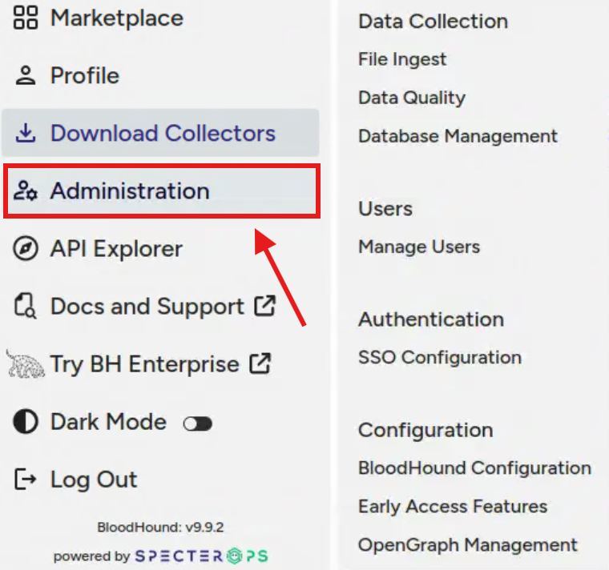

## API Explorer Tab

The **API Explorer** tab provides documentation for the API endpoints available in BloodHound. These endpoints allow users to interact with BloodHound programmatically, including managing authentication, accessing data, and performing administrative operations.

Endpoints are organized by category and display their HTTP methods, paths, and descriptions. You can also search for specific endpoints and expand them to view additional details, such as request parameters and responses.

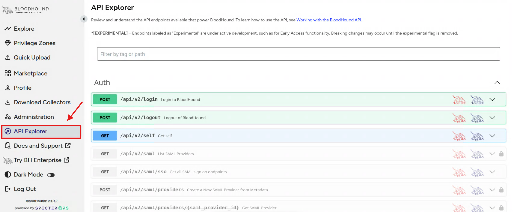

## Quick Upload Tab

The **Quick Upload** tab allows you to import collected data directly into BloodHound for analysis. You can upload JSON or ZIP files generated by SharpHound or AzureHound, either by selecting the files or dragging and dropping them into the upload area.

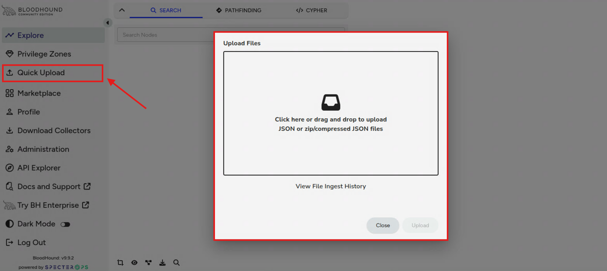

Once uploaded, BloodHound processes the data and imports the discovered objects and relationships into its graph database, making them available for visualization and analysis.

Click into the files input area, it will then open a file explorer window. Navigate to the lab directory and select all the JSON files you extracted previously, and press `Open`.

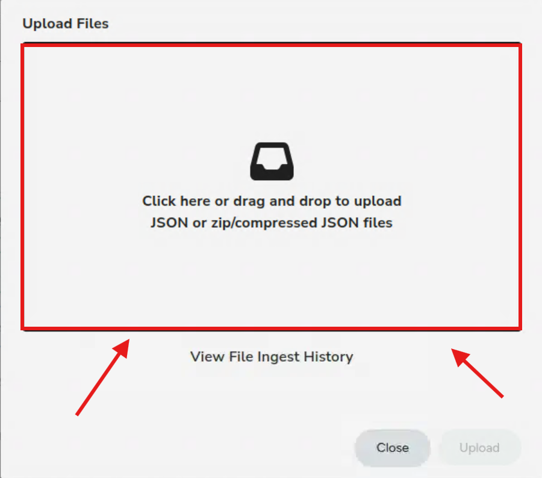

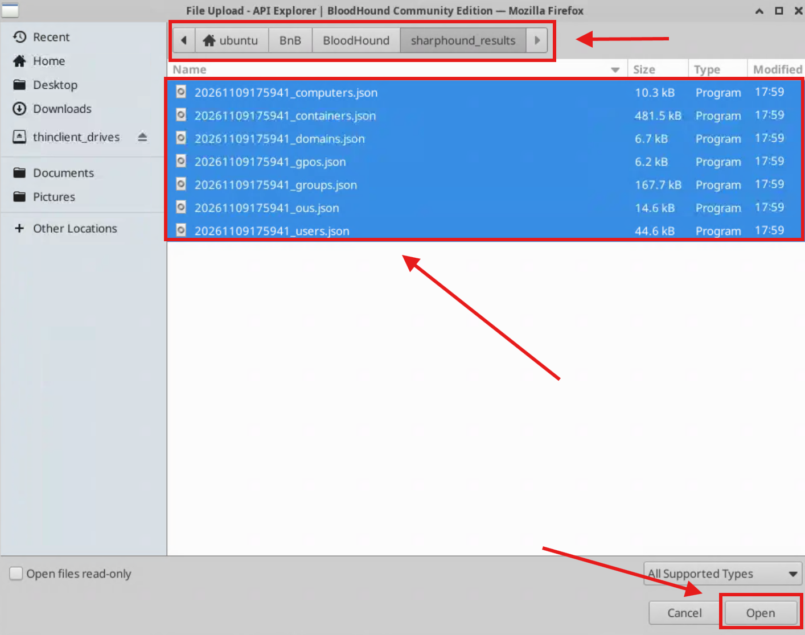

Then press `Upload` to upload them to BloodHound.

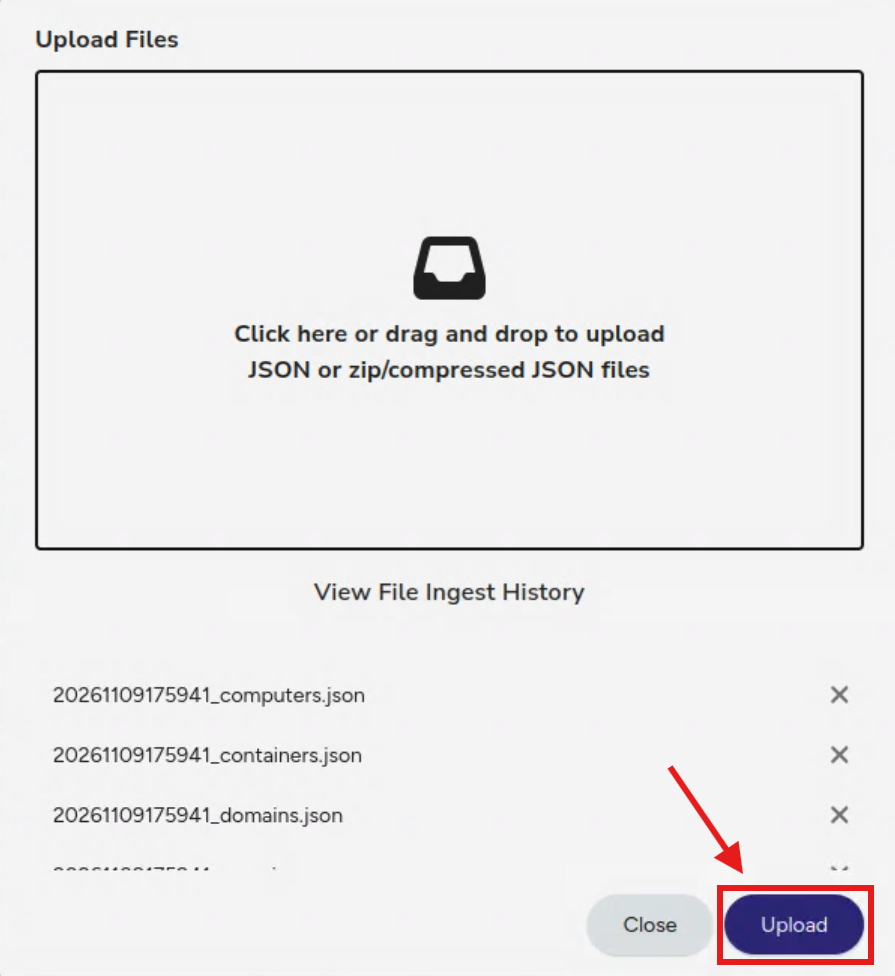

### File Ingest

The **File Ingest** section, located under **Administration -> Data Collection -> File Ingest**, provides another way to upload collected data into BloodHound.

In addition to uploading files, this section allows you to review the file ingestion history, monitor processing statuses, and identify any errors that occurred during data import.

Both options can be used to import data, but **File Ingest** provides additional visibility into the ingestion process.

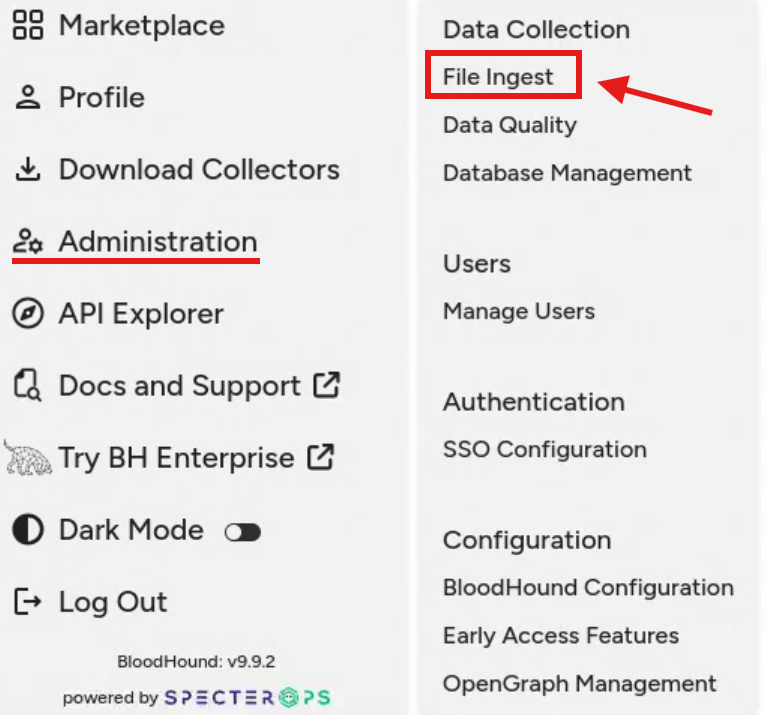

Before moving on, ensure that the status of the files is **Complete**.

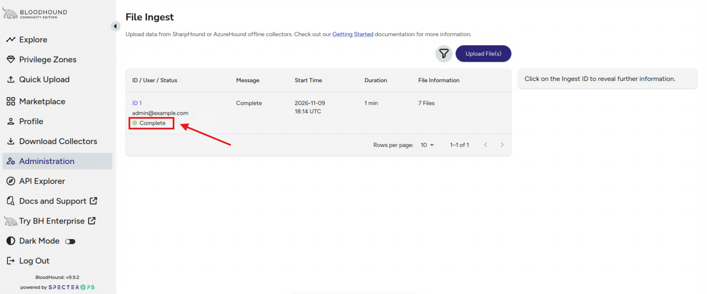

## Understanding BloodHound Graphs

BloodHound uses graph-based visualization to represent Active Directory objects and the relationships between them. This makes it easier to identify permissions, misconfigurations, and potential attack paths that might otherwise be difficult to discover.

A BloodHound graph consists of three main elements:

- **Nodes**: Represent objects such as users, groups, computers, and domains. Different colors and icons help distinguish object types.
- **Edges**: Represent relationships or permissions between objects, such as group membership, password reset rights, or administrative privileges.
- **Paths**: Represent sequences of connected nodes and edges that can reveal potential privilege escalation opportunities.

Edges are directional, meaning that the arrow indicates how one object relates to another.

For example, a `MemberOf` edge from a user to a group indicates group membership, while a `GenericAll` edge indicates that the source object has extensive control over the target object.

>[!NOTE]
>
> A displayed attack path does not mean that exploitation has occurred. It represents a potential sequence of actions based on the permissions and relationships discovered during data collection.

## Explore & Privilege zones Tabs

The **Explore** and **Privilege Zones** tabs provide different ways to investigate and organize the Active Directory environment.

- **Explore**: The main workspace for searching objects, inspecting relationships, visualizing graphs, running queries, and discovering potential attack paths.
- **Privilege Zones**: Allows you to organize and classify objects based on their security importance or status. It includes predefined classifications such as **Tier Zero** and **Owned**, as well as options for creating custom rules.

For example, the **Owned** label can be used to identify objects assumed to be under an attacker's control during an investigation, while **Tier Zero** identifies objects considered critical to the security of the environment.

### Search and Inspect Active Directory Objects

Before investigating attack paths, let's explore how BloodHound displays information about individual Active Directory objects.

Navigate to the **Explore** tab.

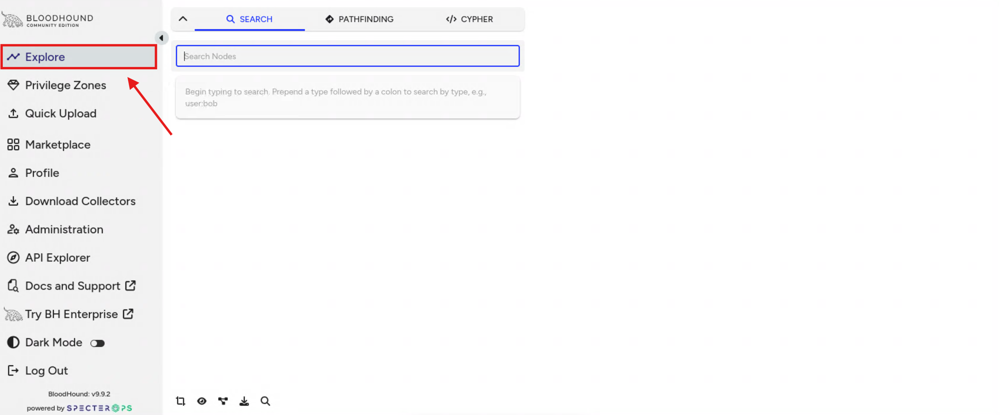

Select the **Search** option, search for `STUDENT01@ANTILAB.LAN`, and select the user from the search results.

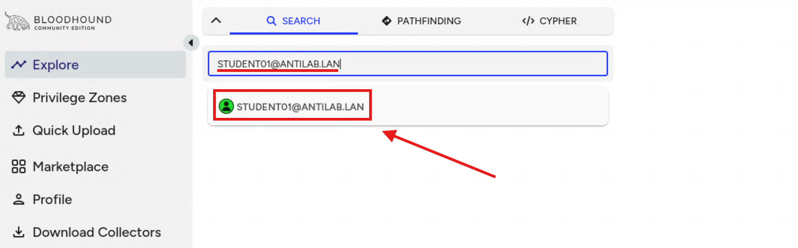

By clicking the displayed node, you open its information panel.

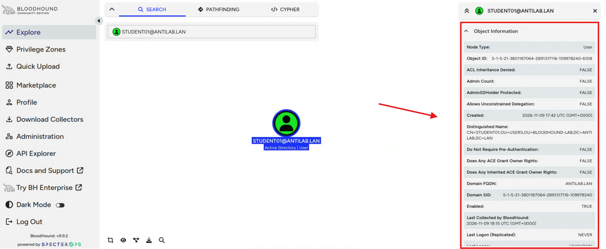

The information panel provides details about the selected object, including its properties, group memberships, and related permissions.

Pay particular attention to the following sections:

- **Object Information**: Displays general information about the object.
- **Member Of**: Shows the groups to which the object belongs.
- **Inbound Object Control**: Shows which other objects have control permissions over the selected object.
- **Outbound Object Control**: Shows which objects the selected object can control.

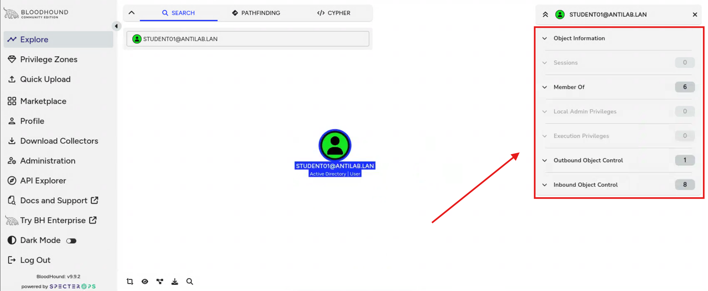

The available information depends on the selected object type and the data collected by SharpHound.

### Interact With the Graph

BloodHound provides several options for interacting with graph visualizations.

Like in the previous step, click the `STUDENT01@ANTILAB.LAN` node to display its properties and related information.

Then, from the right-side panel, expand the **Member Of** catalog. You will see in which groups is member of the `STUDENT01` user.

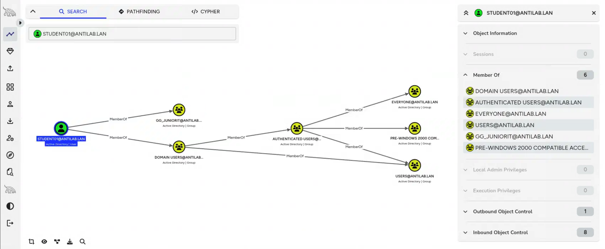

Click the **Member of** edge that correlates the `STUDENT01` user with the **GG_JUNIORIT** group to examine the relationship between them.

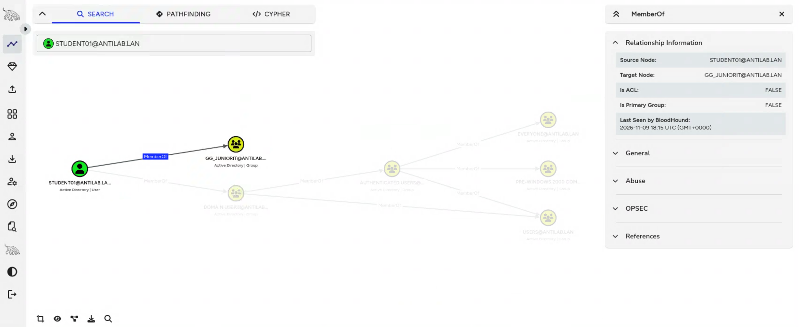

From there, by expanding the other tabs, you can see a lot of useful information. For certain permissions, you can expand the **Abuse** tab to find explanations and example commands demonstrating how these permissions could be exploited.

Right-click a node to access additional actions, such as setting it as a starting or ending node for pathfinding.

In our case, right-click the `STUDENT01` node and select **Add to Owned**. This allows BloodHound to treat the account as a controlled starting point when analyzing potential attack paths from owned objects.

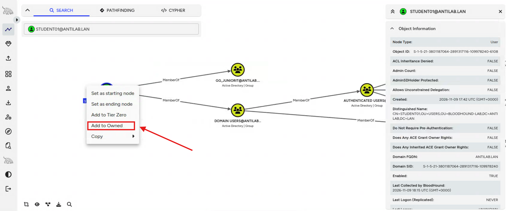

> [!NOTE]
>
> The **Owned** label indicates that an object is assumed to be under an attacker's control during analysis. Marking an object as Owned does not compromise or modify the actual Active Directory object.

You can also examine inbound and outbound relationships to understand how permissions connect different objects.

If you accidentally assigned an object to **Owned**, you can then remove it by following the instructions below.

Let's assume that we accidentally assigned the `IT.OPERATOR` to the owned objects. In order to remove this object from the owned list, first go to the **Privilege Zone** tab at the `Labels` panel.

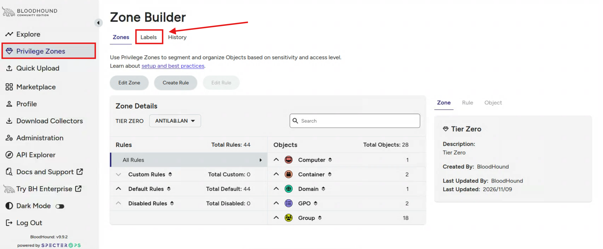

Then select the desired object (in our case, the `IT.OPERATOR`). Observe that the **Edit Rule** button will be enabled.

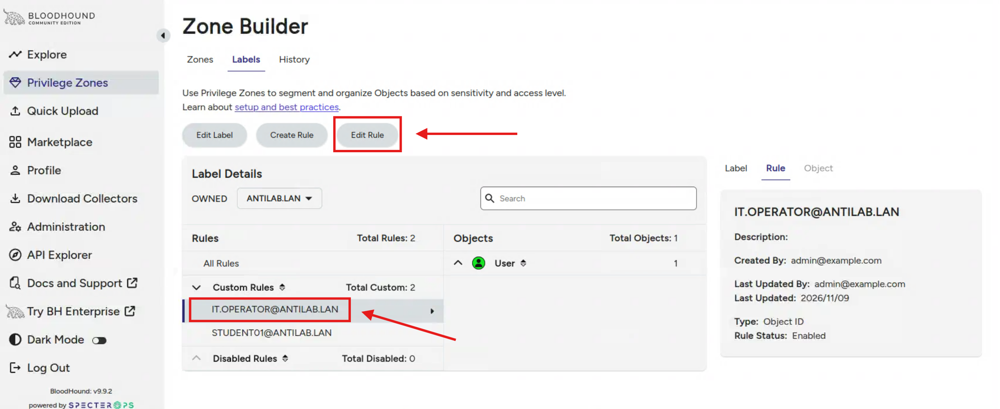

Select it, and by scrolling down, you will see a **Delete Rule** button.

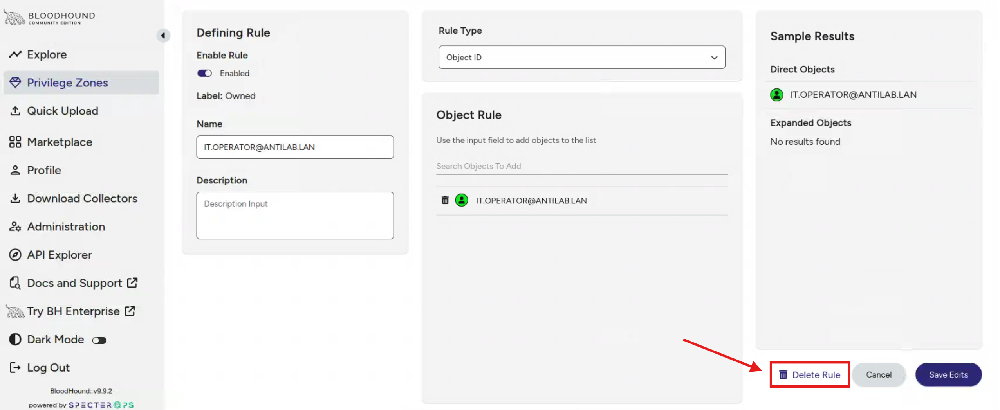

By clicking it, you will be prompted with a verification window. Fill the text field with the sentence it advises you to and click **Confirm**.

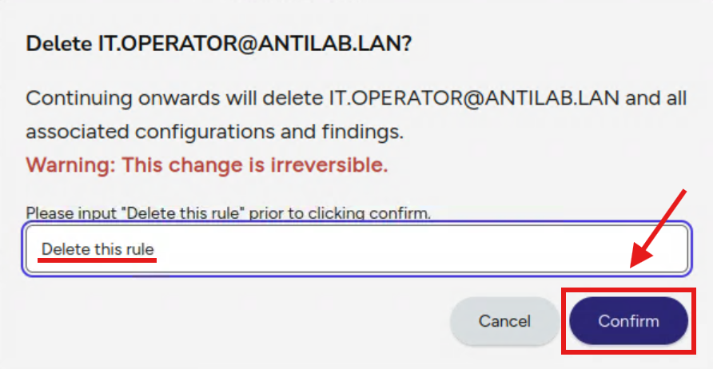

### Path 1: From STUDENT01 to ANTILAB.LAN

Our first scenario focuses on tracing a potential attack path from a standard Active Directory user, `STUDENT01`, to the `ANTILAB.LAN` domain through a series of group memberships and delegated permissions.

In the **Explore** tab, search for the `STUDENT01` user.

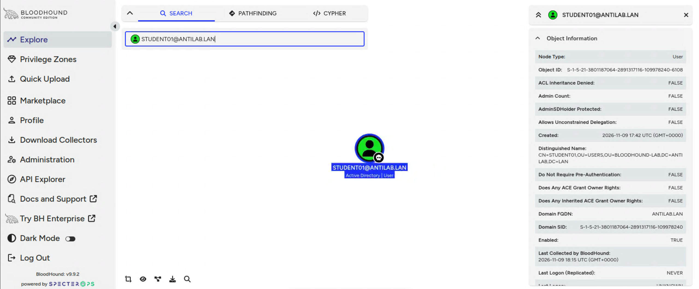

From the right panel, expand **Member Of** to see the groups that this user is a member of. BloodHound displays a graph with the group memberships of `STUDENT01`, including the default `DOMAIN USERS` group and the lab-specific `GG_JUNIORIT` group. The **MemberOf** edges represent these relationships, with `GG_JUNIORIT` playing an important role in the attack path we are investigating.

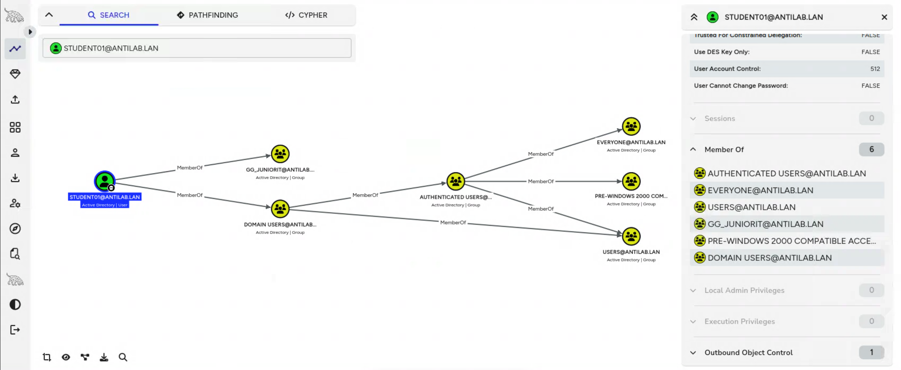

Another important thing to explore is which Active Directory objects we can control. To see these relationships, expand the **Outbound Object Control** section.

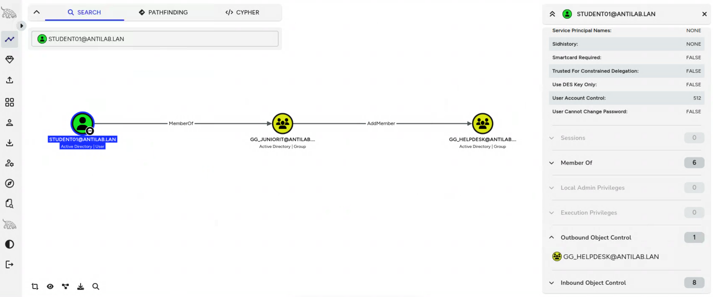

We can see that `GG_JUNIORIT` has **AddMember** permission to the `GG_HELPDESK` group. This means that members of `GG_JUNIORIT` can modify the membership of `GG_HELPDESK`. As a result, we can add ourselves to the `GG_HELPDESK` group and have its privileges.

Clicking the **AddMember** edge displays detailed information about the relationship, including the source and target nodes, permission type, and whether the permission is inherited.

You can also expand the **Windows Abuse** and **Linux Abuse** sections to explore how this permission could be abused. These sections provide explanations, example commands, and tools that could be used to abuse the relationship. Additionally, the **OPSEC** and **References** sections provide information about potential detection considerations and further documentation.

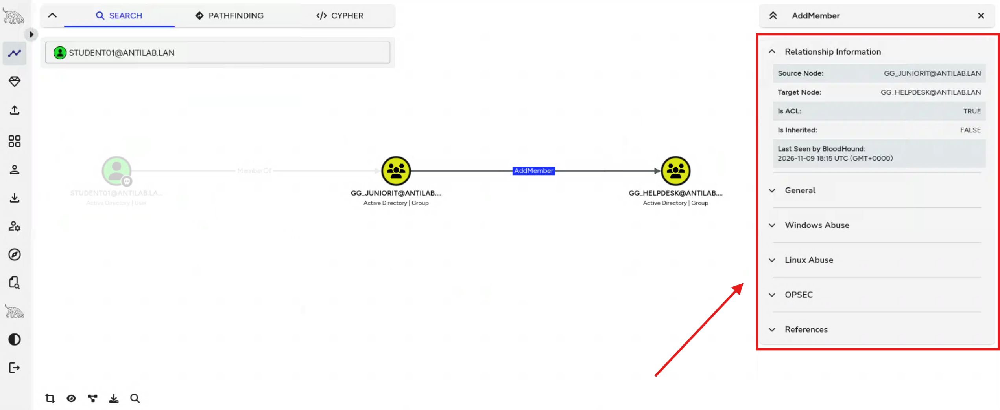

After examining how we could add ourselves to the `GG_HELPDESK` group, let's explore its properties and outbound object control relationships to identify what permissions it has over other Active Directory objects.

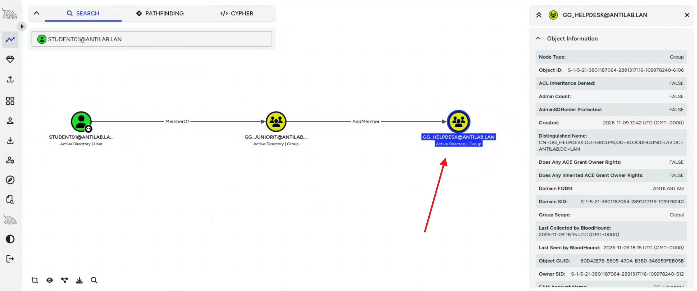

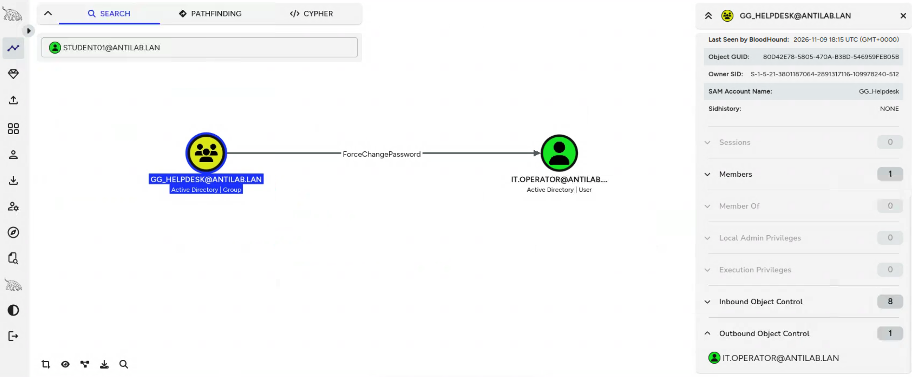

As shown in the graph, the `GG_HELPDESK` group has **ForceChangePassword** permissions over the `IT.OPERATOR` account. This means that members of the group can reset the user's password without knowing the current one. This allows us to compromise the `IT.OPERATOR` account and continue along the attack path.

Now that we have reached the `IT.OPERATOR` account, let's examine its properties and **Outbound Object Control** relationships.

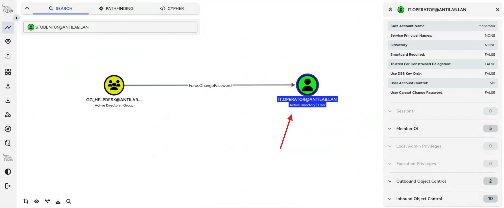

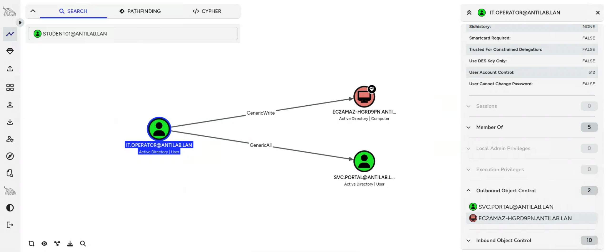

As shown in the graph, `IT.OPERATOR` has **GenericAll** permissions over `SVC.PORTAL` and **GenericWrite** permissions over the Domain Controller's computer object (`EC2AMAZ-HGRD9PN`).

These permissions reveal two potential attack paths. For now, we will continue with the `SVC.PORTAL` service account and explore the **GenericWrite** path later in the lab.

**GenericAll** is a powerful permission that grants extensive control over the target object. In our case, it allows us to reset the password of `SVC.PORTAL` without knowing the current one. By doing so, we could gain control of the service account and use its group memberships and associated permissions to continue along the attack path.

Now that we have reached the `SVC.PORTAL` service account, let's examine its properties and **Outbound Object Control** relationships.

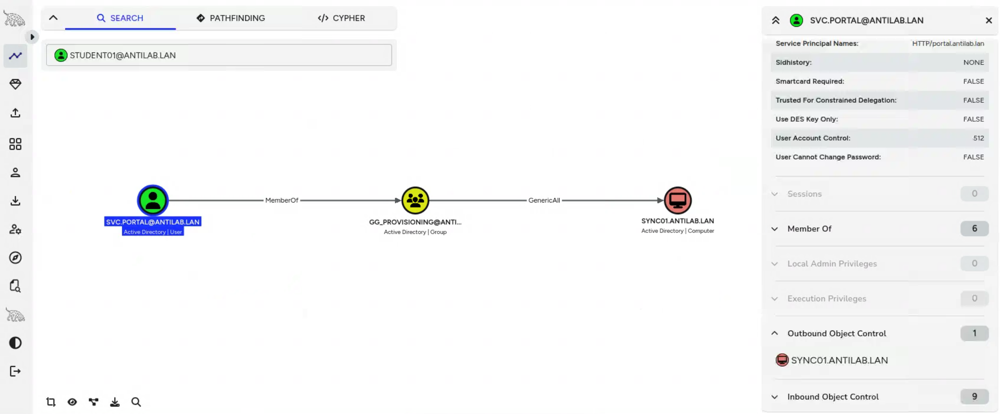

As shown in the graph, `SVC.PORTAL` belongs to the `GG_PROVISIONING` group, which has **GenericAll** permissions over the `SYNC01` computer account. This gives us another opportunity to gain control of an Active Directory object and progress further along the attack path.

Finally, let's examine the **Outbound Object Control** relationships of the `SYNC01` computer account.

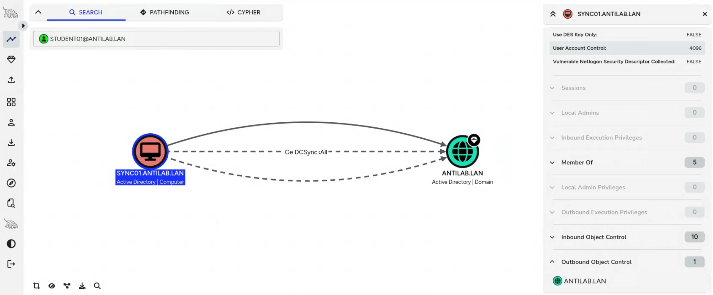

As shown in the graph, `SYNC01` has **DCSync** permissions over the `ANTILAB.LAN` domain. These permissions allow the account to request sensitive information through Active Directory replication, including password hashes.

By compromising `SYNC01`, an attacker could abuse these permissions to retrieve domain credentials, potentially leading to a complete domain compromise.

### Path 2: GenericWrite Over the Domain Controller

In this scenario, we will investigate another branch of the previous attack path while exploring BloodHound's **Pathfinding** functionality.

Pathfinding allows us to automatically discover potential attack paths between two Active Directory objects.

In the **Explore** tab, search for the `STUDENT01` user, right-click the node, and select **Set as starting node**.


You will notice that BloodHound automatically switches to the **Pathfinding** panel, with `STUDENT01` selected as the starting node.


In the destination field, search for the `ANTILAB.LAN` domain and select it. BloodHound will analyze the collected relationships and display potential paths connecting the two objects.


As shown in the graph, BloodHound has automatically identified a path similar to our previous scenario.


The path follows the same relationships until we reach the `IT.OPERATOR` account. However, this time we follow the **GenericWrite** relationship to the Domain Controller's computer object (`EC2AMAZ-HGRD9PN`).

The **GenericWrite** permission allows us to modify certain writable attributes of the target Active Directory object. Depending on the circumstances, this could be abused to gain further control over the computer account.

Finally, notice the **DCFor** relationship connecting `EC2AMAZ-HGRD9PN` to `ANTILAB.LAN`. This relationship indicates that the computer acts as a Domain Controller for the domain.

> [!NOTE]
>
> **GenericWrite** over the Domain Controller's computer object does not automatically grant local administrator privileges or Domain Admin membership. Additionally, **DCFor** represents the computer's role in the domain, not an exploitable permission.

### Path 3: AS-REP Roastable Account

In this scenario, we will explore BloodHound's **Cypher** functionality to identify Active Directory accounts vulnerable to AS-REP Roasting.

Cypher is a query language used to search and analyze graph databases. BloodHound provides several built-in queries that allow us to identify specific security misconfigurations and relationships without writing our own queries.

Navigate to the **Explore** tab and select **Cypher**. Expand **Saved Queries** to view the available prebuilt queries.


You can search for specific queries or filter them by platform, category, and source.


Search for `AS-REP`, select the prebuilt query that identifies AS-REP Roastable users, and run it. BloodHound will display the matching accounts in the graph.


As shown in the results, BloodHound identifies `LEGACY.SUPPORT@ANTILAB.LAN` as an AS-REP Roastable account.

This account has Kerberos pre-authentication disabled, meaning an attacker could request an encrypted AS-REP response without knowing the account's password and attempt to crack it offline.

Select the `LEGACY.SUPPORT` node and inspect its properties. Notice that **Do Not Require Pre-Authentication** is set to **TRUE**, confirming that Kerberos pre-authentication is disabled for this account. Also, verify that **Enabled** is set to **TRUE**, indicating that the account is active.


Expand the **Outbound Object Control** to explore the account's relationships. As shown in the graph, `LEGACY.SUPPORT` belongs to the `GG_HELPDESK` group, which we investigated in our first attack path. If an attacker compromised this account, they could use the group's delegated permissions to continue toward `ANTILAB.LAN`.


### Path 4: Kerberoastable Service Account

In our final scenario, we will explore how to write and execute **custom Cypher queries** to identify Active Directory accounts vulnerable to Kerberoasting.

Unlike the previous scenario, where we used a built-in query, this time we will create our own.

Navigate to **Explore → Cypher** and enter the following query into the Cypher editor:

```cypher
MATCH (u:User)
WHERE u.hasspn = true AND u.enabled = true
RETURN u
```


This query consists of three main parts:

- **MATCH**: Searches for nodes of type `User`.
- **WHERE**: Filters the results to include only enabled accounts with a Service Principal Name (SPN).
- **RETURN**: Displays the matching user objects in the graph.

Execute the query to view the results.


As shown in the results, BloodHound identifies `SVC.PORTAL@ANTILAB.LAN`, the service account we encountered during our first attack path.

Select the `SVC.PORTAL` node and inspect its properties. Notice that **Service Principal Names** contains `HTTP/portal.antilab.lan`, confirming that an SPN is registered to this account. Also, verify that **Enabled** is set to **TRUE**.


Kerberoasting is an attack technique that targets service accounts associated with SPNs. An attacker can request Kerberos service tickets for these accounts and attempt to crack the encrypted ticket data offline to recover their passwords.

Expand **Outbound Object Control** to examine the account's relationships.


As we discovered in Path 1, `SVC.PORTAL` belongs to the `GG_PROVISIONING` group, which has **GenericAll** permissions over the `SYNC01` computer account. If an attacker compromised this service account, they could potentially leverage these permissions to continue toward our final target, `ANTILAB.LAN`.

## Cleanup

Before finishing the lab, let's explore how to manage the collected data and stop the BloodHound environment.

### Clear Imported Data (Optional)

BloodHound provides database management functionalities that allow administrators to remove previously imported data.

Navigate to **Administration -> Database Management** and examine the available data deletion options.


If you want to reset the environment, select the appropriate deletion option and follow the confirmation instructions.

> [!WARNING]
>
> Deleting imported data removes the collected Active Directory information from BloodHound. This does not modify the actual Active Directory environment. Only proceed if you no longer need the imported data for analysis.

### Stop BloodHound CE

Finally, we can stop the BloodHound Docker containers.

On the **Ubuntu VM**, navigate to the lab directory:

```bash
cd ~/BnB/BloodHound
```

Run the following command:

```bash
sudo ./bloodhound-cli containers stop
```


This stops the BloodHound services without deleting their persistent data.

---

[Back to Weaponizing Active Directory Main Page](/Decks/CORE_v3.1/PE/Weaponizing_Active_Directory.md)
