# Eavesarp

# Ubuntu VM

# What is Eavesarp?

Eavesarp analyzes ARP requests to map which hosts communicate with each other and to flag stale network address configurations (SNACs): IPs that hosts still try to reach but that no longer exist. It runs passively by default, and it has optional active modes that confirm stale IPs with ARP resolution and add DNS names.

## What are `ARP` packets?

In order to understand this tool we need to understand what `ARP` packets are. `Address Resolution Protocol` packets are designed to resolve an IP address to a MAC address.

# How to use Eavesarp?

Eavesarp can be run in two ways. Passive and active. However before running any command we need to identify our network interface. We do this using the command below. Let's choose the first interface listed below the loopback interface (`lo`).

```bash
ip a
```

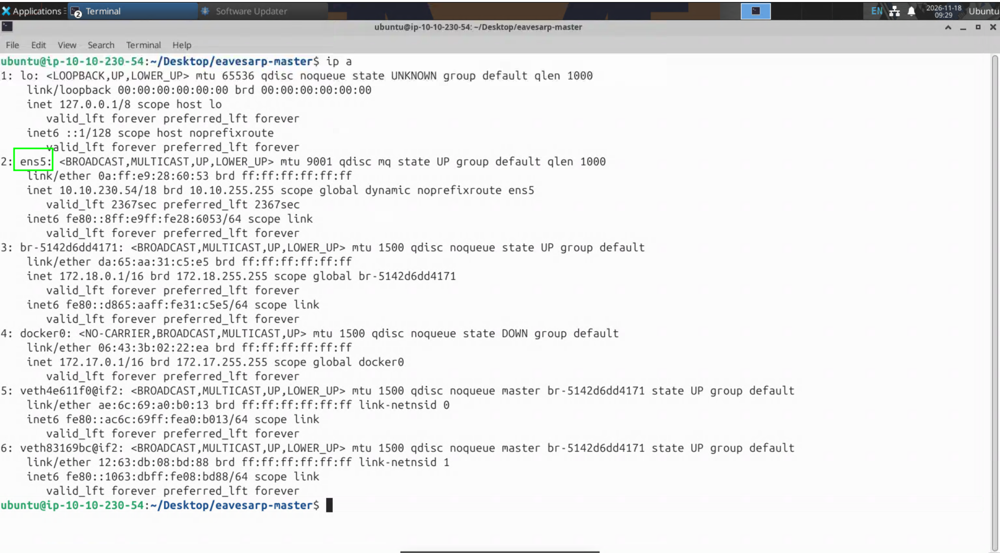

## Passive interception

The first type of interception is `passive` because it only captures the packets and then analyzes them. It never sends any packets or interferes with the network.

```bash
sudo ./eavesarp.py capture -i ens5
```

After this command, open another terminal and run the following commands:


### Making ARP traffic

```bash 
sudo ip neigh flush all
ping -c2 10.10.230.54 #you need to change this ip to your own one
sudo arping -I ens5 -c5 10.10.230.54 #here as well
```
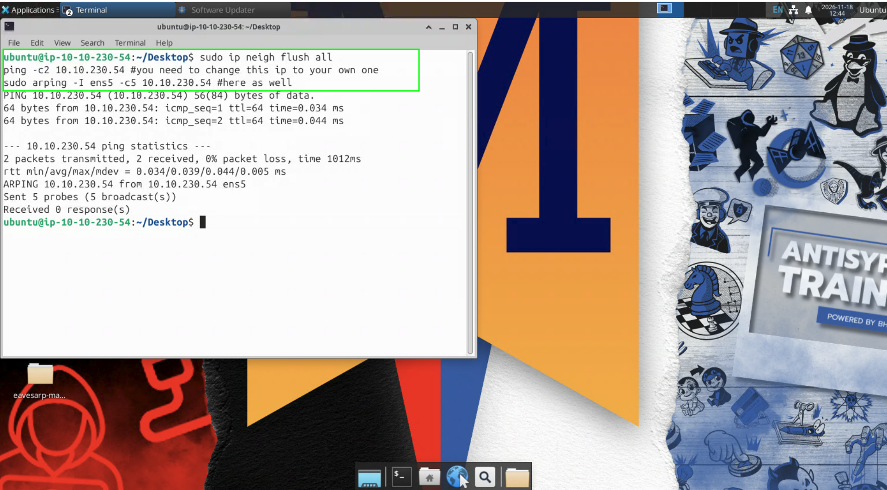

### So, what does this command actually do?

`ip neigh flush all` empties the neighbor cache. It then refills only as the host successfully resolves neighbors it actually communicates with — so pinging your own IP (loopback, no ARP) and an unanswered arping leave it empty, while traffic to a live host like the gateway would create a fresh entry.

### Output of the basic passive interception command

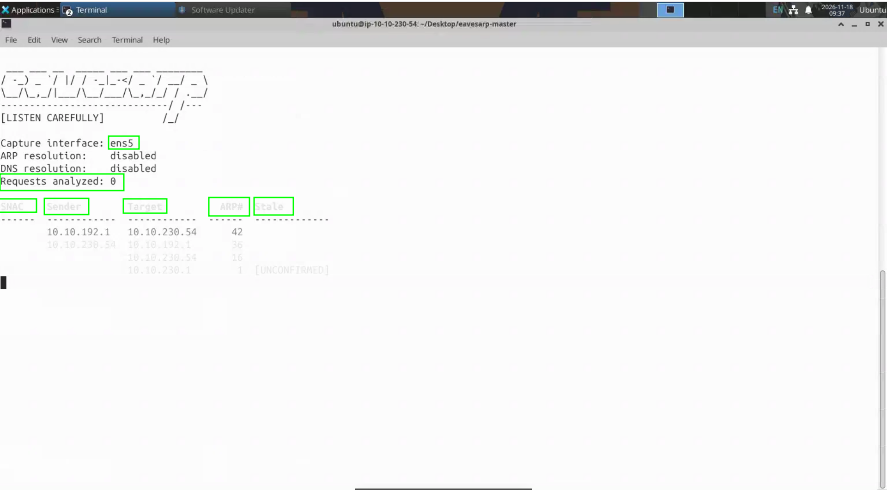

>[!NOTE]
>Let's examine everything that appeared here:
>`Capture interface` -> this is the network interface that we chose.  It captures `ARP` frames visible to the selected interface and capture mechanism.
>`Requests analyzed` -> number of the packets that Eavesarp has analyzed since the tool started running.
>`SNAC` (Stale Network Address Configuration) -> it is the configuration of an `ARP` packet sender. It points the IP address of a host that is no longer active. 
>`Sender` -> the IP address (the host) that is sending the `ARP` request.
>`Target` -> the IP address (the host) about which the sender is asking.
>`ARP#` -> number of times that the sender asked about this target.
>`Stale` -> it shows if target responded to the `ARP` requests.

So let's examine one of the rows to get better understandning of what's happening:

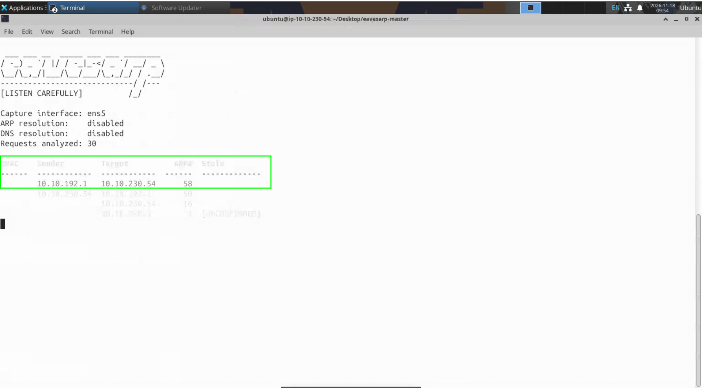

The first thing what we should think about this row is the confirmation that we won't have the problem with `SNAC`. Both `SNAC` and `STALE` columns are empty which indicates the target responded. 

Next are the `Sender` and `Target` columns. The `Sender` is the IP that broadcast
the ARP request; the `Target` is the IP it was trying to resolve to a MAC
address. 
In the first row, 10.10.192.1 (the gateway) asked the network "who has 10.10.230.54?" 
Next to the `Target` we have the `ARP#` column which shows us that this specific question was asked 58 times since the start of the interception.

## Active interception

The active interception has two flags. One is `ARP resolution`, and the other is `DNS resolution`.

### Why is it active and not passive?
In passive mode, eavesarp only reads ARP traffic already on the segment. When it sees a host repeatedly ask for a target that never replies, it cannot prove the target is dead, so it marks the pair as [UNCONFIRMED].

In active configuration however the tool, if it does not receive a response, creates a direct `ARP` packet for the suspected target and sends it to the network. The cost of this operation is reduced stealth.

### What is the DNS resolution ?

This is the second option you can choose that also gonna be categorized as `active`. This takes IP address and tries to match it with `DNS` queries by doing `reverse lookups` (`PTR` queries)

>[!IMPORTANT]
> What is `DNS`? -> This is `Domain Name Server` which resolve the IP addresses to names. For example 8.8.8.8 -> dns.google.
> What is reverse lookup? -> a process that uses an IP address to find its corresponding domain name by querying DNS servers.
> What are the `PTR` queries? -> Those are records of IP + Name that are being used in DNS reverse lookups. Example of `PTR` record: 8.8.8.8.in-addr.arpa.   `PTR`   dns.google.

Let's use it and see the output.


# Running the active mode

```bash
sudo ./eavesarp.py capture -i ens5 -ar -dr
```

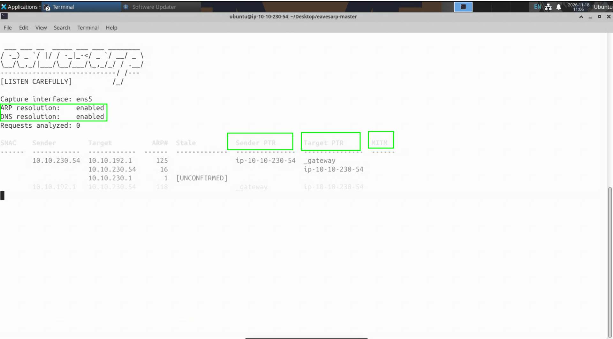

>[!IMPORTANT]
>Sender PTR -> the reverse-DNS name for the sender IP address
>Target PTR -> the reverse-DNS name for the target IP address
>MITM -> The column flags where a `MITM` opportunity exists, a sender -> target pair where, because the target looks stale or unclaimed, you could insert yourself by answering for that address.
>What is MITM? (`man-in-the-middle`) ->  a cyberattack in which a hacker steals sensitive information by eavesdropping on communications between two online targets

Let's examine the new findings:

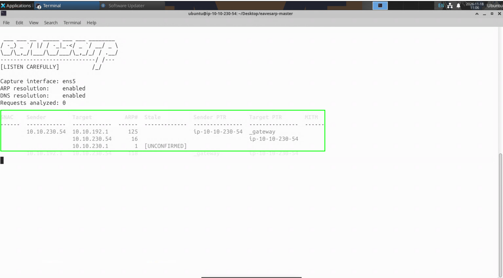

## First row

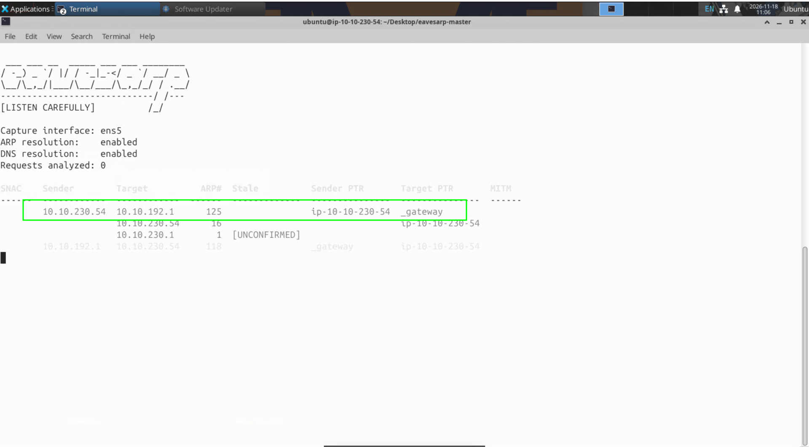

The new columns we are going to focus on are `Sender` and `Target` `PTR`. The sender name was successfully resolved to `ip-10-10-230-54`.

Next to it the target name was resolved to `_gateway`. It got this name because of the role (default gateway) it does, and the
Ubuntu system that assigned this name to the address.

The last column remains empty because this pair is not vulnerable for SNAC.

## Second row

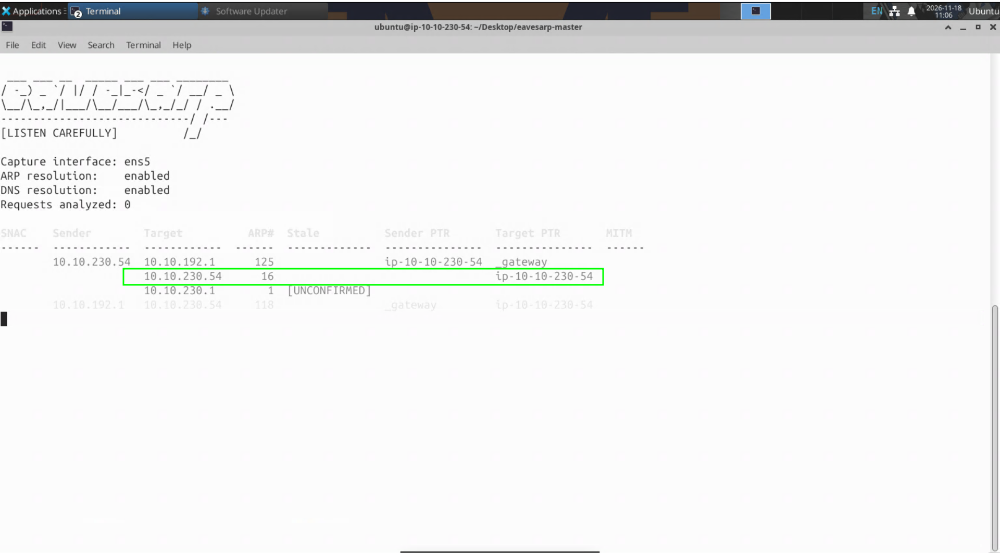

The key thing to notice here is: The sender is `blank`. The rule here is if the sender column is empty it means it's the same as the row above it (in this case 10.10.230.54). We can also see that this is connection from our own host to our own host which is the result of the commands from `Making ARP traffic` chapter.

There were 16 packets that were sended to the target. 

`Sender PTR `is blank because the sender is unchanged from the row above
(grouped, not repeated) — not because it went unresolved.

## Third row

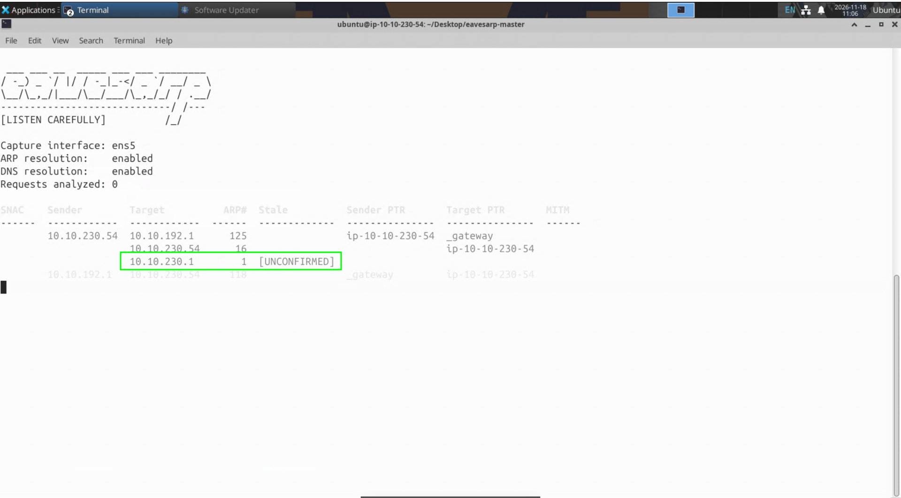

This row is still sender 10.10.230.54 (blank = grouped with the rows above).
It asked for 10.10.230.1 exactly once (ARP# 1) and saw no reply.

Stale = [UNCONFIRMED]: in passive mode, one unanswered request isn't proof
the target is dead — the reply could have been missed or sent where eavesarp
can't see it. The tool withholds judgment rather than classifying it as stale.

`Target PTR` is blank: the reverse (`PTR`) lookup for 10.10.230.1 returned no
name. That means no `PTR` record exists for it — NOT that the host is down.


`10.10.230.1` never appears as a sender anywhere in the table, so eavesarp
has no "seen-as-sender" evidence that it's alive — unlike the host's own
address, which is confirmed that way.


# Analyzing the PCAP and SQLite Databases

Another great option of this tool is analyzing already captured data. In the example below we are going to focus on the `PCAP` file however the tool accepts SQLite Databases as well. Besides that, Eavesarp can also save the output as a `CSV` file.

>[!NOTE]
>`PCAP` -> a file that stores packets captured off the network by tools such as Wireshark or tcpdump. "`PCAP`" is short for "packet capture."
>`CSV` (comma-separated values) -> file is a plain text format used to store tabular data, where each line represents a record and individual fields within that record are separated by commas.

First let's download the packet capture. Paste and run this command in a terminal.

```bash
cd ~/Desktop/eavesarp-master
wget -O 4SICS-GeekLounge-151020.pcap \
  "https://share.netresec.com/s/xYj2qCNbsLEAd6M/download/4SICS-GeekLounge-151020.pcap"
```

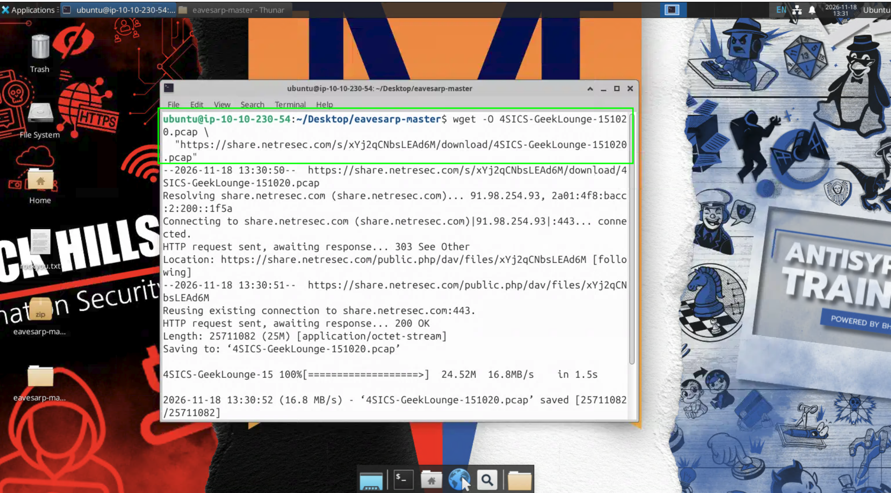

The file should be downloaded within seconds. Now let's analyze it with Eavesarp.

```bash
./eavesarp.py analyze -pfs 4SICS-GeekLounge-151020.pcap --csv-output-file output.csv
```
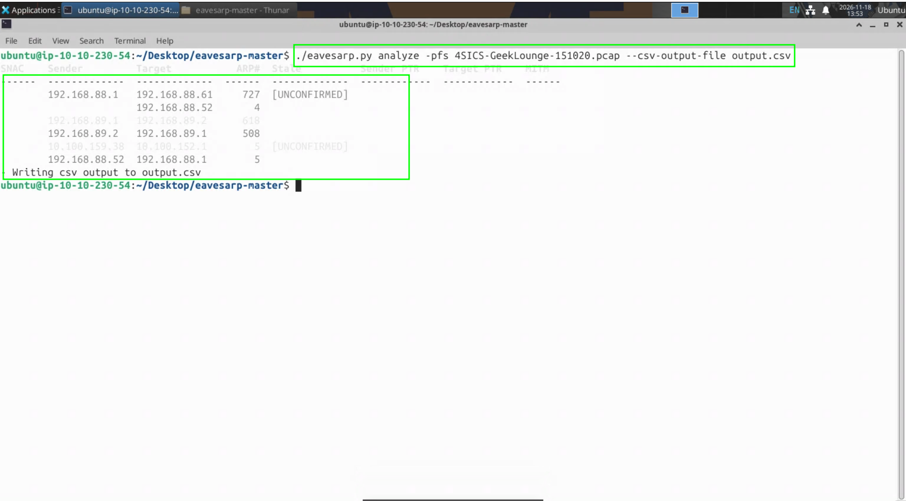

The analysis was successful. Let's see what about the CSV file.

```bash
cat output.csv
```
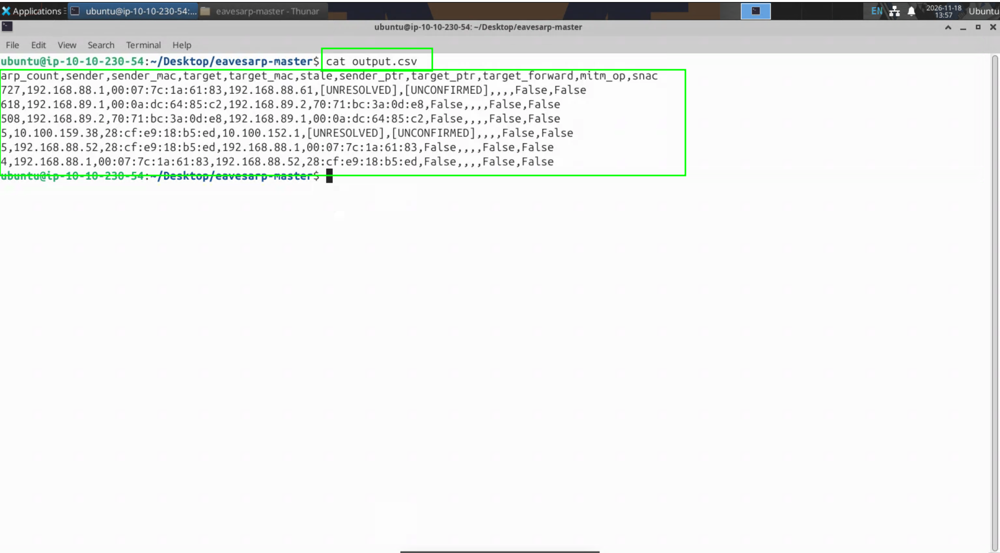

The output was successfully saved as a CSV file.

# Finished?

[Back to reading about Stale Network Address Configurations (SNAC) Attack](https://github.com/blackhillsinfosec/FreeLabFriday_Labs/blob/main/Decks/Green_Expansion_v2/V2Deck/PE/SNAC_Attack.md)


