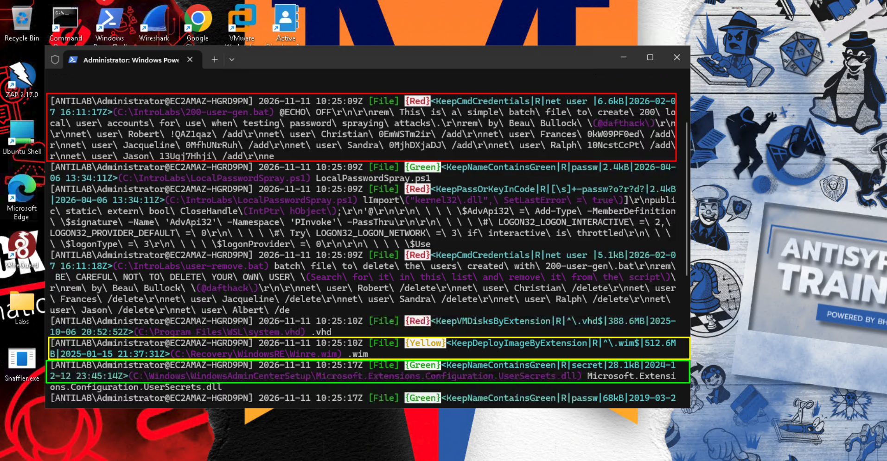
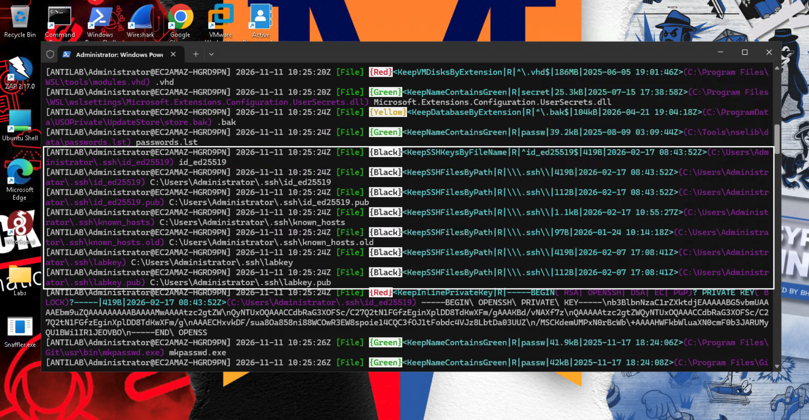
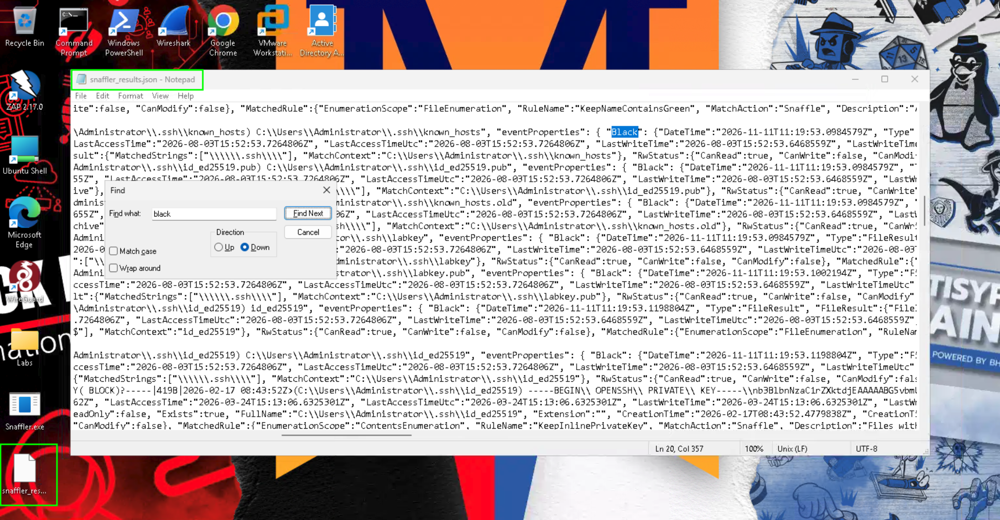
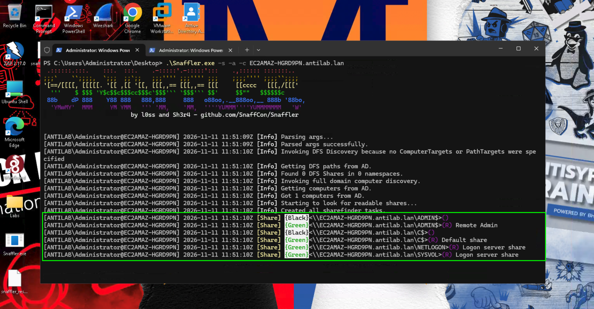
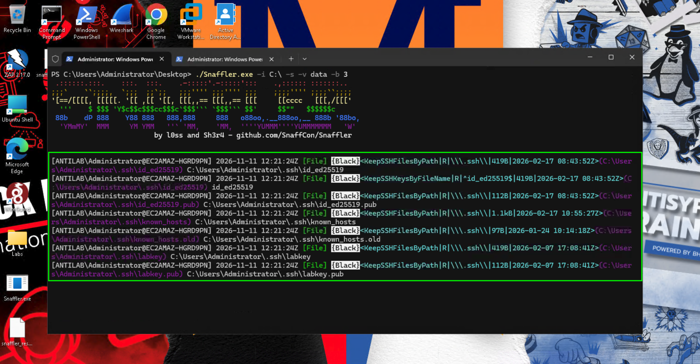
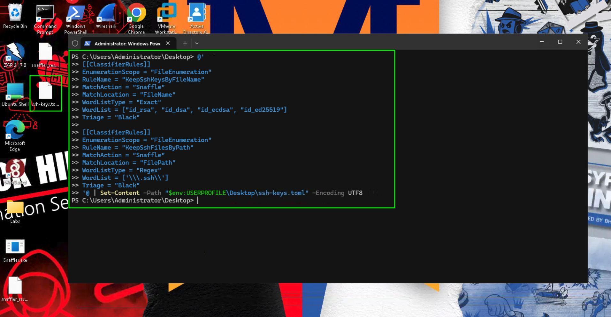
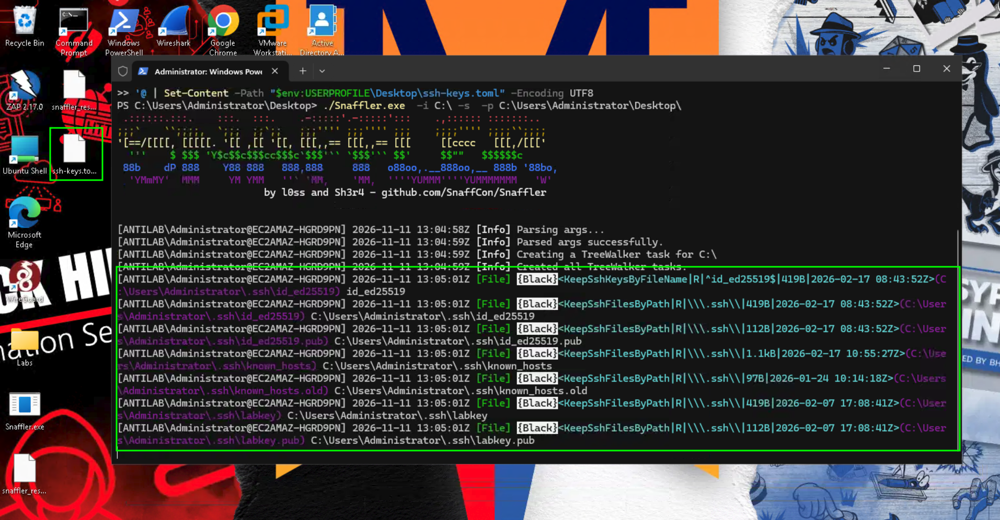

# Snaffler

# Windows VM


<p align="center">
  
</p>

## What is Snaffler?

Snaffler is a penetration-testing tool that can quickly gather useful data for penetration testers. Starting on browser cache files, generic .bak or .old files, PowerShell history files and ending on Private key files (such as ssh keys) or KeePass database files (.kdbx).

Snaffler can query Active Directory to discover computers and shares. With the optional `-u` option, it can also collect selected domain account names for use in searches.

## Example usage: basic gathering

> [!NOTE]
> It is important to run these commands from the same directory where you installed Snaffler.

``` powershell
.\Snaffler.exe -i C:\ -s -v data
```

### Syntax
`-i` -> Snaffler disables its normal discovery of domain computers and network shares. Instead, it scans only the specified directory and its subdirectories (here we set the specified directory as `C:\`)


`-s` -> this flag makes Snaffler display output in the terminal as soon as it finds valuable data. 

`-v` -> this flag controls how much information Snaffler prints. The available levels are `trace`, `debug`, `info`, and `data`; `data` displays findings without most status messages.

### Output of the basic gathering



Let's examine what are the examples of the data we can get from the basic command.

Snaffler rates every finding by how likely it is to be valuable loot. The colors represent different categories of findings.

🔴 Red — “Look at this now.”
High-confidence, high-value finds. In your output:

`200-user-gen.bat` — a batch script that contains possible plaintext credential material (net user Robert !QAZ1qaz /add). The values must be tested and validated; they may be expired, incorrect, or limited to a local account.


🟡 Yellow — “Probably worth a look.”
Medium interest. Could be useful, could be nothing — worth checking if you have time.

`Winre.wim` — a Windows recovery image. Disk/deployment images can contain useful data, but far more often they’re just standard OS files.

🟢 Green — “Low priority, keep moving.”
Weak signal. Something matched a rule, but it’s usually just a filename hint.

Files matched because their name contained `passw` or `secret` (KeepNameContainsGreen), like `Microsoft.Extensions.Configuration.UserSecrets.dll`. That’s a Microsoft library about secrets — not an actual secret.

The most valuable findings that Snaffler can identify are `black` findings which look like this:

⚫ Black — “The most valuable findings. Focus on them as much as possible”



This is the highest rating, reserved for findings that are almost certainly valuable. This whole cluster is your SSH key find:

`id_ed25519`, `labkey` — potential private keys. An unencrypted private key whose corresponding public key is authorized on a reachable host may allow authentication without an account password.

`.pub`, `known_hosts`, `known_hosts.old` — supporting files. `.pub` files contain public keys, while `known_hosts` files record previously seen SSH host keys and may reveal server names, addresses, or fingerprints, but they do not prove access.

The issue with this output is that it's very chaotic and only stored in the terminal. Let's make the output go to prepared file, and in JSON format so it will be easier to look at it.

## Snaffler scan with JSON output saved to a file

``` powershell
.\Snaffler.exe -i C:\ -s -o snaffler_results.json -t json -v data
```

### New syntax

`-o` -> makes our output to be stored in file provided by us (in this example: snaffler_results.json)

`-t` -> the type of logs that we would like to have output in. (in this example: json)

> ![NOTE]
> What is JSON? 
> It is a plain text type of output that makes the data structured and easy-to-read.



This way we have our data saved and stored in structured way.

## Snaffling the list of listable shares on the target hosts.

The tool also offers us the ability to gather the names of discoverable shares on computers in the target Active Directory domain.

``` powershell
.\Snaffler.exe -s -a -c EC2AMAZ-HGRD9PN.antilab.lan
```

### New syntax

`-a` -> Skips file enumeration, just gives you a list of listable shares on the target hosts.

`-c` -> specifies the domain controller that Snaffler should query for computer information. A domain controller is a Windows server that provides Active Directory services (in our example: `EC2AMAZ-HGRD9PN.antilab.lan`)



Here Snaffler pulled names of the shares in this domain.

## Snaffling just the specific category

Snaffler has the ability to look only for specific category of the findings we want. We got 4 options: green, yellow, red, black

``` powershell
./Snaffler.exe -i C:\ -s -v data -b 3
```

### New syntax

`-b` -> sets the desired target of finding's category (in this example: 3 equals `black`)



## Snaffling with our custom rules

Let's say that we got tired of huge amount of the data that the snaffler is giving us. We can trim it by creating our own custom rule. In the example below my rule will make Snaffler look only for the ssh keys and files containing SSH host information.

First, we need to create our custom rule. It will match several exact SSH private-key filenames and paths containing `.ssh`; matching files will be assigned a black triage level.

``` powershell
@'
[[ClassifierRules]]
EnumerationScope = "FileEnumeration"
RuleName = "KeepSshKeysByFileName"
MatchAction = "Snaffle"
MatchLocation = "FileName"
WordListType = "Exact"
WordList = ["id_rsa", "id_dsa", "id_ecdsa", "id_ed25519"]
Triage = "Black"

[[ClassifierRules]]
EnumerationScope = "FileEnumeration"
RuleName = "KeepSshFilesByPath"
MatchAction = "Snaffle"
MatchLocation = "FilePath"
WordListType = "Regex"
WordList = ['\\\.ssh\\']
Triage = "Black"
'@ | Set-Content -Path "$env:USERPROFILE\Desktop\ssh-keys.toml" -Encoding UTF8
```



Now, let's use our new custom rule.

```powershell
./Snaffler.exe -i C:\ -s  -p C:\Users\Administrator\Desktop\
```



We can see that it only showed us `black-tier` findings that were specifically connected to ssh.


# Finished?

[Back to Cleartext Passwords in Files](/Decks/Green_Expansion_v2/V2Deck/PE/Cleartext_Passwords_in_Files.md)

[Back to Credential Harvesting](https://freelabfridays.com/labs/decks/core-v31/pe/credential-harvesting/)
