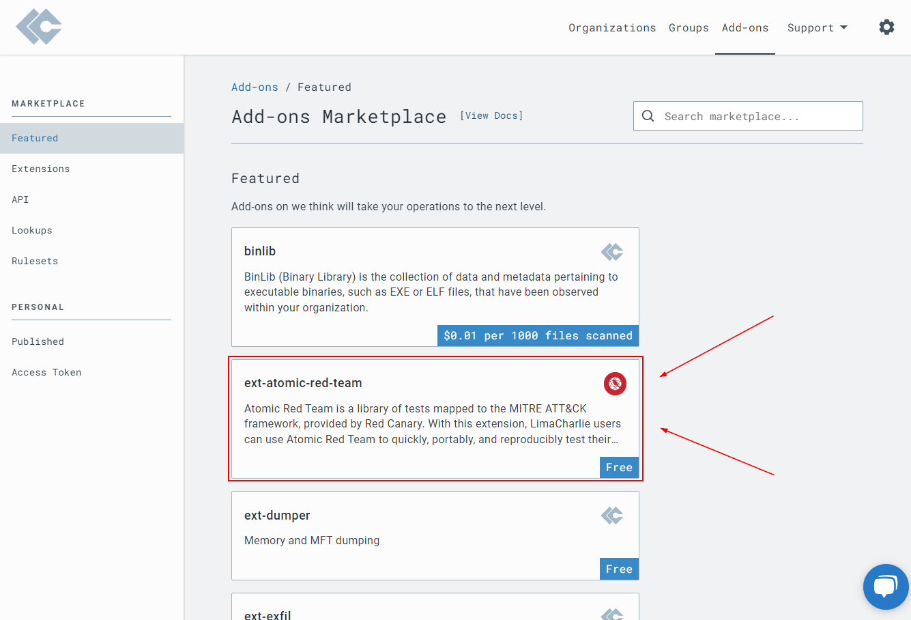
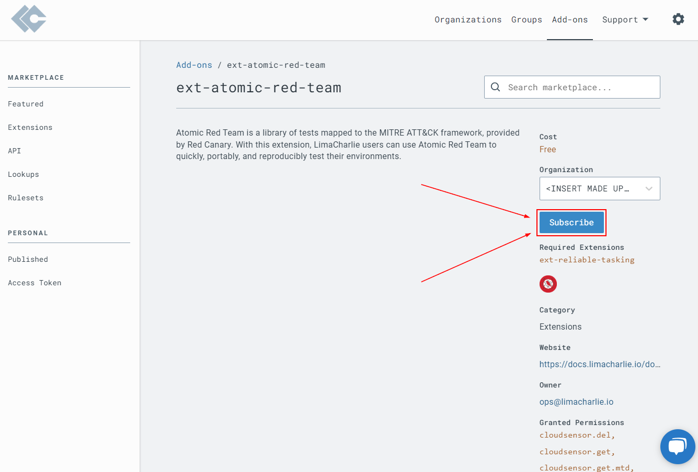
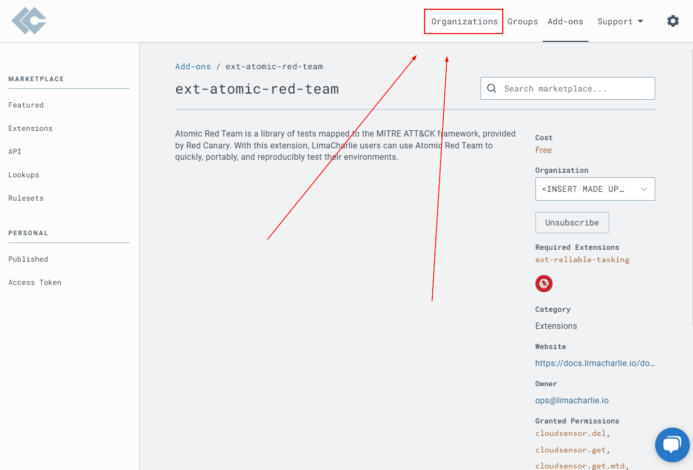
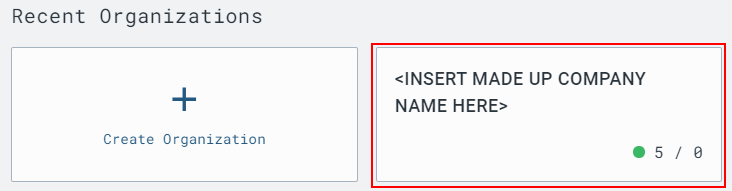
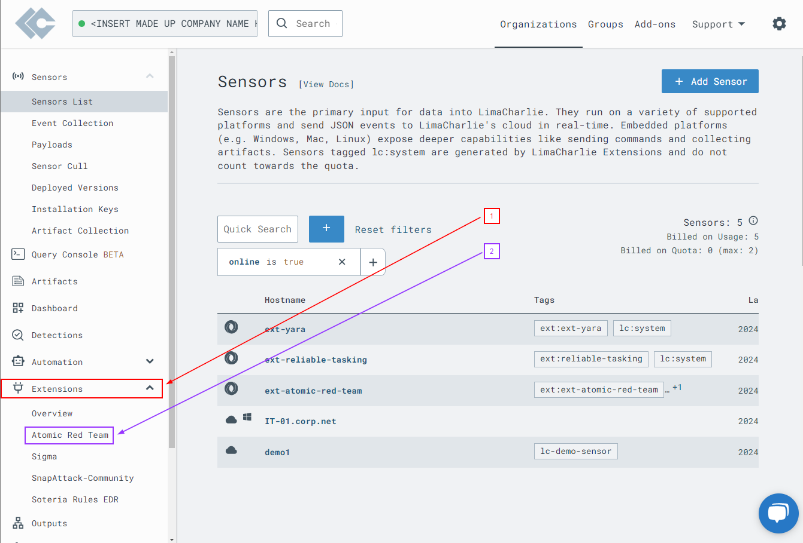
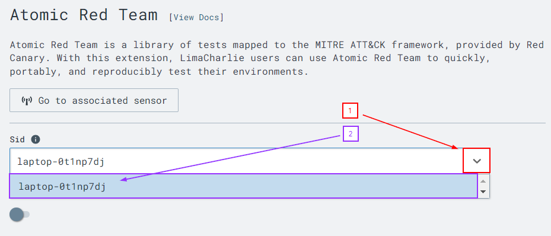
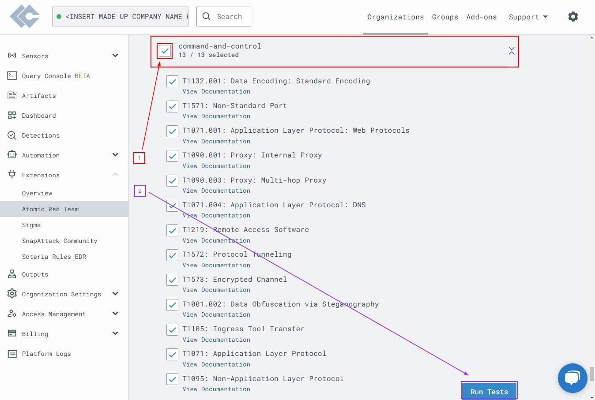
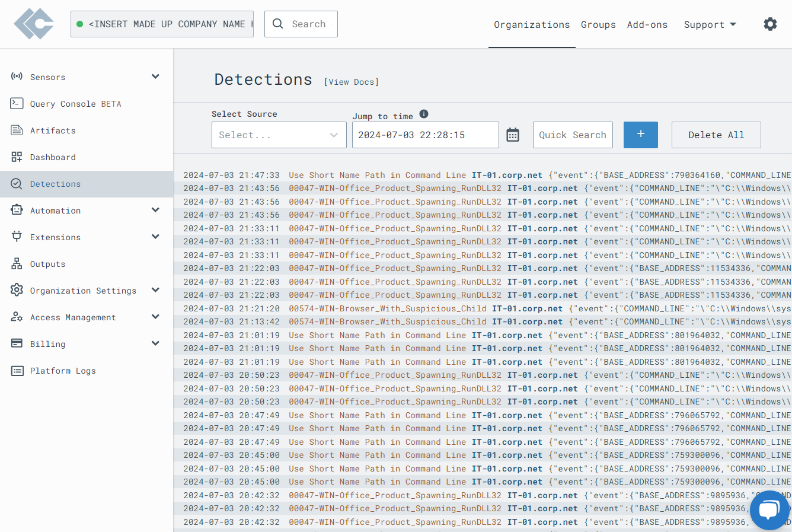
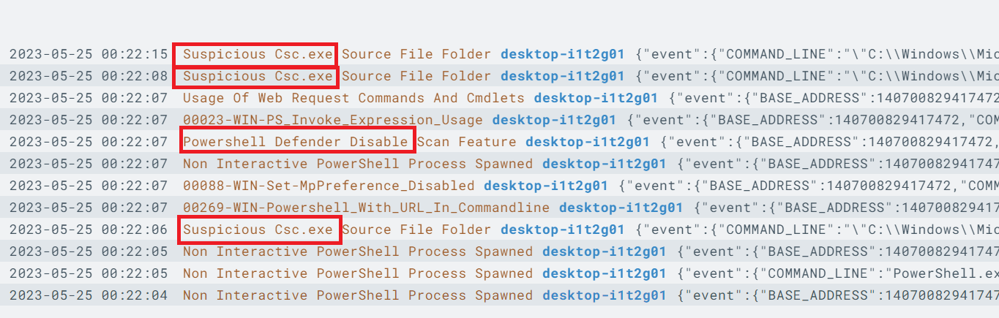

For **Part 1**, click [here](/IntroClassFiles/Tools/IntroClass/limacharlie/limacharlie.md). Please complete Part 1 before starting this lab.

## Lab Objective

In this lab we will:

- Install the **Atomic Red Team** extension in LimaCharlie
- Run a controlled and **fake** cyber attack against our Windows machine
- Use LimaCharlie to see what gets logged and detected
- Understand how a real-world attack may set off bells and whistles for an analyst to investigate

---

> [!NOTE]
> We will pick up where we left off in Part 1, in the browser, logged into the LimaCharlie web interface.

---

## Step 1: Install the Atomic Red Team Extension

We need to install the Atomic Red Team plugin that LimaCharlie offers.

Start by navigating to the **"Add-ons"** tab in the top right of the web page.

Scroll down until you see the Atomic Red plugin. Click the **"ext-atomic-red-team"** plugin.

> [!TIP]
> Take a minute to look at the different plugins and see the full capabilities and features LimaCharlie has to offer.

Locate the subscribe button on the right side of the page, and click **"Subscribe"**.

---

## Step 2: Select Your Device

After Atomic Red finishes installing, return to your organization and click on your machine.

On the left side of your screen, click on **"Extensions"** to expand the drop-down menu. Select **"Atomic Red Team"**.

On the next screen, click the drop-down next to the side bar at the top. Then, select **your** device.

---

## Step 3: Run the Atomic Red Team Tests

Scroll down until you find the **command-and-control** category. Select the box next to the category header and make sure that it selects all of the boxes below.

Now, hit **Run Tests**.

---

## Step 4: Review the Detections

Move over to the **"Detections"** tab on the left and start going through the event logs.

There will be a lot of events. Every single time the page is refreshed, more attacks will appear.

Look through all of the logs and note the **cmd.exe** or **powershell** invokes that are taking place. These are **(usually)** indications that something malicious is occurring and needs to be examined further.

> [!TIP]
> LimaCharlie is an amazing tool because of its versatility. It has an easy-to-use interface and allows a user to dig deeper to see what's happening before, during, and after an attack. It works at both small and large scale, and its many plugins help automate difficult tasks.

**Continuing on to the next Lab?** [Click here to get back to the Navigation Menu](/IntroClassFiles/navigation.md)

**Finished with the Labs?** Please be sure to destroy the lab environment! [Click here for instructions on how to destroy the Lab Environment](/IntroClassFiles/Tools/IntroClass/LabDestruction/labdestruction.md)
