For **Part 2**, click [here](/IntroClassFiles/Tools/IntroClass/LCmeetsAtomicRed/LCAR.md)

<hr>

## Lab Objective

In this lab we will:

- Create a free **LimaCharlie** account and organization
- Create an installation key
- Deploy a LimaCharlie sensor to our Windows machine
- Confirm the sensor is reporting back to LimaCharlie

---

> [!NOTE]
> LimaCharlie is a lightweight, browser-based tool that helps keep an eye on systems, detect threats, and respond quickly to any suspicious activity. This walkthrough uses the Chrome browser, however any browser can be used.

---

## Step 1: Create a LimaCharlie Account

Open a browser window and navigate to the following URL:

```
https://app.limacharlie.io/
```

When the webpage loads, click **"Sign Up"** and fill out the fields.

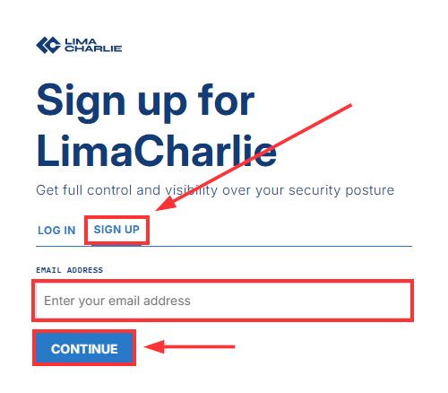

Go to your email and you should receive a link to verify your account. Click the link, then go back to your browser and refresh the page.


---

## Step 2: Set Up Your Organization

Once you return to the page, LimaCharlie will ask you some questions about your company. You can create any fake company you wish.

Enter the following answers into their respective fields:

| Question | Answer |
|---|---|
| What best describes your team/company? | Security Operations Center |
| What best describes your role? | Security Engineer |
| What use cases are you exploring? | Endpoint detection & Response |
| How did you hear about us? | Black Hills Info Sec |

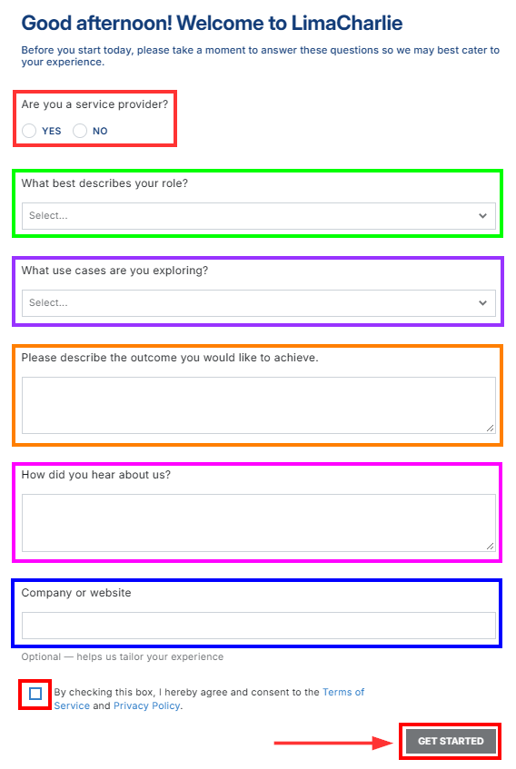

Check the box that says **"By checking this box, I hereby agree and consent to the Terms of Service and Privacy Policy."**

Click **"Get Started"**, then click **"Create Organization"**

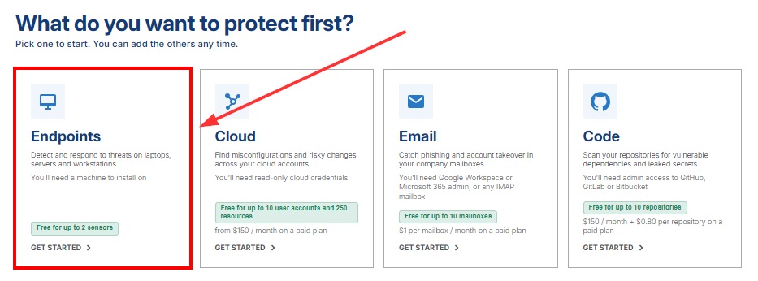

Enter the following information into the fields to create your fictional organization:

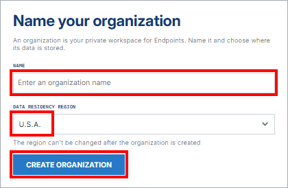

Click **"Create Organization"**.

There may be a small delay while LimaCharlie creates the new company.

> [!TIP]
> It is possible to use this tool to manage more than one company or organization at a time.

---

## Step 3: Create an Installation Key

For this demonstration we will be creating a sensor for our Windows machine, and then setting off **Atomic Red Team** in Part 2 to test if our filter catches it.

After creating your fake organization, you will see this screen pop up:

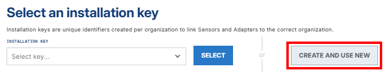

Choose the **"Create & Use New"** button.
You will see a few empty fields. You can add any description you like and any relevant tags.

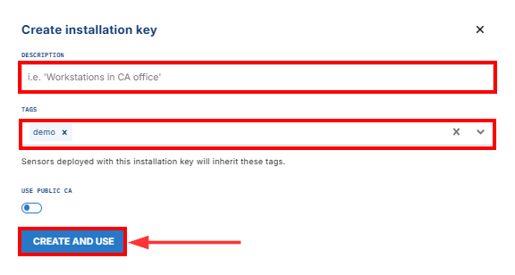

---

<!--
## Step 4: Add a Windows Sensor

Once you have created your new installation key, navigate to **"Sensors List"**.

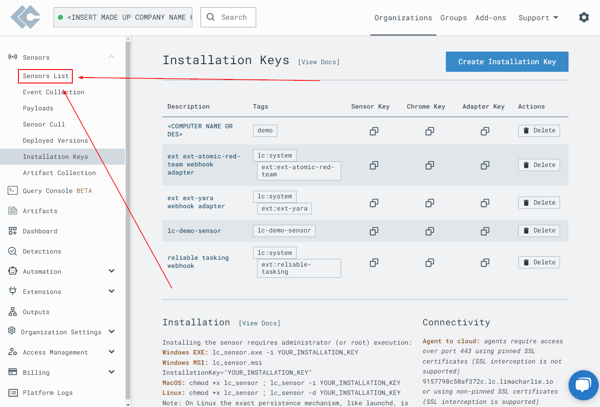

Click **"Add Sensor"**.

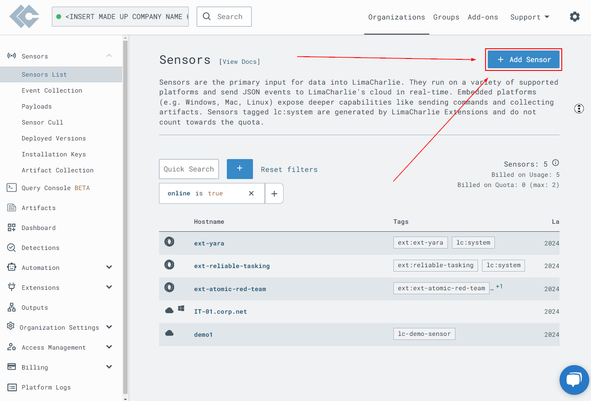

Scroll down and select the **"Windows"** sensor.

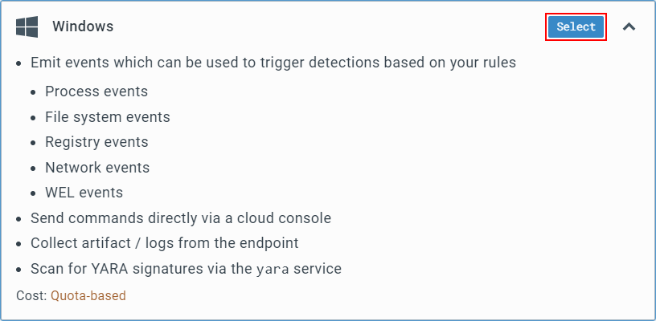

You will be greeted with an installation key menu. From the drop-down menu, select the description you created earlier for your installation key, then click **"Select"**.

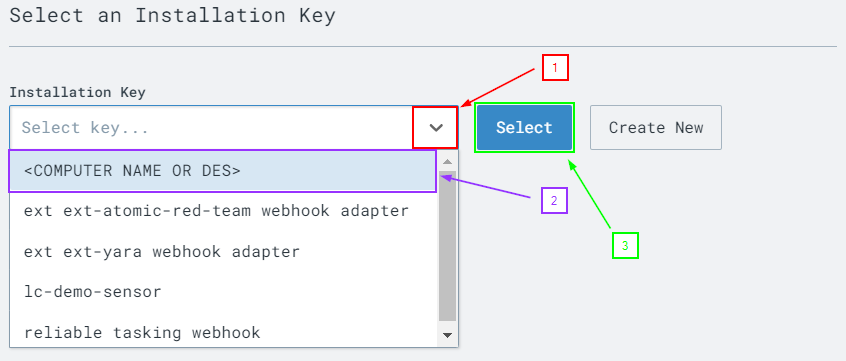

You will be asked which architecture to download. Every Windows machine may be different, but in our case **"x86-64 exe"** should be right.

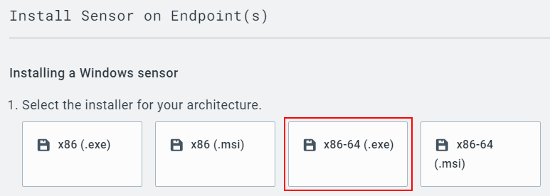

You will be greeted with a few more steps to create your endpoint.

Click **"Download the selected installer"**.

Once it has finished downloading, **copy the string in step 4**.

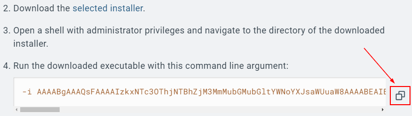

-->


## Step 4: Adding & Installing the Sensor

After hitting "create" key, you will see this screen:


Go to your desktop, right-click **"Windows Terminal"** and select **"Run as administrator"**.

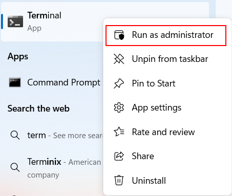

Run the following command to get into the Downloads directory:

```powershell
cd .\Downloads
```

Now enter the beginning of the next command. Tab completion is your friend!

```powershell
.\hcp_win_x64_release_4.29.2.exe
```

**[RIGHT CLICK OR CTRL+V TO PASTE]** the string you copied after the command, then hit **Enter** to run it.

If done correctly, your output should look like this:

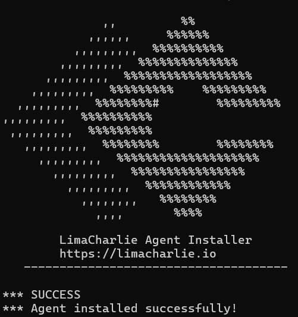

Return to the browser window. You should see this message:

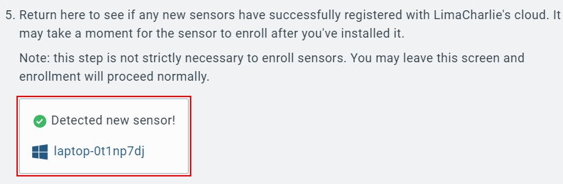

> [!NOTE]
> The name of your computer will be different!

<hr>

For **Part 2**, click [here](/IntroClassFiles/Tools/IntroClass/LCmeetsAtomicRed/LCAR.md)
