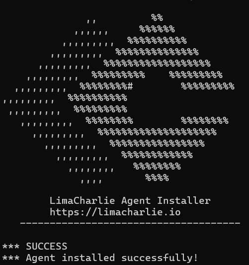

# **LimaCharlie Lab**

---

## **Part 1 of 2 – Endpoint Monitoring & Threat Detection**

In this lab we will be using **LimaCharlie** to investigate **endpoint monitoring** and **threat detection**.

### **What is LimaCharlie?**

LimaCharlie is a lightweight browser-based tool. It helps monitor systems, detect threats, and respond quickly to suspicious activity. This walkthrough uses the **Chrome** browser, but any browser may be used.

---

## **Step 1: Access LimaCharlie and sign up**

Open a browser and go to:

```
https://app.limacharlie.io/
```

Click **"Sign up"**:


Fill out the required field and press **"Continue"**, then press **"Add Password"**: 


Fill out the required fields and click **"Sign Up"**.


Check your email, click the verification link, then return to your browser and refresh the page.

---

## **Step 2: Setup Company Information**

You will be asked questions about your company. Use fictional information.

Enter the following details:

- **Are you a service provider?** -> *No*
- **What best describes your role?** -> *Security Engineer*
- **What use cases are you exploring?** -> *Endpoint Detection & Response*
- **Please describe the outcome you would like to achieve.** -> *Learn how to monitor endpoints, detect threats, and investigate security events.*
- **How did you hear about us?** -> *Black Hills Info Sec*


Check the box to agree to the Terms of Service and Privacy Policy.

Click **"Get started"** then let's set up your first **Organization**.

# An Overview of LimaCharlie.

Before you get set up, here's the basics:

* *Sensors* are the primary input for data into LimaCharlie. They run on a variety of supported platforms and send JSON events to LimaCharlie's cloud in real-time. Embedded platforms (e.g. Windows, Mac, Linux) expose deeper capabilities like sending commands and collecting artifacts.
* *Organizations* are akin to “projects” - they're located in a chosen region and are where configuration and storage is located for a fleet of Sensors and their accompanying infrastructure.
* *Outputs* allow you to forward your data to storage only you control — like an SFTP server or Amazon S3. Storage within LimaCharlie is optional and allows you to store artifacts (i.e. logs) as well as search, browse, and replay historical Sensor data.
* *Add-ons* let you enable features within organizations à la carte, allowing you to run each org as lean or as sophisticated as your needs require.

The first step is to create an organization.

In the *Endpoints* tab, fill out your fictional organization’s details.


Click **"Create Organization"**.

Wait for the organization to be created.

---

## **Step 3: Create & Install a Sensor**

Once you create an organization, you will be asked to select an *installation key*. An installation key can be used for multiple sensors. 
Since this is our first organization, we'll create a new key.


Fill in a description and tags, then click **"Create"**. For the tag, type **demo**, then create the tag. **"Use Public CA"** is not necessary. 


Select *Windows* in the *Install a sensor* section. Open up *Powershell* and run the command to install the sensor. 


Paste the copied command string and press **Enter**.

If successful, your output will look like this:



Return to your browser. You should see a confirmation message. Click on **"DONE"**.


>[!TIP]
>
> **Note**: Your computer name will differ.

You will automatically be taken to the **Sensors List**. 
If you already have a Lima Charlie account, you can add new sensors from here : 


If you want to create new sensors, click **ADD SENSOR** and select the sensor type (in this case, *"Windows"*). The process is the same. 


---

## **Next Steps**

- [Continue to Part 2 of the Lab](./lima_charlie_lab_part2.md)


>[!IMPORTANT]
>
> **Important**: Always destroy your lab environment after completing exercises.

---
[Back to the Section](/SocAnalystLabs/courseFiles/Section_02-toolsAndPlatforms/toolsAndPlatforms.md)
